# Report item multiselection in {{site.productNameTM}} Web Report Designer

Report item multiselection in {{site.productNameTM}} Web Report Designer lets you set or edit the properties of several report items at once. Changing the properties of more than one report item in a single action makes report design simpler and saves work.

## How do I open the properties panel?

You open the properties panel in Web Report Designer by clicking the `Properties` icon in the configuration panel.

The properties panel is displayed as shown below.

> By default, the properties panel displays the `Report` properties.

## How do I edit report items of the same type together?

When you select report items of the same type in Web Report Designer, the properties panel lists the properties of that report item type. For example, drag and drop more than one rectangle report item into the design area and select all of them. The properties of the `Rectangle` report item are listed in the properties panel.

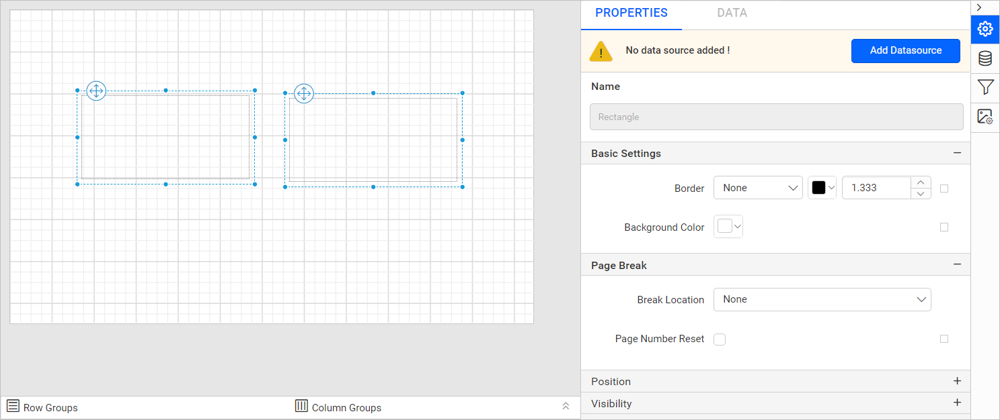

You can edit report item properties while multiple report items are selected. The property change applies to all selected items in the design area in a single action. For example, change the `Background` color in the properties panel.

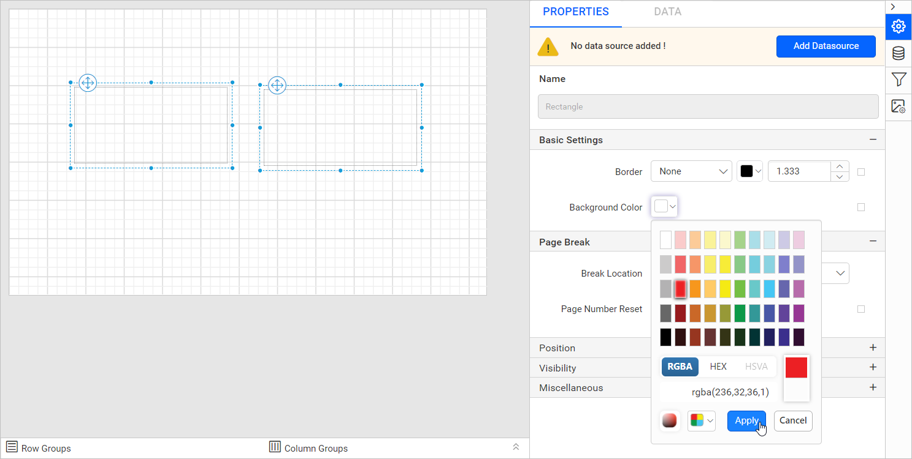

The background color is applied to the selected rectangle report items in the design area.

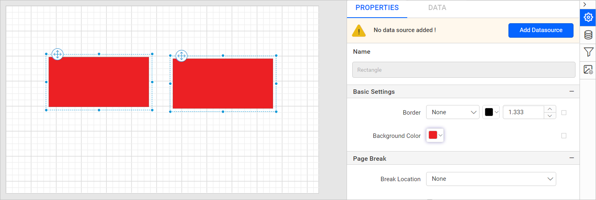

You can set other properties for the selected report items in the same way. On undo and redo actions, the property values are restored in all previously selected report items.

The `Name` property of the report item is disabled and shows the selected report item type. For example, in the image above, two rectangle report items are selected, and the type shows as `Rectangle` in the name property field. You cannot change the `Name` property when multiple report items are selected.

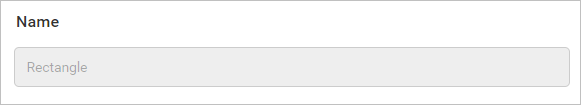

## How do I edit report items of different types together?

When you select report items of different types in Web Report Designer, the properties panel lists only static properties. These include border, background, position, and visibility properties. For example, drag and drop several report items of different types into the design area and select all of them. The static properties are listed in the properties panel.

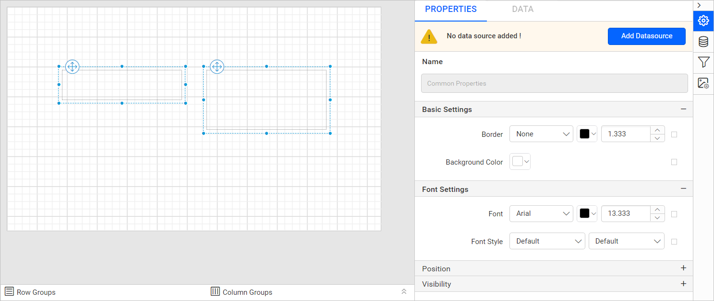

You can edit report item properties while multiple report items are selected. The property change applies to all selected items in the design area in a single action. For example, change the `Background` color in the properties panel.

The background color is applied to the selected report items in the design area.

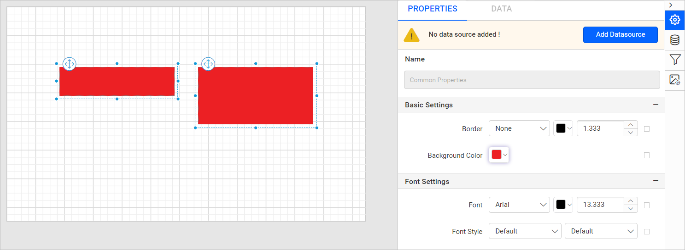

You can set other properties for the selected report items in the same way. On undo and redo actions, the property values are restored in all previously selected report items.

> Note: On a property change, any selected report item that does not support that property is skipped. For example, the line report item has no `Background Color` property support. If you change the background property for a line and rectangle combination, the change is skipped for the line and applied only to the rectangle.

The `Name` property of the report item is disabled, and for a selection of different report items it shows `Common Properties`. You cannot change the `Name` property when multiple report items are selected.

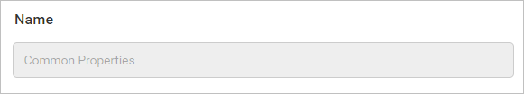

## How do I edit tablix cells with the same item type?

When you select tablix cells that contain the same report item type in Web Report Designer, the properties panel lists the properties of that report item type. For example, select multiple tablix cells that contain a textbox report item. The properties of the `textbox` report item are listed in the properties panel.

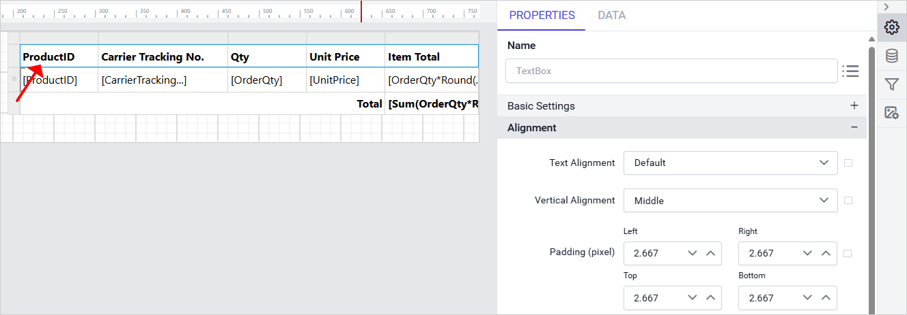

When you edit the properties of multiple selected cells in a tablix, the changes apply to all selected cells in a single action. For example, if you change the `Text Alignment` property for textboxes in the properties panel, the alignment updates for all selected cells at once.

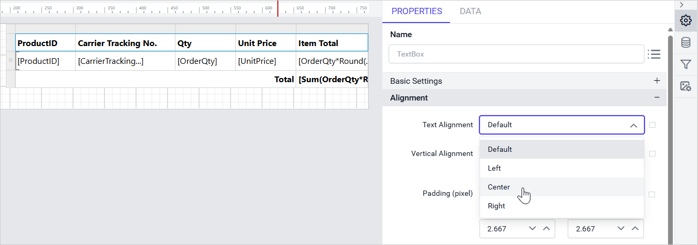

The `Text Alignment` property value is applied to the selected cells in the tablix data region.

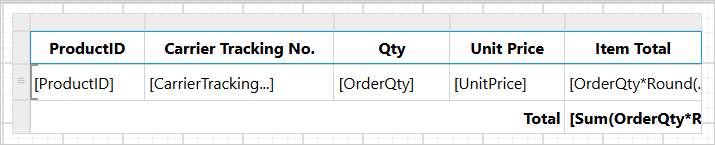

You can set other properties for the selected tablix cells in the data region in the same way. On undo and redo actions, the property values are restored in all previously selected tablix cells.

## How do I edit tablix cells with different item types?

When you select tablix cells that contain different report item types in Web Report Designer, the properties panel lists only static properties. These include border, background, position, and visibility properties. For example, select multiple tablix cells that contain different report item types. The static properties are listed in the properties panel.

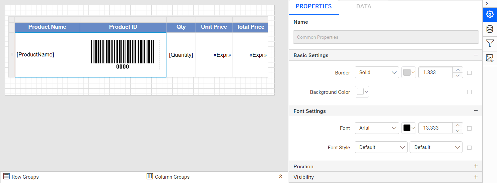

You can edit tablix cell properties while multiple cells are selected. The property change applies to all selected cells in the tablix in a single action. For example, change the `Background` color in the properties panel.

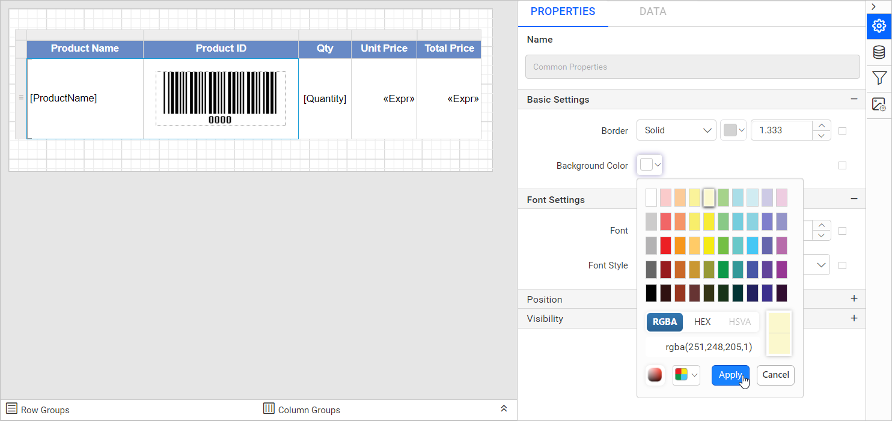

The background color is applied to the selected cells in the tablix data region.

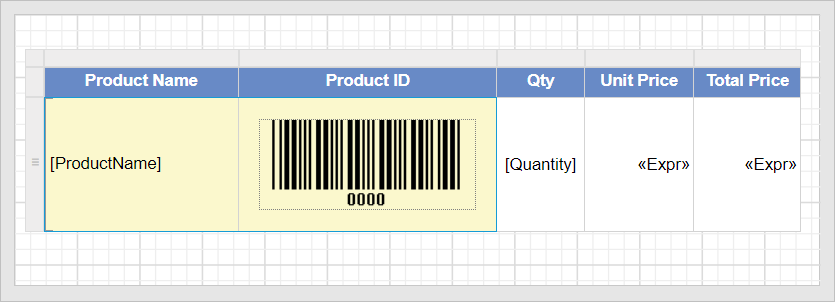

You can set other properties for the selected tablix cells in the data region in the same way. On undo and redo actions, the property values are restored in all previously selected tablix cells.

## Frequently asked questions

### Can I rename report items when several are selected?

No. The `Name` property is disabled and cannot be changed when multiple report items are selected.

### Which properties appear when I select items of different types?

Only static properties appear, such as border, background, position, and visibility properties.

## See also

* [Properties panel](./../../compose-report/properties-panel/)
* [Common properties](./../../compose-report/common-properties/)
* [Report item selection](./../../compose-report/design-surface/report-item-selection/)
