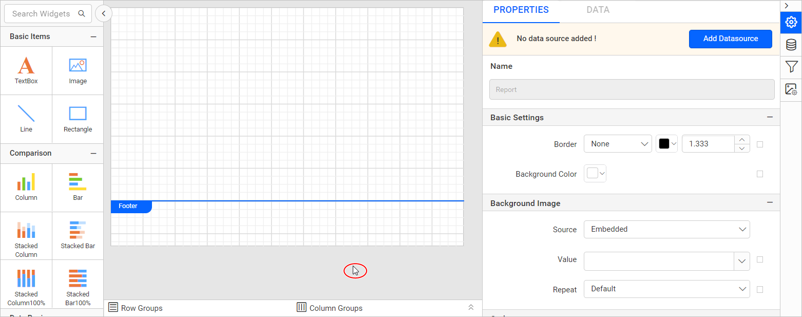

# Report properties in {{site.productNameTM}} Web Report Designer

Report properties in {{site.productNameTM}} Web Report Designer control settings for the whole report, such as border, margin, paper size, and language. To open the `Report` properties, focus the mouse pointer outside of the design area.

## Basic settings

The `Basic Settings` category in Web Report Designer lists the border style, color, width, background color, and performance settings properties.

### Border

The report border in Web Report Designer uses the common border properties. For details, read the [Border Properties](./../../compose-report/common-properties/#border-properties) section.

### Background color

The report background color in Web Report Designer uses the common background color property. For details, read the [Background color](./../../compose-report/common-properties/#background-color) section.

## Background Image

The background image property in {{site.productNameTM}} displays company logos, watermarks, or any other background image in the report. To set a background image for the report, read the [Background Image](./../../compose-report/background-image/) section.

### Performance Settings

The Performance Settings section helps you enable best practices for optimizing RDL and RDLC report rendering in {{site.productNameTM}}. For optimized rendering settings, read the [Performance settings](./../../compose-report/performance-settings/) section.

## Code

The Code Module in {{site.productNameTM}} embeds custom code or assemblies in a report. To embed a custom function or assembly in the report, read the [Code Module](./../../compose-report/code-module/) section.

## Page Units

The page unit property in Web Report Designer sets the unit type for the entire report. By default, the report unit type is `Pixels`. To switch the unit type of the report, read the [Unit Switcher](./../../compose-report/unit-switcher/) section.

## Margin

The `Margin` property in Web Report Designer increases or decreases the left, right, top, and bottom spacing of the report layout.

## Paper Size

The paper size property in Web Report Designer specifies the size of the paper when you print the report. The paper size property determines the number of pages in a report.

### Orientation

Page orientation in {{site.productNameTM}} is the direction in which a report is displayed or printed. The two basic types are portrait (vertical) and landscape (horizontal). The default orientation is `portrait`.

### Paper size

You set the paper size in Web Report Designer by selecting a size from the drop-down list, which sets the width and height of the report layout. This property decides the width and height of the report layout on export.

To set a custom width and height for the report layout, choose the `Custom` paper size. When you select `Custom` in the drop-down list, the `Width` and `Height` fields are enabled. You can then increase or decrease the width and height of the report layout.

## Language

The **Language** property in {{site.productNameTM}} sets the locale of a report, which determines the default formats for displaying report data.

Select the language you need in the **Language** property dropdown.

> The language property on a text box overrides the language property on the report.

## Miscellaneous

The Miscellaneous category in Web Report Designer holds the ConsumeContainerWhitespace, Custom attributes, and Custom Style properties.

### ConsumeContainerWhitespace

The ConsumeContainerWhitespace property in {{site.productNameTM}} removes unwanted white space in the report preview and export. Set it to true if all whitespace in containers should be consumed; otherwise, false.

### Custom attributes

The Custom attributes property in Web Report Designer adds custom properties at the report level. To create and assign values for custom properties in the properties panel, read the [Custom Properties](./../../compose-report/common-properties/#custom-properties) section.

### Custom Style

The `Custom Style` property in {{site.productNameTM}} lets you use external CSS to style a report, beyond the built-in styling options. Use this property to meet specific design needs and keep styling consistent across multiple reports. For a step-by-step guide to setting up custom styles in your report, read the **How To** section of this guide.

## Frequently asked questions

### What is the default page unit for a report?

By default, the report unit type is `Pixels`.

### What is the default page orientation?

The default orientation is `portrait`.

### Does a text box language override the report language?

Yes. The language property on a text box overrides the language property on the report.

## See also

* [Page layout](./../../compose-report/page-layout/)
* [Performance settings](./../../compose-report/performance-settings/)
