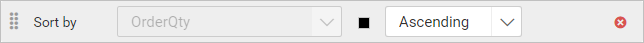
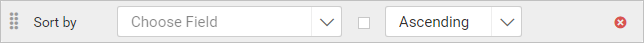

# Sort data in Bold Reports® Web Report Designer

Sorting in Bold Reports® Web Report Designer arranges data in ascending or descending order, so it is easier to read. You can use it to sort the data in data regions.

The following image shows the sort dialog.

## How do I add sorting?

You add sorting in Web Report Designer by adding one or more sort expressions in the sort dialog.

1. To add a sort expression, click the **Add** icon.

   

2. Choose the field you need from the first drop-down list, which lists the dataset fields, or set an [Expression](./../../compose-report/sort-data/#set-expression).
    

3. Choose a sort direction in the second drop-down list, which lists the sort `Direction` types.

   * **Ascending** sorts the data in A-Z order.

   * **Descending** sorts the data in Z-A order.

      

4. Click OK.
5. To add multiple sort expressions, repeat steps 1 to 4.

    

## Set Expression

You set a sort expression in Web Report Designer from the square icon next to the field. First, follow steps 1 to 4 in the previous section to add a sort expression.

1. To edit or create an expression, click the square icon and select `Expression`.

    

2. The `Expression` dialog opens. For details, read the [Expression](./../../compose-report/expressions/) section and its following sections.

    

3. The icon turns `Black color` when the expression is applied to the dataset field.
   

## Reset Expression

You reset a sort expression in Web Report Designer from the same square icon.

1. To reset an expression, click the square icon and select `Reset`.
   

2. The icon turns `White color` after the reset action.
   

## How do I reorder sort expressions?

You reorder sort expressions in Web Report Designer by dragging them. Click and hold the icon in the left corner, and then drag the sort expression to a higher or lower position.

The new position of the dragged sort expression is shown below:

## How do I remove sorting?

You remove a sort expression in Web Report Designer by clicking the **Delete** icon in the right corner of that expression.

## Frequently asked questions

### Which sort directions are available?

**Ascending** sorts the data in A-Z order, and **Descending** sorts the data in Z-A order.

### Can I sort by more than one field?

Yes. Repeat the add steps to add multiple sort expressions, and drag them to change their order.

## See also

* [Filter data](./../../compose-report/filter-data/)
* [Group data](./../../compose-report/group-data/)
* [Interactive sorting](./../../compose-report/interactive-sorting/)
