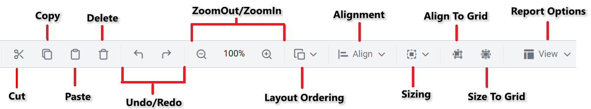

# {{site.productNameTM}} Web Report Designer toolbar

The {{site.productNameTM}} Web Report Designer toolbar contains icons and buttons for common report design operations, such as cut, copy, and paste.

The following image shows the toolbar items.

## Cut

The `Cut` action in Web Report Designer removes the selected report item. You can then paste it anywhere on the designer surface.

## Copy

The `Copy` action in Web Report Designer makes another copy of the selected report item. You can then paste it anywhere on the designer surface.

## Paste

The `Paste` action in Web Report Designer pastes the cut or copied report item on the designer surface. `Paste` is enabled only after you perform a `Cut` or `Copy` operation.

## Delete

The `Delete` option in Web Report Designer removes the selected report item from the designer surface.

## Undo

The `Undo` action in Web Report Designer records recent actions, such as add, delete, insert, property changes, and other design actions in a report.

## Redo

The Redo action in Web Report Designer reverses the last undo action in a report.

## Zoom out

The `Zoom out` option in Web Report Designer decreases the document's current zoom factor.

## Zoom in

The `Zoom in` option in Web Report Designer increases the document's current zoom factor.

## Layout ordering

`Layout ordering` in Web Report Designer changes the layout order of report items on the design surface. To learn about ordering modes, read the [Layout Ordering](./../../compose-report/layout-ordering/) section.

## Alignment

[Alignment](./../../compose-report/design-surface/report-item-alignment/#align) in Web Report Designer has a set of options to align the selected report items on the designer surface.

## Distribute

The [Distribute](./../../compose-report/design-surface/report-item-alignment/#distribute) option in Web Report Designer places the selected report items on the design surface at equal intervals from each other.

## Sizing

[Sizing](./../../compose-report/design-surface/report-item-alignment/#sizing) in Web Report Designer gives the selected report items on the design surface an equal size.

## Align to grid

Align to grid in Web Report Designer snaps the top left of the selected report items to the closest gridline.

## Size to grid

Size to grid in Web Report Designer snaps the selected report item to the closest gridline by resizing it on all four sides.

## View

The `View` menu in Web Report Designer contains options to show or hide `Header`, `Footer`, `Grid Lines`, `Snap To Shape`, `Ruler`, `Page Margin`, and `Full Screen` in the report design.

**Header** : Enables or disables the header area in the report. To add and remove the header on the designer surface, read the [Header](./../../compose-report/show-or-hide-header-footer-in-report/#show-or-hide-report-header) section.

**Footer** : Enables or disables the footer area in the report. To add and remove the footer on the designer surface, read the [Footer](./../../compose-report/show-or-hide-header-footer-in-report/#show-or-hide-report-footer) section.

**Grid Lines** : Gridlines are the pattern of lines drawn behind the report items. They give visual guidance while you drag or arrange objects on the designer surface. Click the `Grid Lines` option in the view menu to show or hide the gridlines in the report.

**Snap To Shape** : When you drag a report item on the design surface, snapping guidelines show the alignment position so you can align it with the closest report item. Click the `Snap To Shape` option in the view menu to enable or disable the snapping guidelines in the report design.

**Ruler** : The Ruler in Web Report Designer helps you position report items precisely and keep a clear layout.

**Page Margin** : The Page Margin feature shows a clear visual representation of margin areas, so you can better manage layout and report-level properties.

**Full Screen** : The Full Screen feature expands the standalone report designer to fill your entire screen.

## Frequently asked questions

### When is the Paste option enabled?

`Paste` is enabled only after you perform a `Cut` or `Copy` operation.

### Which options does the View menu contain?

The `View` menu contains `Header`, `Footer`, `Grid Lines`, `Snap To Shape`, `Ruler`, `Page Margin`, and `Full Screen`.

## See also

* [Layout ordering](./../../compose-report/layout-ordering/)
* [Report item alignment](./../../compose-report/design-surface/report-item-alignment/)
* [Ruler](./../../compose-report/ruler/)
