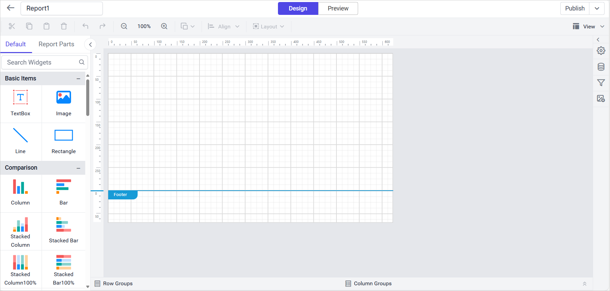
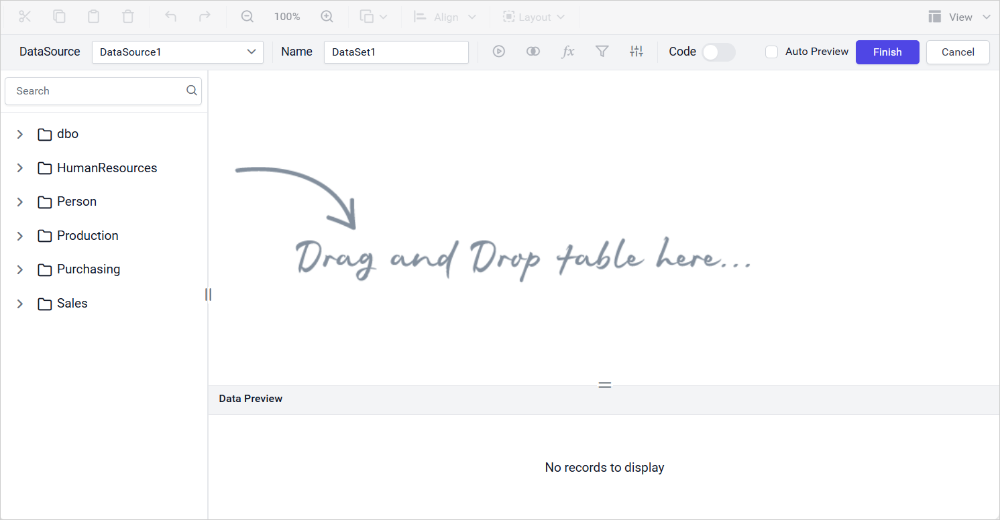
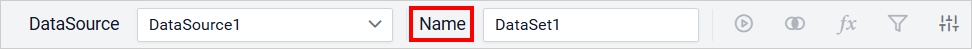
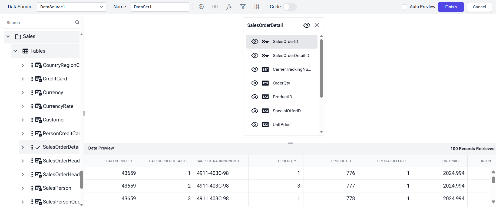
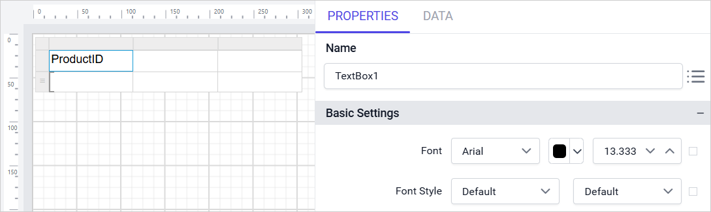
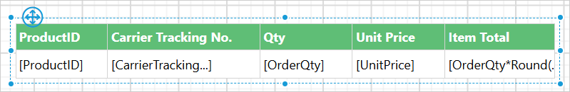
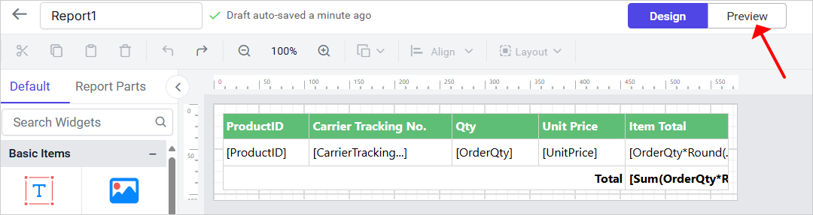
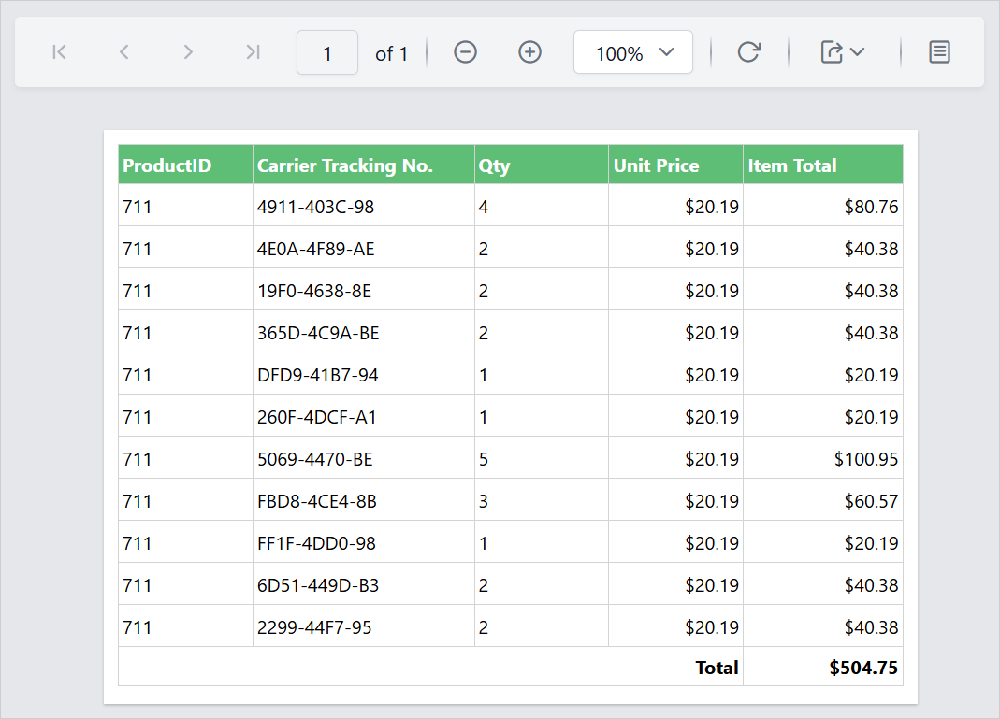

# Design an RDL report in {{site.productNameTM}} Web Report Designer

**Designing a report** in {{site.productNameTM}} Web Report Designer lets you connect to data, add a table report item, assign fields to it, and preview the result, all in the browser. The following steps show how to design a simple RDL report in Web Report Designer.

## What is RDL report design in Web Report Designer?

RDL report design in {{site.productNameTM}} Web Report Designer means building a report's data connections, layout, and report items in RDL (Report Definition Language) format directly in the browser. You use the browser-based Web Report Designer rather than a separate desktop tool.

The designer combines a data configuration panel, a design surface, and a properties pane. You can connect to a data source and drag report items such as tables onto the canvas. You can then bind fields to them and adjust their appearance in one continuous workflow.

### With Web Report Designer, you can

* Connect to a SQL data source and query data using the built-in query designer.
* Drag and drop report items such as tables onto the design surface.
* Assign column headers and data fields to table cells using the data assign menu.
* Resize columns and rows, and customize appearance from the properties pane.

## How do I create data for the report?

You create data in Web Report Designer from the **Data** panel by connecting to a SQL data source.

1. To add data, click the **Data** icon in the `Data Configuration` panel. The `Data` panel opens.
   

2. Click the `New Data` button in the data panel.
   

3. Choose the `SQL` type to connect data.
   

4. In the new data source panel:
    * In the **Name** field, enter the data source name without special characters.
    * In the **Server Name** field, select an existing server in the local network from the drop-down list, or enter a remote server name like `myserver.domain.com`.
    * In the **Authentication Type** field, choose **Windows** or **SQL Server** authentication.
    * If you chose **SQL Server** authentication, enter the **username** and **password** of the server.
    * In the **Database** field, choose or enter an existing valid database, for example AdventureWorks.
       

5. Click the `Connect` button. The following view is displayed.
   
   > This example uses an **AdventureWorks** database for demonstration.

### Edit dataset name

You edit the name of the `Data` in Web Report Designer in the **Name** field in the toolbar pane.

### Drag and drop table in query designer

The left pane of the Web Report Designer query designer holds the **tables**, **views**, and **procedures** of the connected database. Drag the table or view you want from the left pane and drop it into the center pane labeled `Drag and Drop table here`, as shown below:

The table is dropped in the design area as shown below.

### Execute query

You run the query in Web Report Designer with the `Run` option in the tools pane.

1. Click the `Run` option in the tools pane to execute and visualize the data.
   

2. The data is retrieved based on the specified query.
   

### Save Data

You save the data in Web Report Designer by clicking `Finish` in the tools pane.

1. Click the `Finish` button in the tools pane.
   

2. Your dataset is now listed in the `Data` panel as shown below.
   

3. Expand the icon to view the data fields.
   

## Add table report item

The left pane in the Web Report Designer design view contains basic items, data regions, data visualization, and sub reports for designing an interactive report.

> This example uses the `Table` report item for demonstration.

1. Select the `Table` item under `Data Regions` in the item panel, and then drag and drop it to the design area.
   

2. The `Table` renders with two rows and three columns in the design area.
   

### Assign data

You bind data to the table in Web Report Designer by assigning the dataset to the `Dataset` property of the table.

> The Assign data step applies only to report items in the `data visualization` and `data region` categories.

### Add column header

You add a column header in Web Report Designer by entering text in a table cell.

1. Select the first cell in the table. Click the `Text Editor` icon or the `Add Text` option from the Data Assign Menu to open the dialog. Enter `ProductID` as the column header text.
2. To set the column header text as `ProductID`, follow the steps in the [Set header text using data assign menu](../report-items/tablix/design-ssrs-rdl-report-using-table/#set-header-text-using-data-assign-menu) section.
   
3. Add the column header text you need to the other cells in the table in the same way.
   

### Assign data fields in table cell

You assign data fields to table cells in Web Report Designer from the data assign menu.

1. Select the table cell and click the `Data assign` menu icon to open the data assign menu.
   

2. Assign the `ProductID` field to the table cell.
   

3. Assign the other data fields you need to the table cells in the same way.
   

4. To add the `=Fields!OrderQty.Value*Round(Fields!UnitPrice.Value,2)` expression to a selected Tablix cell, follow the steps in the [Set expression using data assign menu](../report-items/tablix/design-ssrs-rdl-report-using-table/#set-expression-using-data-assign-menu) section.

5. The table now looks as shown below.
   

### Resize the column

You resize table columns in Web Report Designer by dragging the column gripper. Resizing row height and column width improves report readability.

1. Place the mouse pointer on the column border.
   

2. Drag the column gripper horizontally to adjust the column width.
   

### Resize the row

You resize table rows in Web Report Designer by dragging the row gripper.

1. Place the mouse pointer on the row border.
   

2. Drag the row gripper vertically to adjust the row height.
   

### Customize the appearance

You customize the table appearance in Web Report Designer from the `PROPERTIES` pane. The pane holds general settings and settings specific to the report item. Configure the settings you want on the table for a better design and better readability.

### Add total

You add a total row in Web Report Designer from the table cell context menu.

1. Select the first cell of the second row, right-click, and choose **Add Total**.
   

2. Select the first four columns of the third row, right-click, and choose **Merge cells**.
   

3. Change the cell content to `Total` in the `Multi-Text Run Editor` dialog, and align the content to the `Right` side.
   

4. Select the last cell in the third row. To add the expression `=Sum(Fields!OrderQty.Value*Round(Fields!UnitPrice.Value,2))`, follow the steps in the [Set expression using data assign menu](../report-items/tablix/design-ssrs-rdl-report-using-table/#set-expression-using-data-assign-menu) section.

The table design now looks as shown below.

## How do I save the report?

To save a report in Web Report Designer after you finish designing, read the **How to save report** section.

## How do I preview the report?

You preview the report in Web Report Designer with the **Preview** button in the report header.

1. Click the **Preview** button in the report header.
   

2. The report preview is displayed as shown below.
   

   > Download the above report design from the [RDL report design sample on GitHub](https://github.com/boldreports/resources/tree/master/docs/report-designer/design-rdl-report-in-web-report-designer.rdl)

## What are the key features?

{{site.productNameTM}} Web Report Designer offers the following features for designing a table report:

* **Browser-based query designer**: Connect to a SQL data source and build a query visually, without leaving the Web Report Designer.
* **Drag-and-drop table design**: Add a table report item to the design surface, then assign column headers and data fields directly from the data assign menu.
* **Expression support**: Use expressions such as `=Fields!OrderQty.Value*Round(Fields!UnitPrice.Value,2)` to compute values and totals in table cells.
* **Live preview**: Preview the report at any point in the design process to check layout, data binding, and totals before saving.

## What are common use cases?

Common use cases for designing RDL reports in {{site.productNameTM}} Web Report Designer include:

* **Building a tabular report against a SQL database**: Connect to a SQL Server data source, query the required tables, and present the results as a table report.
* **Adding computed totals to a report**: Use expressions and the `Add Total` action to summarize numeric columns, such as order quantities and prices.
* **Adjusting report layout for readability**: Resize table columns and rows, and customize cell properties to improve how the report reads once rendered.
* **Prototyping a report design quickly**: Design and preview an RDL report entirely in the browser before publishing it to the {{site.productNameTM}} Report Server.

## Who should use this guide?

The {{site.productNameTM}} RDL report design guide is intended for:

* Report authors designing a table-based RDL report for the first time.
* Developers connecting reports to SQL Server data sources.
* Anyone adapting this walkthrough to design similar table reports with their own data.

## What do I need first?

Before you design an RDL report in Web Report Designer, you need:

* Access to a SQL Server (or compatible) database and valid connection credentials.
* Familiarity with the table you want to report on, including its columns and any computed values you plan to use.

## What are the considerations and limitations?

Keep the following in mind when you follow this Web Report Designer walkthrough:

* This walkthrough uses a SQL data source and the `AdventureWorks` sample database for demonstration; steps for other connector types may differ slightly.
* Expressions used in table cells, such as `Sum` and arithmetic operations, follow the report expression syntax described in the linked Tablix sections.
* Column header and data field assignment steps are shared with the Tablix report item documentation, linked below.

## FAQ

### Do I need a SQL Server database to follow this guide?

The steps here use a SQL data source and the `AdventureWorks` database for demonstration, but the same table design workflow applies to other supported connector types.

### Can I add computed totals to a table report?

Yes. Select the target cell, and use `Add Total` or a custom expression such as `=Sum(Fields!OrderQty.Value*Round(Fields!UnitPrice.Value,2))` to compute a total.

### Can I preview the report before saving it?

Yes. Click the `Preview` button in the report header at any point during design to see the current output.

### Where can I download the sample report used in this guide?

A downloadable copy of the report design used in this walkthrough is linked in the Preview report section above.

## How do I get help?

If a data connection fails or a report item does not render as expected in Web Report Designer, check your data source credentials and query. For embedding data sources, adding report parameters, and working with the Tablix report item, read the related sections below.

## See also

* [Design a Basic Chart Report](./../report-items/chart/) for a walkthrough focused on charts instead of tables.
* [Create an Embedded DataSource](./../manage-data/datasource/create-an-embedded-data-source/) if you'd rather keep a data source private to one report instead of sharing it.
* [Create an Embedded DataSet](./../manage-data/dataset/create-an-embedded-dataset/) to build a dataset that belongs to this report alone.
* [Link a Shared DataSource into a Report](./../manage-data/datasource/link-a-shared-data-source/) to reuse a data source that's already stored on the Report Server.
* [Link a Shared DataSet into a Report](./../manage-data/dataset/link-a-shared-dataset/) to reuse a dataset that's already stored on the Report Server.
* [Create a Duplicate Copy of DataSource in a Report](./../manage-data/datasource/duplicate-a-data-source/) to base a new data source on one that already exists.
* [Create a Duplicate Copy of DataSet in a Report](./../manage-data/dataset/duplicate-a-dataset/) to base a new dataset on one that already exists.
* [Add a Report Parameter to a Report](./../report-parameters/add/) to let readers filter or customize the report at run time.
* [Embed an Image in a Report](./../image-manager/add-image/) to add a logo or other static image to the report design.
