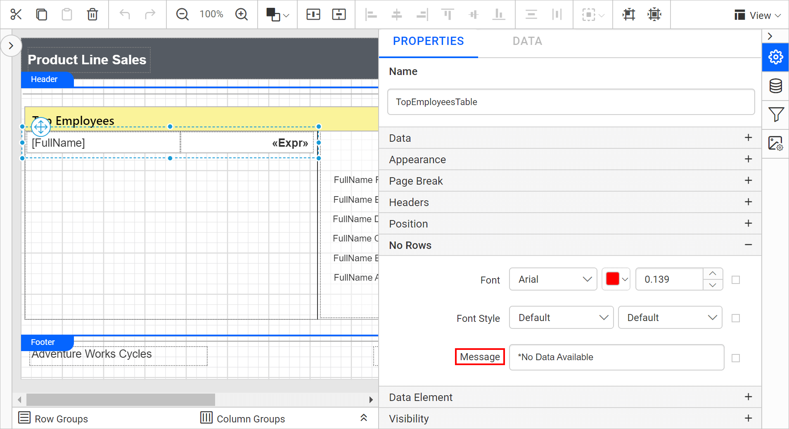
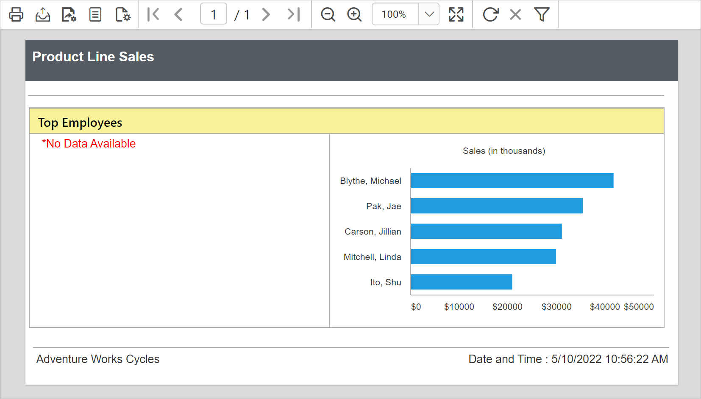
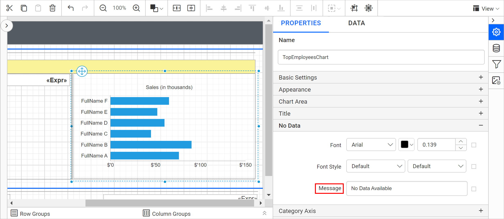
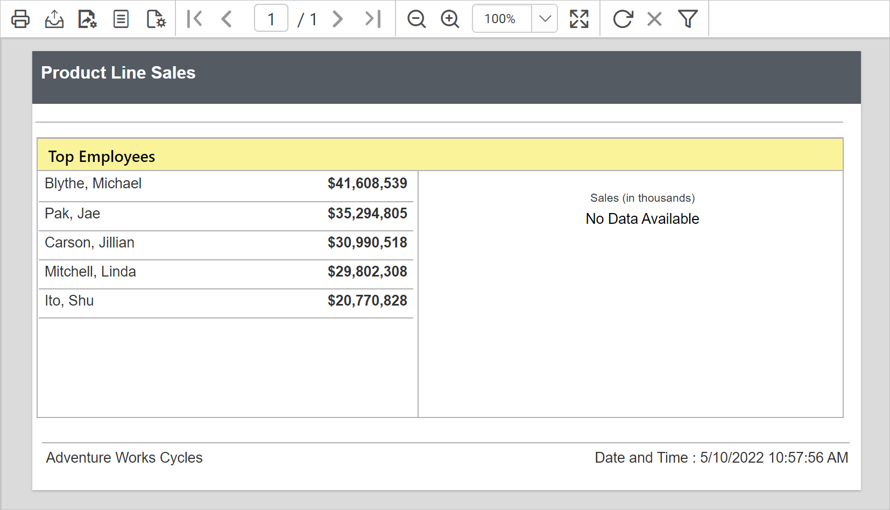

# How to display no data message for a data region

{{site.productNameTM}} Report Designer can display a message when no data exists in the database or no row matches the user selection in an RDL report. Showing a clear message when there is no data for a user selection is good practice.

To show the message, set custom text in the `No Rows` property. No Rows is an option on a matrix, table, chart, sub-report, and similar items that displays alternate text when your query returns no results.

## To set the NoRowsMessage property for a table, matrix, list, or subreport

You set the no rows message for a table, matrix, list, or subreport in {{site.productNameTM}} Report Designer from the `No Rows` category in the properties panel.

1. Select the table, matrix, or list data region or subreport on the design surface. The `Properties` panel displays the properties for the selected item.
2. Under the `No Rows` category in the properties panel, enter the text you want to display in the `Message` property field.

You can also set the message text from dynamic values using `Expressions`. To open the set or reset expression menu in the properties panel, read the [Set Expression](./../../compose-report/properties-panel/#set-expression) and [Reset Expression](./../../compose-report/properties-panel/#reset-expression) sections.

During report preview, the specified message is displayed if the user-specified value is not available in the database.

## To set the NoDataMessage property for a chart

You set the no data message for a chart in {{site.productNameTM}} Report Designer from the `No Data` category in the properties panel.

1. Select the chart on the design surface. The `Properties` panel displays the properties for the selected item.
2. Under the `No Data` category in the properties panel, enter the text you want to display in the `Message` property field.

You can also set the message text from dynamic values using `Expressions`. To open the set or reset expression menu in the properties panel, read the [Set Expression](./../../compose-report/properties-panel/#set-expression) and [Reset Expression](./../../compose-report/properties-panel/#reset-expression) sections.

During report preview, the specified message is displayed if the user-specified value is not available in the database.

## Frequently asked questions

### Which property shows a message when a table has no rows?

Set the text in the `Message` property field under the `No Rows` category in the properties panel.

### Can the no data message be dynamic?

Yes. You can set the message text from dynamic values using `Expressions`.

## See also

* [Properties panel](./../../compose-report/properties-panel/)
* [Expressions](./../../compose-report/expressions/)
* [Report Designer FAQ](./../../faq/)
