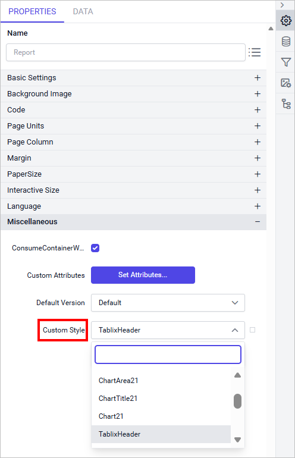
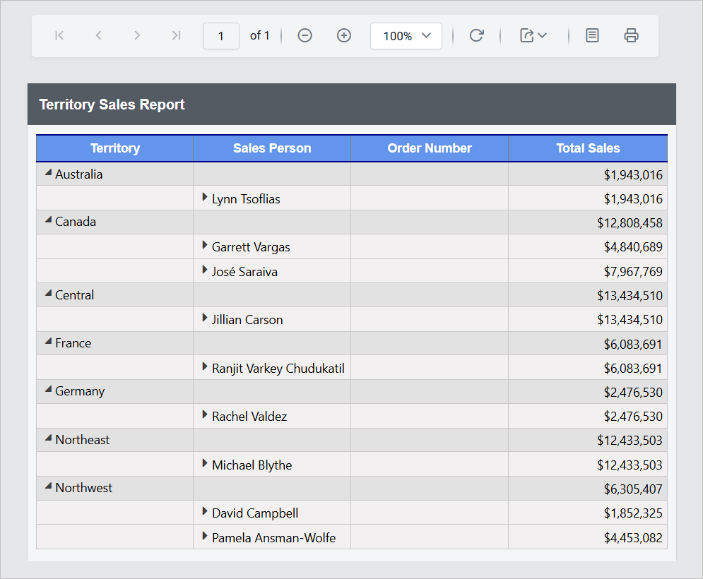

# How to configure custom styles into report items

Bold Reports® lets you register custom styles on the Report Server in an on-premises environment and configure them in Web Report Designer. These styles are applied in report preview and export.

## How do I create and register custom styles on the server?

You create and register custom styles on the Bold Reports® Report Server with any of the following methods:

* File Upload
* Custom Location
* Preconfigured Location

For configuration steps, read the [Register Custom Styles](../../../../administrator-guide/how-to/register-custom-styles/) section.

## How do I choose the custom style in the designer?

You choose a custom style in Web Report Designer from the `Custom Style` dropdown in **Report Properties**.

1. Open Web Report Designer. The designer renders as shown below.
    

2. Go to the **Properties** panel. In the **Report Properties** section under `Miscellaneous`, the `Custom Style` dropdown displays the style keys from the uploaded file. Select the style key you need.
    

3. The previous step applies the custom style at the report level. You can also apply custom styles to specific report sections (header, body, report items, and footer) as needed.

## How do I view the custom style in preview?

Bold Reports® applies the styles defined in the selected `Style Key` to all parts of the report. You get consistent, customized styling in both the preview and the exported outputs.

The following image shows external CSS applied in the viewer.

## Frequently asked questions

### Can I apply a custom style to only part of a report?

Yes. Besides the report level, you can apply custom styles to specific report sections such as the header, body, report items, and footer.

### Are custom styles applied in exported reports?

Yes. The styles are applied in both the report preview and export.

## See also

* [Report properties](./../../compose-report/report-properties/)
* [Report Designer how-to guides](./../../how-to/)
