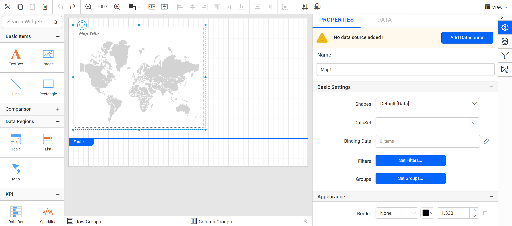

# How to configure custom map shapes

{{site.productNameTM}} On-Premises Edition lets you configure custom shape data and visualize it on the map report item. To add custom shape data to the On-Premises Edition application and use it in the report designer, follow these steps.

## Where do I place the custom shape data file?

You place custom shape data files in the {{site.productNameTM}} On-Premises Edition installed location, next to the built-in shape data files. The built-in shape data files are located at:

Version below 3.1

`{Installed_location}\{{site.productName}}\Report Server\ReportService\bin\ShapeData`.

Version above 3.1

`{Installed_location}\BoldServices\reporting\reportservice\ShapeData`.

Copy your shape data file and paste it at this location, for example **storelocations.js**.

Version below 3.1

Version above 3.1

## How do I add the file entry?

You register the shape data file in {{site.productNameTM}} by adding an entry to the mapshapes.txt file in the same location. After you paste the file, open mapshapes.txt.

Version below 3.1

Version above 3.1

Add the entry for your file name and display name, and then save the file.

## How do I visualize the shape data on a map?

You visualize the custom shape data in Web Report Designer by selecting it in the **Shapes** property of a map report item.

1. Launch the on-premise application and [create a new report](https://help.boldreports.com/enterprise-reporting/designer-guide/manage-content/reports/create-report/#steps-to-create-a-report).
   
2. Drag a map into the design area from the item panel.
   
3. The newly added shape data entry is listed in the **Shapes** property drop-down under the **Basic Settings** category.
   

To visualize shape data and analytical data with the map report item, read the [Design a rdl report using map](./../../report-items/map/use-case/design-map-using-custom-rule/) section.

## Frequently asked questions

### Which file lists the available map shapes?

The mapshapes.txt file in the ShapeData location lists them. Add your file name and display name there.

### Where does a new shape appear in the designer?

It is listed in the **Shapes** property drop-down under the **Basic Settings** category of the map report item.

## See also

* [Report Designer how-to guides](./../../how-to/)
