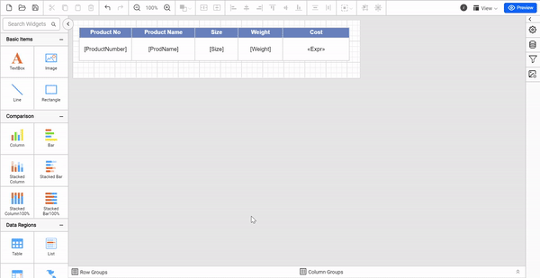
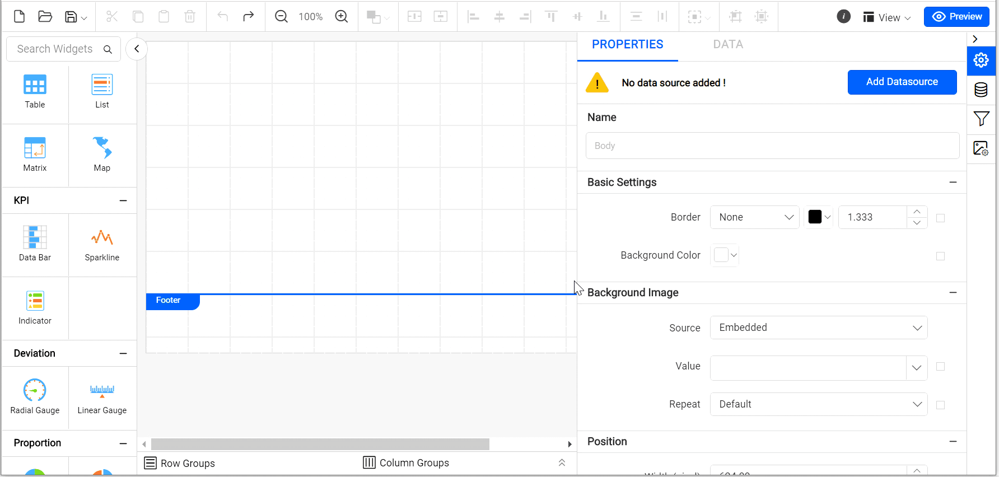
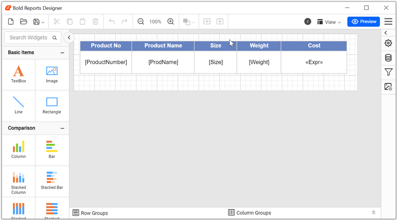
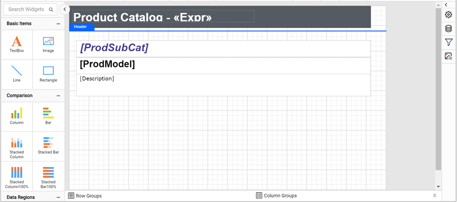
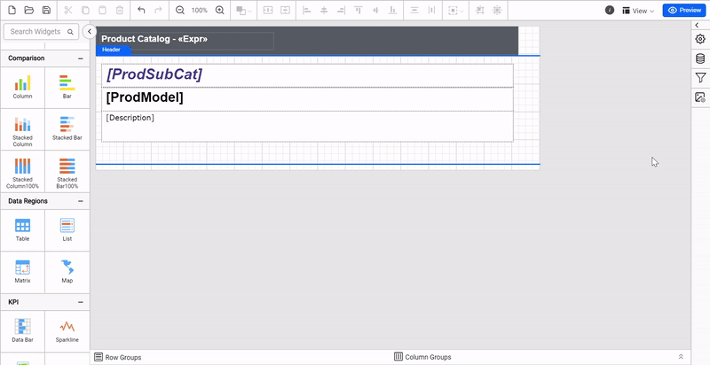
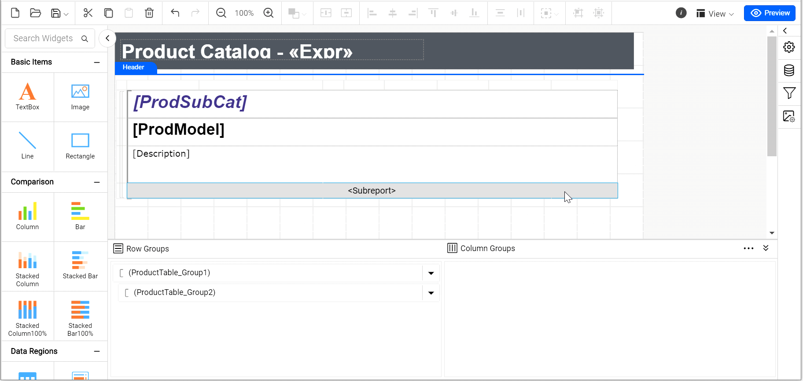
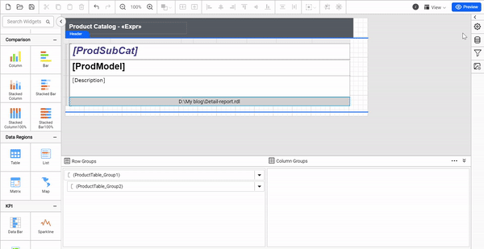
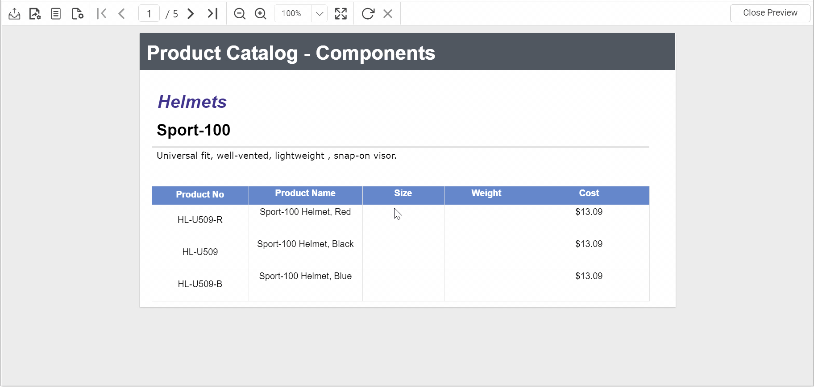

# How to create master detail report using subreport in Web Report Designer

{{site.productNameTM}} Web Report Designer lets you create a master-detail report that shows the detail records from a subreport. You build a detail report, build a master report, and then link the detail report into the master report as a subreport.

## How do I create and customize the detail report?

You create the detail report in Web Report Designer with two hidden parameters, a dataset, and a table.

1. Open the Web Report Designer.
   

2. To add parameters to the detail report, click `Parameters`. Then, click `New parameter` in the parameter panel.

3. The following wizard is displayed.
   

4. Set the parameter name to `ProdSubCat`, the prompt to `ProdSubCat`, and the visibility to `hidden`.

5. Click `Save`.

6. Repeat the same steps to add the parameter `ProdModel`.
   

7. Connect to the data source using the [data source documentation](./../../manage-data/datasource/).

8. Connect to the dataset using the [dataset documentation](./../../manage-data/dataset/).

9. Create the `ProductCatalog` dataset with the following query.
   

    ```csharp
      SELECT top 60 PS.Name AS ProdSubCat, PM.Name AS ProdModel, PC.Name AS ProdCat, PD.Description, PP.LargePhoto,P.Name AS ProdName,P.ProductNumber, P.Color, P.Size, P.Weight, P.StandardCost,P.Style,P.Class, P.ListPrice
      FROM  Production.Product P INNER JOIN
      Production.ProductSubcategory PS INNER JOIN
      Production.ProductCategory PC ON PS.ProductCategoryID = PC.ProductCategoryID ON P.ProductSubcategoryID = PS.ProductSubcategoryID INNER JOIN
      Production.ProductProductPhoto PPP ON P.ProductID = PPP.ProductID INNER JOIN
      Production.ProductPhoto PP ON PPP.ProductPhotoID = PP.ProductPhotoID LEFT OUTER JOIN
      Production.ProductDescription PD INNER JOIN
      Production.ProductModel PM INNER JOIN
      Production.ProductModelProductDescriptionCulture PMPDCL ON PM.ProductModelID = PMPDCL.ProductModelID ON
      PD.ProductDescriptionID = PMPDCL.ProductDescriptionID ON P.ProductModelID = PM.ProductModelID
    WHERE (PMPDCL.CultureID = 'en') and PS.Name = @ProdSubCat and PM.Name = @ProdModel
    ```

10. Drag the table report item and configure the fields as shown in the following image.
    

You can download the finished detail report from the
[Sample report](https://www.syncfusion.com/downloads/support/directtrac/general/ze/Detail-report1732874929.zip).

## How do I create the master report?

You create the master report in Web Report Designer with the same dataset query, without the parameter filter, and a grouped table.

1. Open the Web Report Designer.
   

2. Connect to the data source using the [data source documentation](./../../manage-data/datasource/).

3. Connect to the dataset using the [dataset documentation](./../../manage-data/dataset/).

4. Create the `ProductCatalog` dataset with the following query.
   

    ```csharp
      SELECT top 60 PS.Name AS ProdSubCat, PM.Name AS ProdModel, PC.Name AS ProdCat, PD.Description, PP.LargePhoto,P.Name AS ProdName,P.ProductNumber, P.Color, P.Size, P.Weight, P.StandardCost,P.Style,P.Class, P.ListPrice
      FROM  Production.Product P INNER JOIN
      Production.ProductSubcategory PS INNER JOIN
      Production.ProductCategory PC ON PS.ProductCategoryID = PC.ProductCategoryID ON P.ProductSubcategoryID = PS.ProductSubcategoryID INNER JOIN
      Production.ProductProductPhoto PPP ON P.ProductID = PPP.ProductID INNER JOIN
      Production.ProductPhoto PP ON PPP.ProductPhotoID = PP.ProductPhotoID LEFT OUTER JOIN
      Production.ProductDescription PD INNER JOIN
      Production.ProductModel PM INNER JOIN
      Production.ProductModelProductDescriptionCulture PMPDCL ON PM.ProductModelID = PMPDCL.ProductModelID ON
      PD.ProductDescriptionID = PMPDCL.ProductDescriptionID ON P.ProductModelID = PM.ProductModelID
    WHERE (PMPDCL.CultureID = 'en')
    ```

5. Drag the table report item and configure the fields. Then, add groups in the tablix to display the data using the [details group documentation](./../../report-items/tablix/add-or-delete-a-details-group-ssrs/).

6. The initial design of the report is displayed as shown in the following image.
   

You can download the finished master report from the
[Sample master report](https://www.syncfusion.com/downloads/support/directtrac/general/ze/Master-report804288141.zip).

## How do I link the subreport to the master report?

You link the detail report (`product category detail records`) to the master report in Web Report Designer by inserting a subreport item and passing parameters to it.

1. Right-click the last row (`Description`) and select `Insert Row`, and then click the `Inside Group-Below option`.

2. In the newly added row, select all the cells using the `Ctrl Key + Mouse left click` combination.

3. Right-click any selected cell, and then click `Merge Cells`.

4. Right-click the newly added row, select Insert, and then click Subreport.
   

5. Select the sub-report item on the design surface and open the `properties panel`.

6. Under Basic Settings, copy the sub-report path and paste it in the Report field.
   

7. Click `Set Parameters`, and then click the `Add` button.

8. Set the Parameter Name to `ProdSubCat` and the value to `=Fields!ProdSubCat.Value`.

9. Repeat the same for the parameter `ProdModel` with the value `=Fields!ProdModel.Value`.
   

10. Click Preview at the top-right corner of the Web Report Designer toolbar to see the output.
    

## Frequently asked questions

### Why are the detail report parameters hidden?

The `ProdSubCat` and `ProdModel` parameters get their values from the master report through `Set Parameters`, so their visibility is set to `hidden`.

### Which values does the master report pass to the subreport?

It passes `=Fields!ProdSubCat.Value` to `ProdSubCat` and `=Fields!ProdModel.Value` to `ProdModel`.

## See also

* [Create a master-detail report using a table](./../../how-to/create-master-detail-report-using-table/)
* [Create a master-detail report using a list](./../../how-to/create-master-detail-report-using-list/)
* [Report Designer how-to guides](./../../how-to/)
