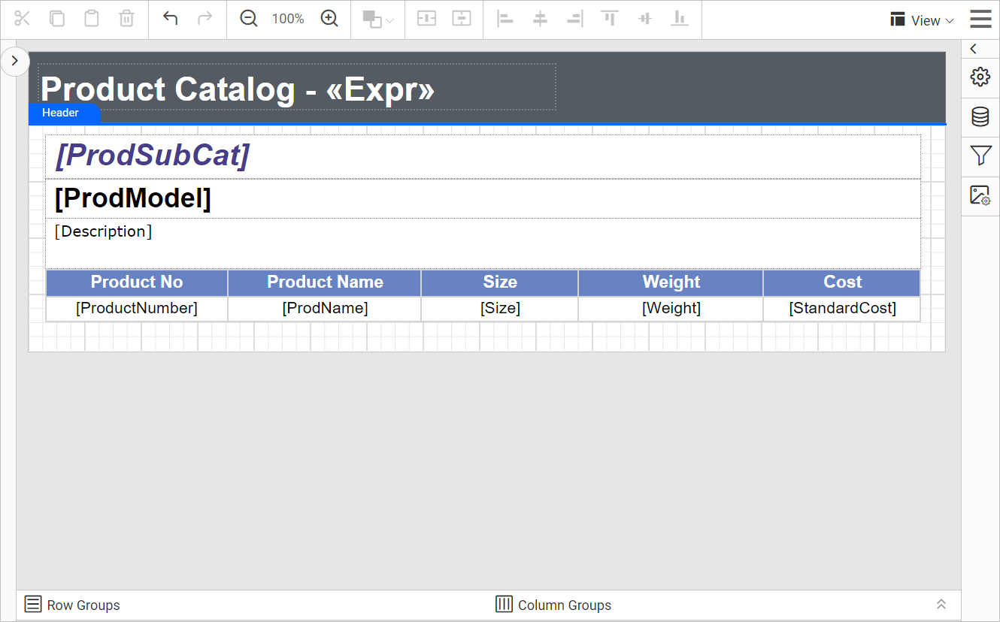
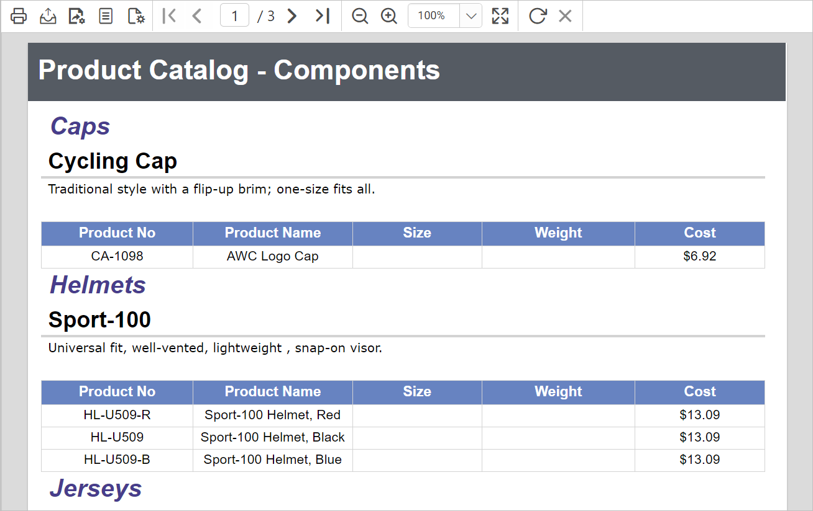

# How to create a master detail report using the table in Web Report Designer

{{site.productNameTM}} Web Report Designer lets you show master-detail data in a single report with the table report item. Use this when your data source contains a master-detail relationship. This format works well for organizing items that have many details.

## How do I build a master-detail report with a table?

The {{site.productNameTM}} blog post "Create Impressive Master-Detail Reports using the table report item" gives step-by-step instructions and tips for getting the most from the customizable templates.

Read the [blog post on master-detail reports using the table report item](https://www.boldreports.com/blog/create-master-detail-reports-using-table) for step-by-step instructions.

## **Design**

The following image shows the master-detail report design using a table in Web Report Designer.

## **Preview**

The following image shows the preview of the master-detail report using a table.

## See also

* [Create a master-detail report using a list](./../../how-to/create-master-detail-report-using-list/)
* [Create a master-detail report using a subreport](./../../how-to/create-master-detail-report-using-subreport/)
* [Report Designer how-to guides](./../../how-to/)
