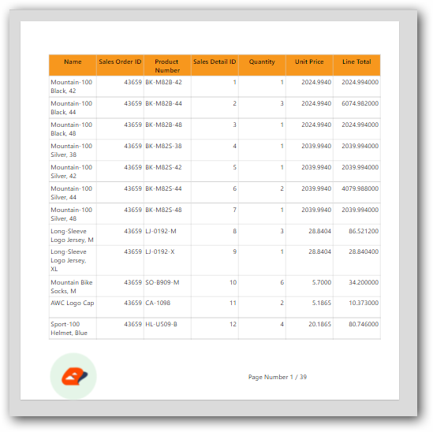

# How to create the cover page report in {{site.productNameTM}}

{{site.productNameTM}} Report Designer lets you create a cover page for your report using a rectangle with a page break.

Prefer watching over reading? Watch this video for creating a report with a cover page:

`youtube: https://www.youtube.com/watch?v=SNslWbGl0TU`

## How do I create the cover page using a rectangle?

You create a cover page in {{site.productNameTM}} Report Designer by placing the cover content in a rectangle that has a page break.

1. Drag and drop the rectangle report item into the design area from the item panel. Create your cover page inside the rectangle item.
   
2. Add a page break for the rectangle report item and enable the `Page Number Reset` option.
   
3. Design your detailed report after the rectangle report item.
   
4. Preview the report. The first page shows the cover page, and the second page shows the detailed report.
   
   

> Download the above report design from the [cover page sample report](https://www.syncfusion.com/downloads/support/directtrac/general/ze/Cover_Page_Report_(2)-268815869)

## Frequently asked questions

### Which option keeps page numbers correct after the cover page?

Enable the `Page Number Reset` option on the rectangle's page break.

## See also

* [Page layout](./../../compose-report/page-layout/)
* [Report Designer how-to guides](./../../how-to/)
