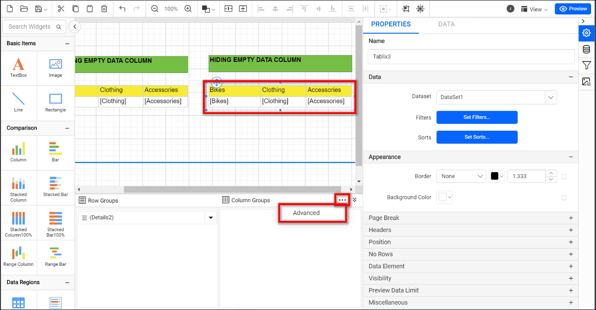
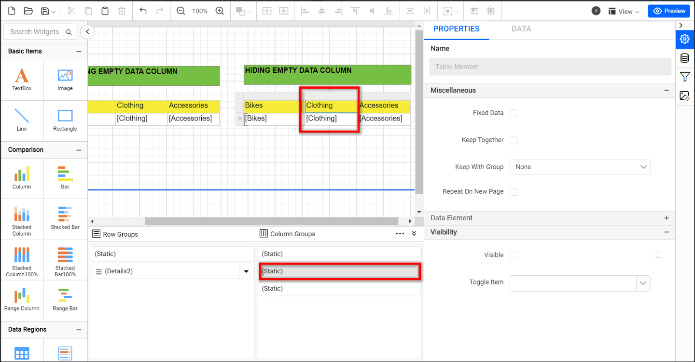
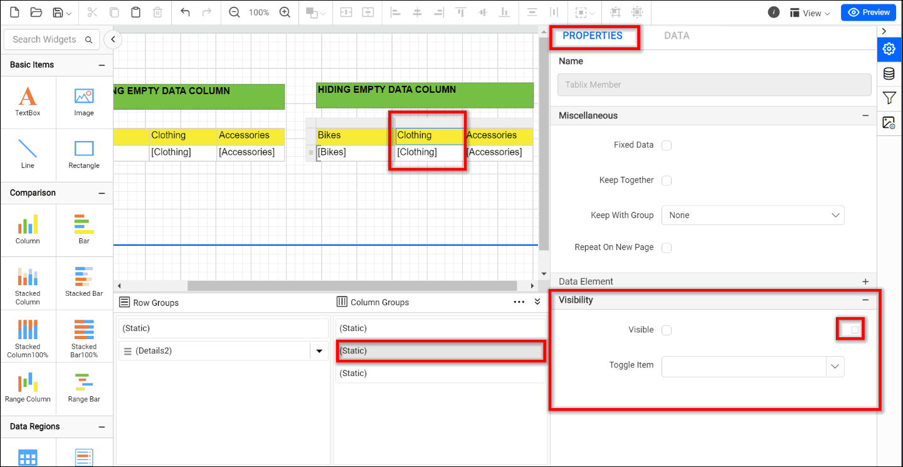
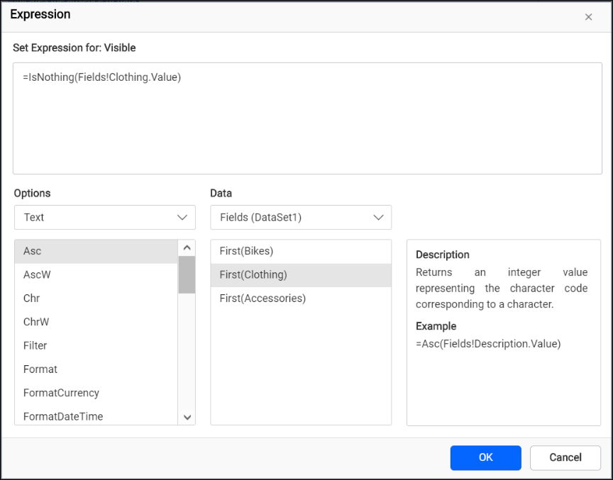
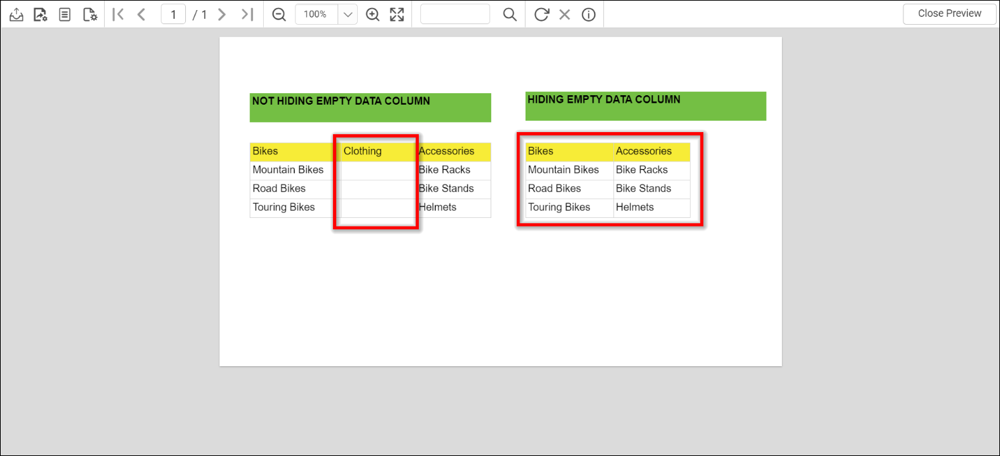
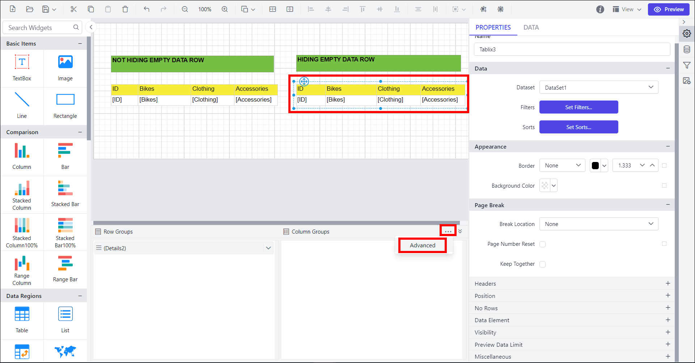
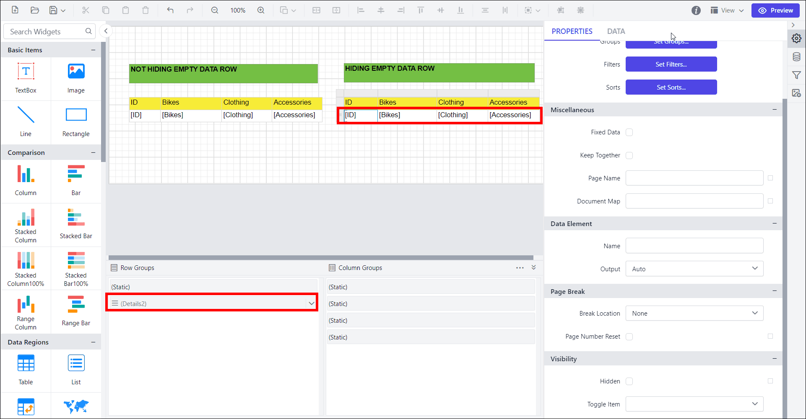
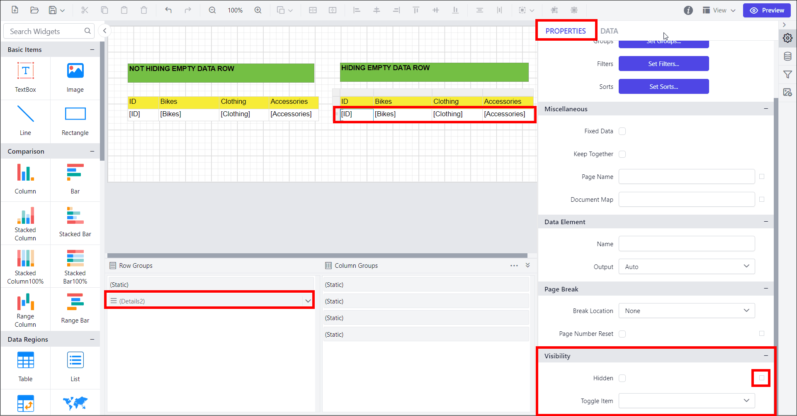
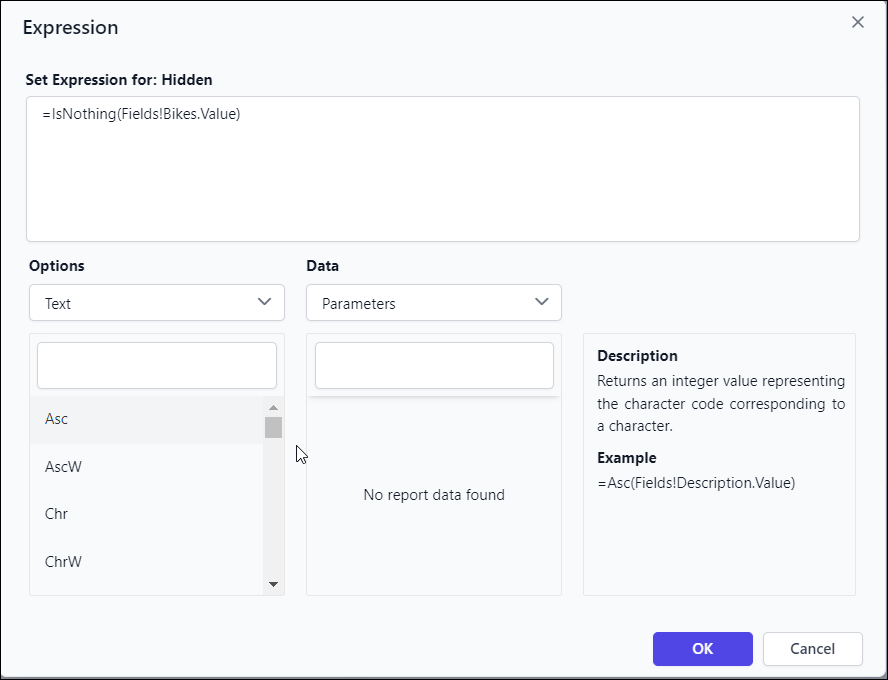
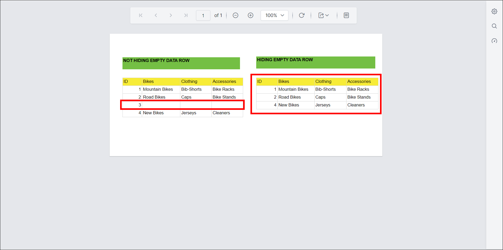

# How to hide the table column or row when the field value is empty

Bold Reports<sup>®</sup> lets you control the visibility of a tablix column or row based on whether data is present. You set the visibility property with an expression. The following steps show how to do this in your reports.

## Hide the table column when the field value is empty

You hide an empty table column in Bold Reports<sup>®</sup> Report Designer by setting an `IsNothing` expression on the column's **Visibility** property.

1. Drag and drop the table, select the dataset, and assign the field values. Select the tablix, enable the advanced mode, and set the visibility expression for the columns to hide them when they contain empty data.
   
   
2. In the Properties window or pane, find the **Visibility** property. Click the expression button (a white box) next to the `Visibility` property.
   
3. The Expression Editor opens, where you define the logic for hiding the column based on data presence. Enter the following expression, selecting the field that indicates the absence of data:
   

   ```csharp
    =IsNothing(<Your_field_name>)
   ```

   For example:

   ```csharp
    =IsNothing(Fields!Clothing.Value)
   ```

4. Click the **OK** option to save the Expression Editor.
5. Save your report and `preview` it. The column visibility now adjusts dynamically based on the availability of data.
   

> The IsNothing(Fields!Clothing.Value) expression evaluates to True when the field value is null or empty, and False when it contains data. By setting the **Visibility** property to False, the column will be hidden when the expression evaluates to True.

You can download the finished sample report from the [hide empty column sample report](https://www.syncfusion.com/downloads/support/directtrac/general/ze/HideEmptyDataColumn1272261074.zip).

## Hide the table row when the field value is empty

You hide an empty table row in Bold Reports<sup>®</sup> Report Designer by setting an `IsNothing` expression on the row's **Visibility** property.

1. Drag and drop the table, select the dataset, and assign the field values. Select the tablix, enable the advanced mode, and set the visibility expression for the rows to hide them when they contain empty data.
   
   
2. In the Properties window or pane, find the **Visibility** property. Click the expression button (a white box) next to the `Visibility` property.
   
3. The Expression Editor opens, where you define the logic for hiding the row based on data presence. Enter the following expression, selecting the field that indicates the absence of data:
   

   ```csharp
    =IsNothing(<Your_field_name>)
   ```

   For example:

   ```csharp
    =IsNothing(Fields!Bikes.Value)
   ```

4. Click the **OK** option to save the Expression Editor.
5. Save your report and `preview` it. The row visibility now adjusts dynamically based on the availability of data.
   

> The IsNothing(Fields!Bikes.Value) expression evaluates to True when the field value is null or empty, and False when it contains data. By setting the **Visibility** property to False, the row will be hidden when the expression evaluates to True.

You can download the finished sample report from the [hide empty row sample report](https://www.syncfusion.com/downloads/support/directtrac/general/ze/HideEmptyRowColumn1542738587.zip).

## Summary

With these steps, you can hide a column or row dynamically in Bold Reports<sup>®</sup> when the related tablix contains no data. The IsNothing() function in an expression lets you control column or row visibility based on data presence. This technique improves the visual appearance and usability of your Bold Reports<sup>®</sup> projects.

## Frequently asked questions

### What does the IsNothing expression return?

It evaluates to True when the field value is null or empty, and False when it contains data.

### Where do I set the expression?

Set it on the **Visibility** property by clicking the expression button (a white box) next to it in the Properties pane.

## See also

* [Properties panel](./../../compose-report/properties-panel/)
* [Expressions](./../../compose-report/expressions/)
* [Report Designer how-to guides](./../../how-to/)
