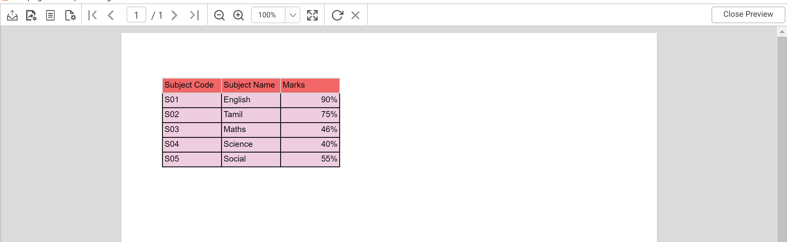

# How to remove the additional zeros when using percentage format

The percentage format in Bold Reports® Report Designer automatically converts a cell value into a percentage. If your value is already a pre-calculated percentage, this adds extra zeros to it.

## How do I remove the additional zeros?

You remove the extra zeros in Bold Reports® Report Designer by dividing the field value by 100 in an expression.

1. Click the textbox field value in the tablix, and apply an expression to **divide** the field value by 100.
   
2. Click **Preview**. The percentage value is shown as in the following image.
   

## See also

* [Format data](./../../compose-report/format-data/)
* [Expression Builder](./../../compose-report/expressions/)
* [How-to guides for Web Report Designer](./../../how-to/)
