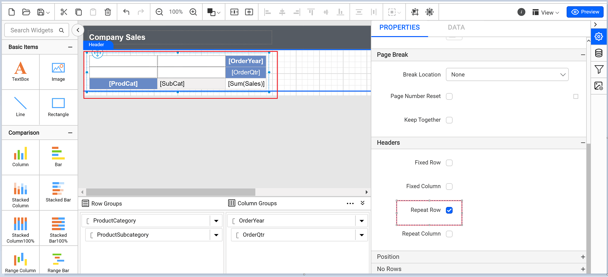
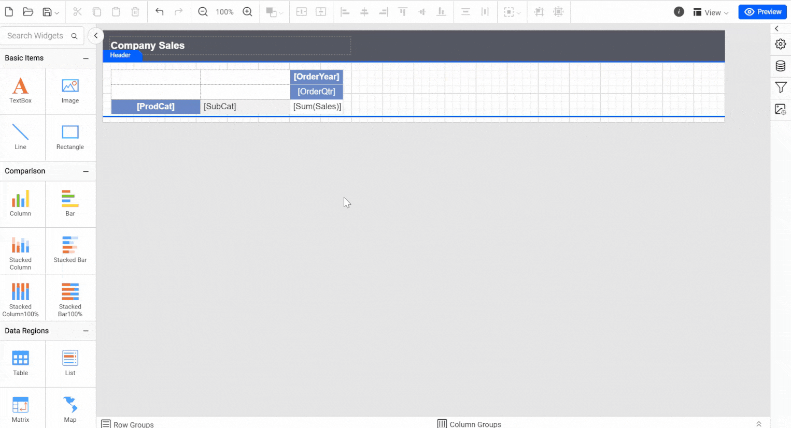
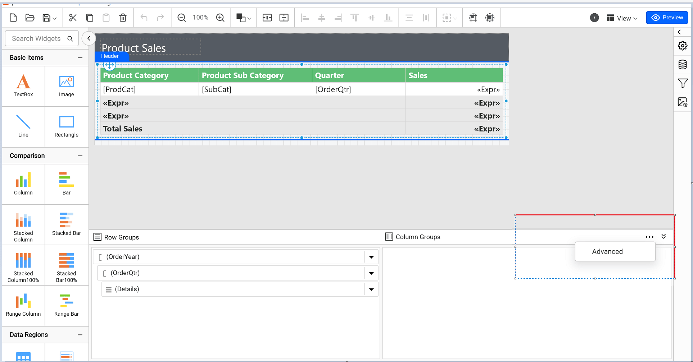
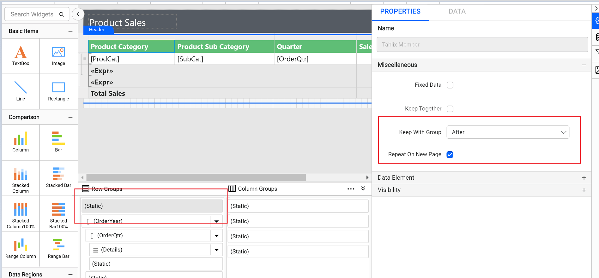
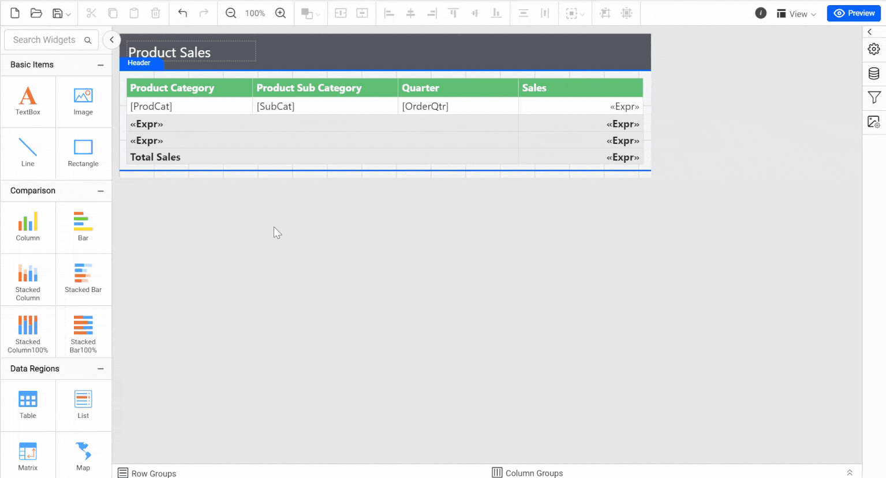

# How to repeat row and column headers on multiple pages

Bold Reports® Report Designer lets you repeat row and column headers on multiple pages. Use the **Repeat Column** and **Repeat row** options for a matrix, and the **RepeatOnNewPage** option for static table rows or columns.

## How do I display column headers on multiple pages in a matrix?

You repeat matrix column headers in Bold Reports® Report Designer with the **Repeat Column** option in the **Headers** section.

1. Select the matrix report item in the report and open the **Properties** panel.
2. Expand the **Headers** section in the **Properties** panel and select the **Repeat Column** check box under the **Headers** section.
   
3. Click **Preview** at the top-right corner. The matrix header columns are repeated on each report page, as in the following image.
   

## How do I display row headers on multiple pages in a matrix?

You repeat matrix row headers in Bold Reports® Report Designer with the **Repeat row** option in the **Headers** section.

1. Select the matrix report item in the report and open the **Properties** panel.
2. Expand the **Headers** section in the **Properties** panel and select the **Repeat row** check box under the **Headers** section.
   
3. Click **Preview** at the top-right corner. The matrix header rows are repeated on each report page, as in the following image.
   

## How do I display a static row or column on multiple pages?

You repeat a static table row or column in Bold Reports® Report Designer with the **RepeatOnNewPage** option in the Grouping panel's Advanced Mode.

1. Select the table report item and open the **Properties** panel.
2. Click the **dotted button** on the right side of the **Grouping panel** and select **Advanced Mode**. The Grouping panel displays the hierarchical static and dynamic members of the table groups.
   
3. Click a static member in Row Groups and check the **RepeatOnNewPage** option in the Properties panel.
4. Set the **KeepWithGroup** property to After. Choose one of the following options from the drop-down menu based on your group:
   

   * **After:** Keep this selected member with the following group members. Set this option to keep a group header with a group.
   * **Before:** Keep this selected member with the previous group members. Set this option to keep a group footer with a group.
   * **None:** Set this option when you do not want this member kept with the members of the selected row group.

5. Repeat steps 3 and 4 for as many adjacent members as you want to repeat.
6. Click **Preview**. The table header is repeated on each report page, as in the following image.
   

## Frequently asked questions

### Which KeepWithGroup value keeps a group header with its group?

Set **KeepWithGroup** to **After** to keep a group header with a group.

### Where is the RepeatOnNewPage option?

Select a static member in Row Groups in the Grouping panel's **Advanced Mode**, and check **RepeatOnNewPage** in the Properties panel.

## See also

* [Group data](./../../compose-report/group-data/)
* [Page layout](./../../compose-report/page-layout/)
* [Report Designer how-to guides](./../../how-to/)
