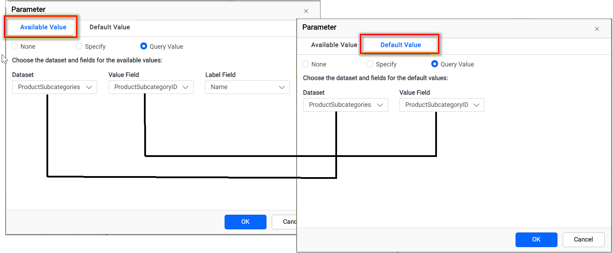

# How to select all the available values in the parameter list as default in the report

To select all available values by default in {{site.productNameTM}} Report Designer, use the same dataset query for the parameter's available values and default values. First, review the [Create Parameter](./../../report-parameters/add/#create-parameter) section, and then follow these steps.

## How do I set the available values?

You set the available values for a {{site.productNameTM}} parameter in the parameter assign dialog.

1. Click `Assign Value >>` to open the parameter assign dialog.

   

2. The parameter dialog opens on the `Available Value` tab by default. Follow the [Available Values](./../../report-parameters/define-available-values-for-parameter/#query-values) section and choose the dataset values you need in the dropdowns.

   

## How do I set all values as default?

You set all values as default in {{site.productNameTM}} by choosing **Query Value** on the `Default Value` tab with the same dataset and value field.

1. Switch to the `Default Value` tab, which has the following options.

   

2. Select the **Query Value** option under the **Default Value** tab.

   

3. Choose the dataset and the value field. They must be the same as the **Available Value** dataset and value field query value.

   

4. Save the parameter and preview the report. By default, the report renders with all available values in the parameter list.

   

## Frequently asked questions

### Why are not all values selected by default?

The **Default Value** dataset and value field must be the same as the **Available Value** dataset and value field.

## See also

* [Add a report parameter](./../../report-parameters/add/)
* [Get distinct values in parameter drop down](./../../how-to/get-distinct-values-in-ssrs-parameter-drop-down/)
* [Report Designer how-to guides](./../../how-to/)
