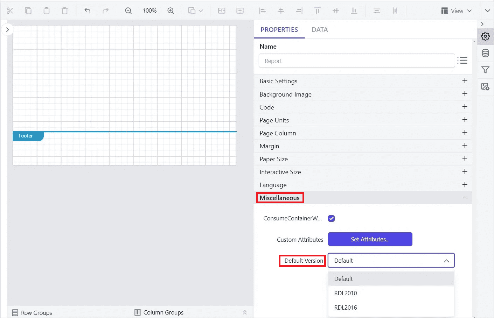

# How to upgrade or downgrade reports using {{site.productNameTM}} Designer

{{site.productNameTM}} Report Designer lets you upgrade or downgrade reports between 2008, 2010, or 2016 RDL schema versions with the `Default Version` option. You find this option under `Report Properties` in the properties panel.

## Which Default Version options are available?

The `Default Version` property in {{site.productNameTM}} Report Designer has the following options:

**Default** - Refers to the 2016 RDL schema version. When you create a new report, the schema version is set to 2016 by default.

**RDL2010** - Upgrades or downgrades the report to the 2010 RDL schema version.

**RDL2016** - Upgrades the report to the 2016 RDL schema version.

## Steps to upgrade or downgrade reports

You upgrade or downgrade a report in {{site.productNameTM}} Designer by changing the `Default Version` property and saving the report.

1. Launch the Enterprise Server application and edit a target report.
2. Open [Report Properties](./../../compose-report/report-properties/). Under the `Miscellaneous` category, choose the target version in the `Default Version` property drop-down.
3. Save the report.

## Which upgrades are supported?

{{site.productNameTM}} Designer supports the following report upgrades:

|Current version | Target version |
|----------------|----------------|
| 2008 schema version | User can upgrade the reports to 2010 or 2016 schema version |
| 2010 schema version | User can upgrade the reports to 2016 schema version |

## Which downgrades are supported?

{{site.productNameTM}} Designer supports the following report downgrade:

|Current version | Target version |
|----------------|----------------|
| 2016 schema version | User can downgrade the reports to 2010 schema version |

> **NOTE:** The `Default Version` property is used to convert the RDL structure of the report that is opened or saved in the current report designer instance. It is not intended to display the actual version of the report opened in the designer.

## Frequently asked questions

### What schema version does a new report use?

A new report uses the 2016 RDL schema version by default.

### Does the Default Version property show the report's actual version?

No. It converts the RDL structure of the report opened or saved in the current designer instance. It does not display the actual version of the opened report.

## See also

* [Report properties](./../../compose-report/report-properties/)
* [Report Designer how-to guides](./../../how-to/)
