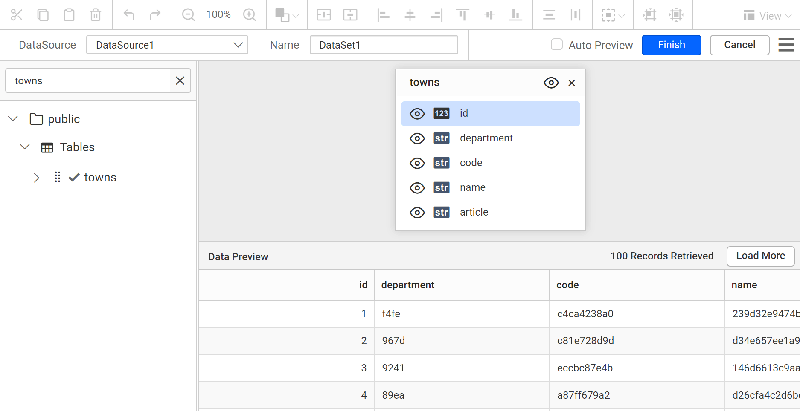

# Connect to Amazon Redshift data source

To connect {{site.productNameTM}} to an Amazon Redshift database, open the **Data** configuration panel in the Web Report Designer and create an Amazon Redshift data source.

## How do I create an Amazon Redshift data source?

To create an Amazon Redshift data source in the {{site.productNameTM}} Web Report Designer, open the **Data** configuration panel and choose the Amazon Redshift connection type.

1. Click the **Data** icon in the configuration panel.
   
2. In the `DATA` configuration panel, click the `NEW DATA` button.
   
3. In the connection type panel, choose the `Amazon Redshift` data source type.
   

### How do I configure the basic options?

When you create a new data source in the Web Report Designer, the `NEW DATASOURCE` panel shows the basic options.

1. Specify the data source name without special characters in the **Name** field.
2. Enter a valid Amazon Redshift server or host name in the **Server Name** field.
3. Enter a valid Amazon Redshift username in the **UserName** text box.
4. Enter a valid Amazon Redshift password in the **Password** text box.
5. Select a database that you want to query in the listed database associated with the given Amazon Redshift server in the database drop-down.
   
6. Click `Connect` to open the query design pane.
7. Enter the required query and execute it. The corresponding values appear in a grid for preview.

   

8. Click `Finish` to save the data source with a relevant name and continue designing the report.

## Frequently asked questions

### What details do I need to connect to Amazon Redshift?

You need a valid Amazon Redshift server or host name, username, and password. You then select a database associated with that server.

### How do I preview Amazon Redshift data?

Click `Connect`, enter the required query, and execute it. The corresponding values appear in a grid for preview.

## See Also

* [Connect to PostgreSQL data source](./../../data-connectors/postgresql-data-source/)
* [Connect to Amazon RDS data source](./../../data-connectors/amazon-rds-data-source/)
* [Connect to Amazon Aurora data source](./../../data-connectors/amazon-aurora-data-source/)
