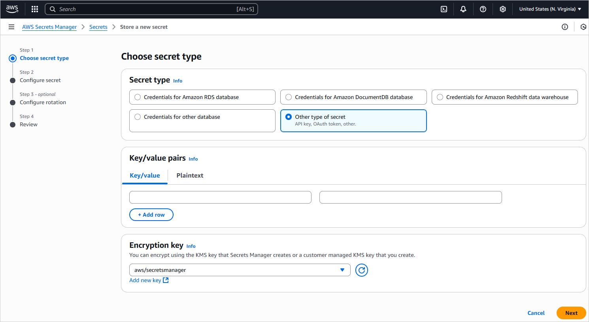
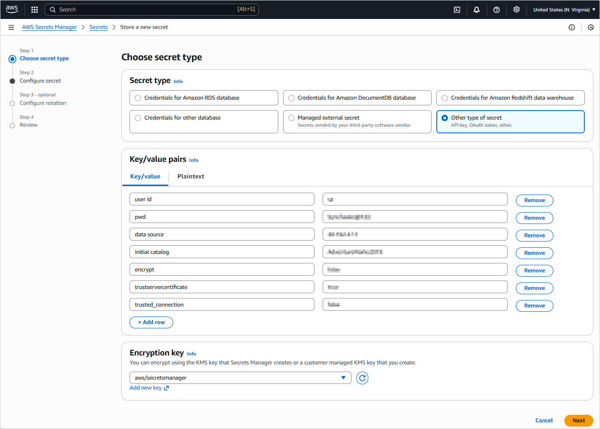
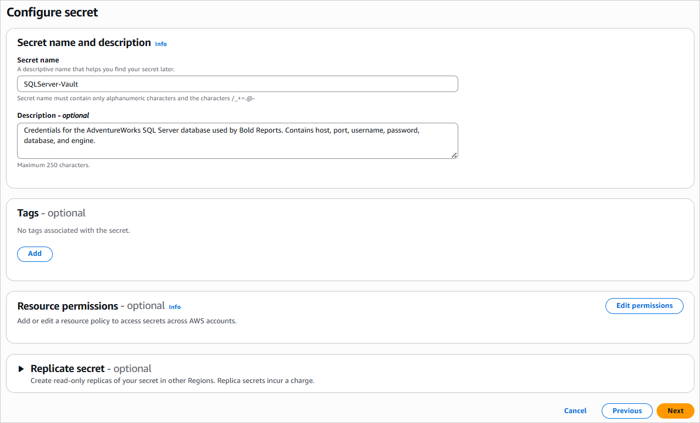
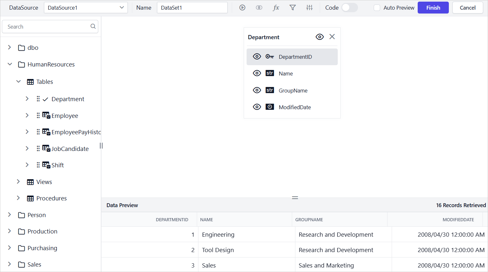

# Connect to AWS Secrets Manager

{{site.productNameTM}} connects to AWS Secrets Manager to retrieve database credentials dynamically, so you can connect to your chosen database (e.g. SQL Server, PostgreSQL, and MySQL) within reports. This enhances security by centralizing credential management.

## How do I create a secret in AWS Secrets Manager?

Before you connect {{site.productNameTM}} to AWS Secrets Manager, create and configure a secret in your AWS account. The secret stores the credentials for your database.

1. Sign in to the AWS Management Console and open the Secrets Manager console at the [AWS Secrets Manager Console](https://console.aws.amazon.com/secretsmanager/).
2. In the Secrets Manager console, choose the `Secrets` option from the left navigation panel, then click `Store a new secret`.
    
3. On the **Choose secret type** page, select the `Other type of secret` option. With this option, you can manually define the key-value pairs or provide a custom JSON string for your database credentials.
    
4. In the **Key/value pairs** section, select the **Key/value** option, then add your database credentials as individual key-value pairs. For proper integration with {{site.productNameTM}}, use the following valid keys:
    | Engine           | Valid Keys |
    |------------------|------------|
    | SQL Server       | server, data source, initial catalog, database, user id, uid, pwd, password, trusted_connection, integrated security, persist security info, encrypt, trustservercertificate, certificate, port, connect timeout, connection timeout |
    | MySQL           | server, host, port, database, db, uid, user id, userid, username, user, user name, pwd, password, sslmode, ssl mode, tlsversion, ssl-ca, sslcert, sslkey, sslverify, use compression, persist security info, allow public key retrieval, connection timeout, connect timeout, default command timeout |
    | PostgreSQL       | server, host, port, database, db, username, user id, uid, user name, pwd, password, sslmode, ssl mode, sslrootcert, sslcert, sslkey, sslcrl, trust server certificate, connect timeout, command timeout, timeout, client_encoding, options, keepalives, keepalives_idle, keepalives_interval, keepalives_count, integrated security, persist security info |

    
5. In the **Configure secret** section, enter a `Secret name`. You use this `Secret Name` later when you configure the data source in {{site.productNameTM}}. Optionally, add a `Description`. Click `Next`, then complete the remaining configuration steps (for example rotation settings) until you reach the final `Review` page.
    
6. In the `Review` section, verify all your settings, then click the `Store` option to finalize the creation of your secret.

Your secret is now created and ready to be accessed by {{site.productNameTM}}.

## How do I create an AWS Secrets Manager data source?

To create an AWS Secrets Manager data source in the {{site.productNameTM}} Web Report Designer, open the **Data** configuration panel and enter your AWS details.

1. Click the **Data** icon in the configuration panel.
   
2. In the `DATA` configuration panel, click the `NEW DATA` option.
   
3. In the Connection type panel, select `AWS Secrets Manager` as the data source type.
   
4. In the `NEW DATASOURCE` panel, provide the following details:
   * Specify the data source name without special characters in the **Name** field.
   * Select `SQL Server` from the **Database Engine** drop-down to use with the configured AWS Secrets Manager secret.
   * Enter your AWS Access Key ID in the **Access Key** text box. The Access Key ID authenticates requests to AWS.
   * Enter your AWS Secret Access Key in the **Secret Access Key** text box. The Secret Access Key works with the Access Key ID for authentication.
   * Enter the **Region** where your AWS Secrets Manager secret is stored (e.g., us-east-1).
   * From the **Secret Name** drop-down, select the secret that contains your database credentials in AWS Secrets Manager (e.g., SQLServer-Vault). The selected secret is expected to contain the following SQL Server connection string key-value pairs: data source, user id, pwd, initial catalog, encrypt, trustservercertificate and trusted_connection.
   
5. Click the `Connect` option to connect {{site.productNameTM}} with the Microsoft SQL Server database.
6. Drag and drop the table from the table schema in the query design view page.
   
7. Click the `Finish` option to save the data source with a relevant name and continue designing the report.
    

### AWS Secrets Manager supported database engine in {{site.productNameTM}}

{{site.productNameTM}} supports the following database engines with AWS Secrets Manager:

* SQL Server
* MySQL
* PostgreSQL

The following image shows the **Database Engine** drop-down.

## Frequently asked questions

### Why use AWS Secrets Manager with {{site.productNameTM}}?

{{site.productNameTM}} retrieves database credentials from AWS Secrets Manager dynamically. This enhances security by centralizing credential management.

### Which secret type should I choose in AWS Secrets Manager?

Select the `Other type of secret` option. You can then define key-value pairs or provide a custom JSON string for your database credentials.

### What AWS details do I need for the data source?

You need your AWS Access Key ID, Secret Access Key, the **Region** where the secret is stored, and the **Secret Name**.

## See Also

* [Connect to SQL Server data source](./../../data-connectors/sql-data-source/)
* [Connect to MySQL data source](./../../data-connectors/mysql-data-source/)
* [Connect to PostgreSQL data source](./../../data-connectors/postgresql-data-source/)
