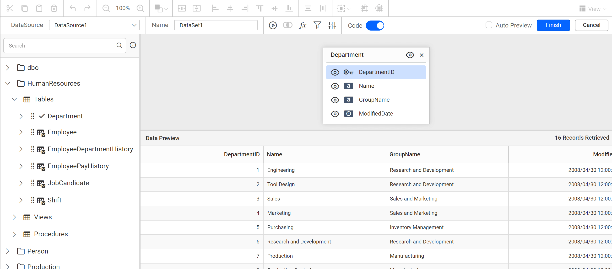
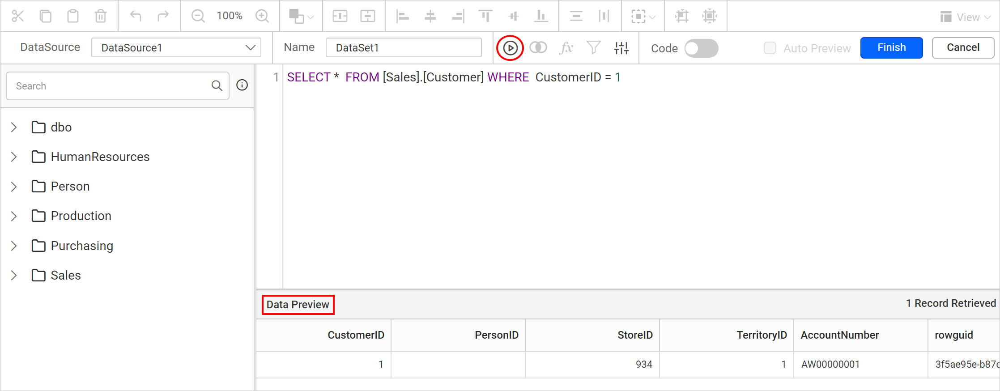
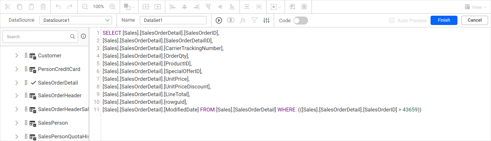

# Connect to Azure SQL Data Warehouse data source

To visualize Azure SQL Data Warehouse data in {{site.productNameTM}}, create an Azure SQL Data Warehouse data source from the **Data** configuration panel in the Web Report Designer. You can connect with basic options, advanced options, or a custom SQL query.

## How do I create an Azure SQL Data Warehouse data source?

To create an Azure SQL Data Warehouse data source in the {{site.productNameTM}} Web Report Designer, open the **Data** configuration panel and choose the Azure SQL Data Warehouse connection type.

1. Click the **Data** icon in the configuration panel.
   
2. In the `DATA` configuration panel, click the `NEW DATA` button.
   
3. In the connection type panel, choose the `Azure SQL Data Warehouse` data source type.
   

### Create Azure SQL Data Warehouse data source with basic options

When you create a new data source in the Web Report Designer, the `NEW DATASOURCE` panel shows the basic options.

1. Specify the data source name without special characters in the **Name** field.
2. Enter a valid Azure SQL Data Warehouse server or host name in the **Server Name** field.
3. Enter a valid Azure SQL Data Warehouse username in the **UserName** text box.
4. Enter a valid Azure SQL Data Warehouse password in the **Password** text box.
5. Select a database that you want to query in the listed database associated with the given Azure SQL Data Warehouse server in the database combo box.
6. Configure the `Encrypt` and `Trust Server Certificate` options based on your SQL Server configuration.
7. Click `Connect` to connect {{site.productNameTM}} with the Azure SQL Data Warehouse server database.
   
8. Drag and drop the table from the table schema in the query design view page.
   
9. Click `Finish` to save the data source with a relevant name and continue designing the report.
   

Enable the Save password option to embed the credentials within the report when saving it in {{site.productNameTM}} Report Server.


> On report download action, the credentials will be not be saved with report data.

### Create Azure SQL Data Warehouse data source with advanced options

The {{site.productNameTM}} advanced options let you build your own connection string for Azure SQL Data Warehouse.

1. Click `Advanced Options` in the `New Data` panel.

   

2. The panel switches to advanced options. Set the connection string and authentication type as required, then click `Connect`.

   

3. Drag and drop the table from the table schema in the query design view page.

   

4. Click `Finish` to save the data source with a relevant name and continue designing the report.


> Click `Basic Options` to switch back to the basic connection settings.


#### Connection string

A connection string is the text representation of connection properties for a data provider. {{site.productNameTM}} uses it in the advanced options to connect to Azure SQL Data Warehouse.

If the database is located in the Azure SQL Server Database Engine and installed on your local computer, specify the connection string as in the following example:

```js
Data source=<InstanceName>; initial catalog=AdventureWorks; Encrypt=True;TrustServerCertificate=True;

```

If the database is located in any other server domain, specify the connection string with or without credentials as in the following examples:

```js
Data Source=myserver.domain.com;Initial Catalog=AdventureWorks;Encrypt=True;TrustServerCertificate=True;

```

```js
Data Source=myserver.domain.com;Initial Catalog=AdventureWorks;user id=sa;password=sa@123;Encrypt=True;TrustServerCertificate=True;

```

If the database is accessed using an Azure Managed Identity, specify the connection string as in the following example, without user ID and password properties. Authentication is handled via Microsoft Entra ID (formerly Azure AD):

```js
Data Source=myserver.database.windows.net;Initial Catalog=AdventureWorks;Authentication=Active Directory Managed Identity;

```

> Note:
> * Ensure that the {{site.productNameTM}} server (or the app hosting it) is running in Azure and has a Managed Identity enabled.
> * The Azure SQL Database must have a Microsoft Entra ID user mapped to the Managed Identity with appropriate permission.

#### Authentication types for advanced connection

{{site.productNameTM}} advanced connections support Azure SQL server credentials, prompted credentials, or no credentials.


**SQL Server** - A user name and password must be supplied to access the Azure SQL Server database, the credentials might be for a database login. The credentials are passed to the data source for authentication.


Enable the Save password option to embed the credentials within the report when saving it in Report Server.

> On report download action, the credentials will be not be saved with report data.

**Prompt** - When you configure a data source connection to use prompted credentials, each user who accesses the report must enter a user name and password on preview action to retrieve the data.


**None** - Choose the authentication type as `None` when the authentication details or any other arguments required to connect with the data source are provided in the connection string.

## How do I connect through a custom SQL query?

The {{site.productNameTM}} Web Report Designer lets you define the data source of certain data connections with a manually written SQL query instead of dragged tables. The custom SQL query applies to connection types such as Microsoft SQL connections.

Connect to the Azure SQL Server database with [Basic Options](./../../../manage-data/data-connectors/azure-sql-data-warehouse/#create-azure-sql-data-warehouse-data-source-with-basic-options) or [Advanced Options](./../../../manage-data/data-connectors/azure-sql-data-warehouse/#create-azure-sql-data-warehouse-data-source-with-advanced-options). After the connect action, the query design view opens.

### How do I switch to code view?

The {{site.productNameTM}} query design view opens in design view by default. To switch to code view, enable the slider option in the tools pane, as highlighted in the following image.


The query editor pane then switches to code view, as shown in the following image.


### How do I write and execute a query?

In the {{site.productNameTM}} `Query Editor` pane, you can write your own query to access table schema information and retrieve data from your database.

1. Write your query in the `Query Editor` pane.
2. Click the `Execute` option in the tools pane. The data for your query appears at the bottom of the `Query Editor`.



If you disable the Code Slider in the tools pane to switch back to design view, an alert message asks you to confirm removing your query. Proceeding with this action resets the code view query.


Click `Yes` to discard the query and go to design view, or click `No` to keep it. Save the data source by clicking the `Finish` button.

### How do I view the query for tables added in design view?

The {{site.productNameTM}} `Query Editor` pane shows the query for a data source you already created in design view.

For example, drag the `SalesOrderDetail` table in design view and apply filters.

Then, enable the `Code Switcher` to view the query. The query shows the applied filters and the changes made in the table.



## Frequently asked questions

### Can I use Azure Managed Identity with Azure SQL Data Warehouse?

Yes. Use a connection string without user ID and password with `Authentication=Active Directory Managed Identity`. Authentication is handled via Microsoft Entra ID (formerly Azure AD).

### Are credentials saved when I download the report?

No. On report download action, the credentials are not saved with report data.

### Which authentication types are available for advanced connections?

You can choose **SQL Server**, **Prompt**, or **None**.

## See also

* [Formatting Columns](./../../../transforming-data/formatting-columns/)
* [Join Tables](./../../../transforming-data/join-table/)
* [Query Filter](./../../../transforming-data/query-filter/)
* [Dataset Parameter](./../../../transforming-data/link-a-query-parameter-with-a-report-parameter/)
* [Query Parameter](./../../../transforming-data/define-query-parameters/)
* [Query Expression](./../../../transforming-data/configure-expression-columns/)
