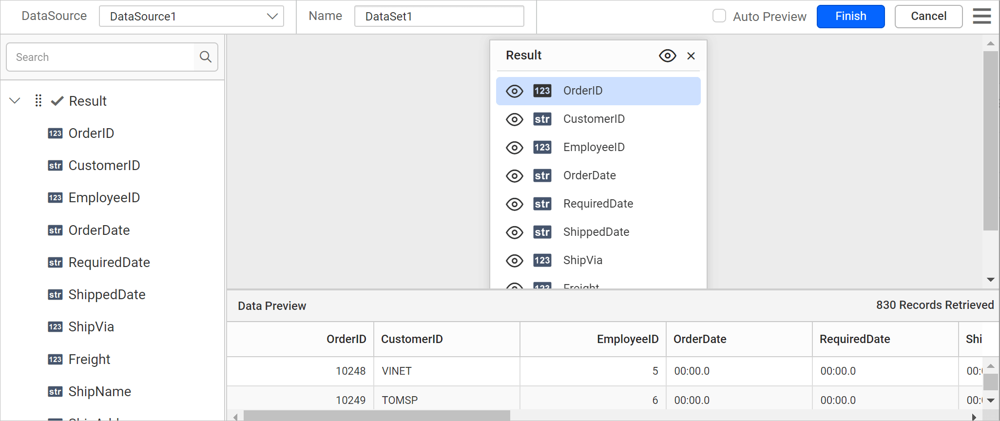

# Connect to CSV data source

To use CSV data in {{site.productNameTM}}, create a CSV data source that retrieves data from CSV and text files, or from an external URL.

## How do I create a CSV data source?

To create a CSV data source in the {{site.productNameTM}} Web Report Designer, open the **Data** configuration panel and choose the CSV connection type.

1. Click the **Data** icon in the configuration panel.
   
2. In the `DATA` configuration panel, click the `NEW DATA` button.
   
3. In the connection type panel, choose the `CSV` data source type.
   
4. Specify the data source name without special characters in the **Name** field.
   

You can connect CSV data using the following two options:

* **File Path** - Load from disk.
* **External** - Load from external URL.

### Load from disk

To load a CSV file from disk in the {{site.productNameTM}} Web Report Designer, upload the file and connect.

1. Choose the `File` option in the `Type` field. The upload option appears, as shown in the following image.
   
2. Click the three-dotted button to open the upload box. Browse the CSV file and click open.
   
3. If your data contains headers, enable the `Consider the first row as header` option to treat them as headers.
4. Use `Separator` based on the type of file uploaded. For the list of supported separators, see [CSV separators](./../../../manage-data/data-connectors/csv-data-source/#separator).
   
5. Click `Connect` to open the query design pane. The query design pane shows the specified CSV data's structure in the left pane.
   
6. Drag and drop the table from the left pane in the query design view page and execute.
   
7. Click `Finish` to save the data source with a relevant name and continue designing the report.
   

### Load from external URL

To load CSV data from an external URL in the {{site.productNameTM}} Web Report Designer, specify the URL and connect.

1. Choose the `External` option in the `Type` field.
   
2. Specify an external URL in the `External` text area.
   
3. If your data contains headers, enable the `Consider the first row as header` option to treat them as headers.
4. Use `Separator` based on the type of file uploaded. For the list of supported separators, see [CSV separators](./../../../manage-data/data-connectors/csv-data-source/#separator).
   
5. Click `Connect` to open the query design pane. The query design pane shows the specified CSV data's structure in the left pane.
   
6. Drag and drop the table from the left pane in the query design view page and execute.
   
7. Click `Finish` to save the data source with a relevant name and continue designing the report.
   

## Separator

The {{site.productNameTM}} CSV data source uses the `Separator` setting based on the type of file uploaded. Available options are listed under the separator drop-down.

To set a custom delimiter, choose the `Custom` option in the separator drop-down.

In the delimiter textbox, enter the required delimiter. The data is retrieved from the data source based on that delimiter.

## Frequently asked questions

### Where can I load CSV data from?

You can load CSV data from disk with the **File Path** option or from an external URL with the **External** option.

### Can I use a custom delimiter for CSV files?

Yes. Choose the `Custom` option in the separator drop-down and enter the required delimiter in the delimiter textbox.

## See also

* [Connect to Excel data source](./../../data-connectors/excel-data-source/)
* [Connect to JSON data source](./../../data-connectors/json-data-source/)
* [Connect to XML data source](./../../data-connectors/xml-data-source/)
