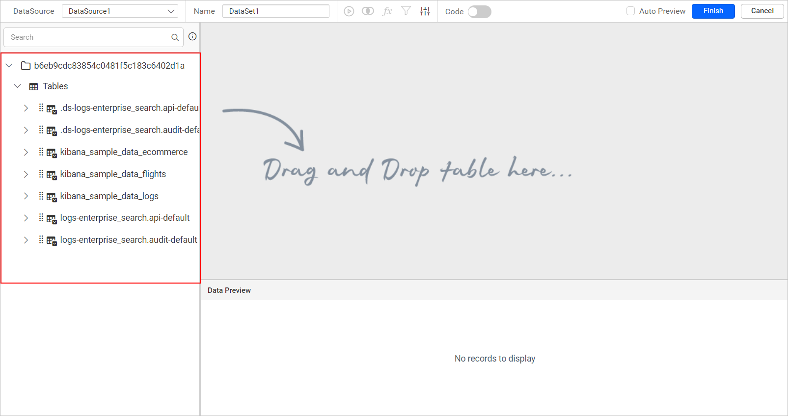
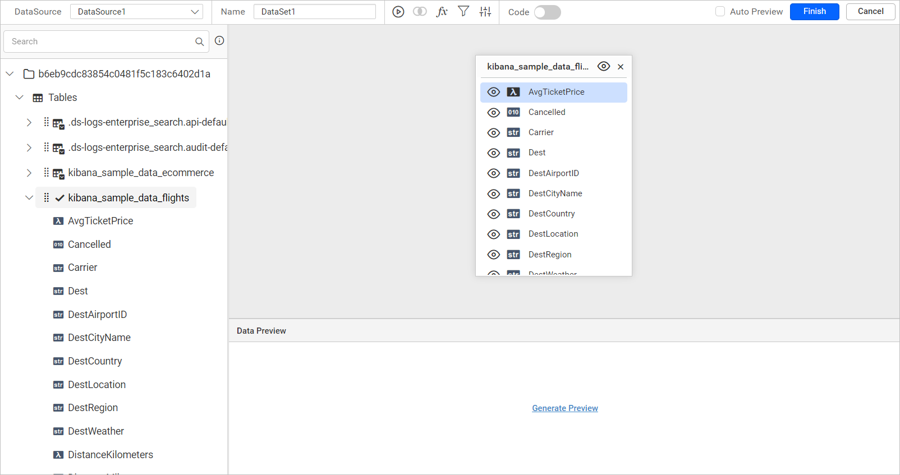
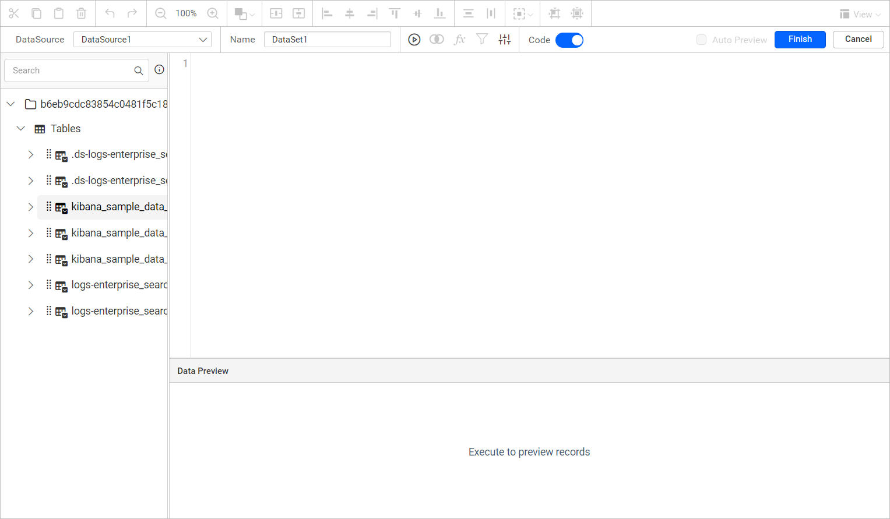
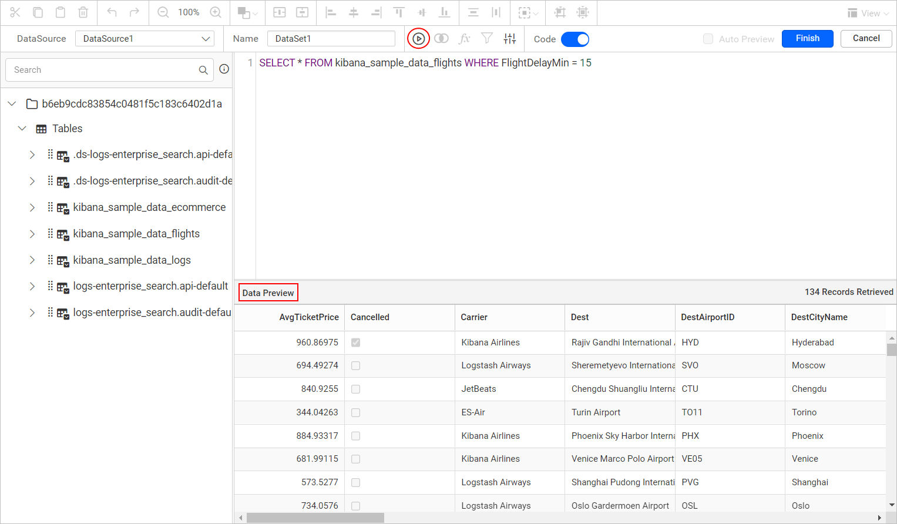
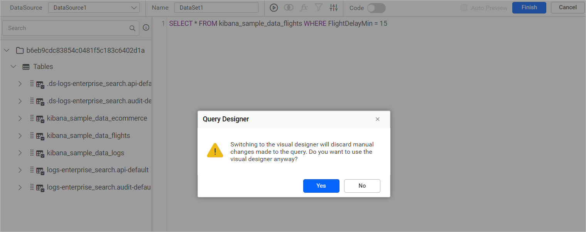
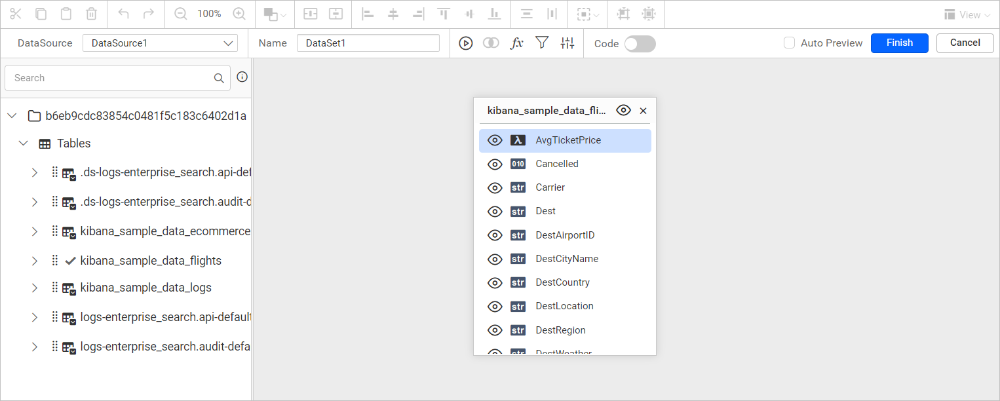
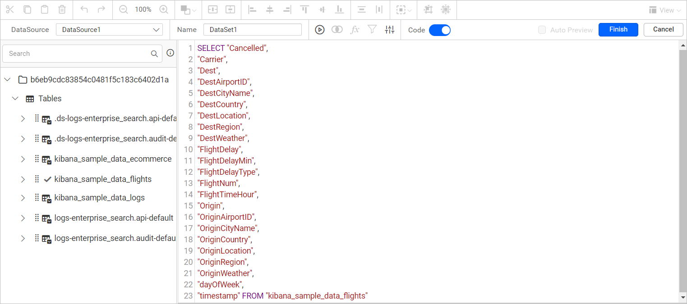

# Connect to Elastic Search data source

To connect Bold Reports® to Elastic Search, open the **Data** configuration panel in the Web Report Designer and create an Elastic Search data source. You can then add tables in design view or write a custom query.

## How do I create an Elastic Search data source?

To create an Elastic Search data source in the Bold Reports® Web Report Designer, open the **Data** configuration panel and choose the Elastic Search connection type.

1. Click the **Data** icon in the configuration panel.
   
2. In the `DATA` configuration panel, click the `NEW DATA` button.
   
3. In the connection type panel, choose the `Elastic Search` data source type.
   

### How do I configure the basic options?

When you create a new data source in the Web Report Designer, the `NEW DATASOURCE` panel shows the basic options.

1. Specify the data source name without special characters in the **Name** field.

2. Choose a connection type. Two Connection types are available in the Elastic Search connector:
   * Elasticsearch SQL
   * Open Distro

3. Enter a valid Elastic Search server or host name in the **Server Name** field.

4. Enter the **Port** in which the server is running in the port text box.

5. If the Elastic Search server uses **Elasticsearch SQL** as the Connection type, select an Authentication type from the available options. The configuration of the Elastic Search server determines the Authentication type.
   * None
   * Basic HTTP Authentication

6. If the Elastic Search server uses **Basic HTTP Authentication** as the Authentication type, enter a valid Elastic Search username in the **Username** text box and a valid Elastic Search password in the **Password** text box.
   

7. Select a database that you want to query in the listed database associated with the given Elastic Search server in the database combo-box.
   

After you connect the data source, the data design view page opens. The page lists the schemas and tables from the Elastic Search server in a `treeview` section.

Drag and drop the required table from the tree view list.

> Multiple joins are not supported for the Elastic Search data source in Bold Reports®.

Click `Finish` to save the data source with a relevant name and continue designing the report.

## How do I connect through a custom query?

The Bold Reports® Web Report Designer lets you define the data source of certain data connections with a manually written query instead of dragged tables. The custom query applies to connection types such as Elasticsearch SQL and Open Distro connections.

After the connect action, the query design view opens.

### How do I switch to code view?

The Bold Reports® query design view opens in design view by default. To switch to code view, enable the slider option in the tools pane, as highlighted in the following image.

The query editor pane then switches to code view, as shown in the following image.

### How do I write and execute a query?

In the Bold Reports® `Query Editor` pane, you can write your own query to access table schema information and retrieve data from your database.

1. Write your query in the `Query Editor` pane.
2. Click the `Execute` option in the tools pane. The data for your query appears at the bottom of the `Query Editor`.

If you disable the Code Slider in the tools pane to switch back to design view, an alert message asks you to confirm removing your query. Proceeding with this action resets the code view query.

Click `Yes` to discard the query and go to design view, or click `No` to keep it. Save the data source by clicking the `Finish` button.

### How do I view the query for tables added in design view?

The Bold Reports® `Query Editor` pane shows the query for a data source you already created in design view.

For example, drag the `kibana_sample_data_flights` table in design view.

Then, enable the `Code Switcher` to view the query. The query reflects the changes made in the table.

## Frequently asked questions

### Which connection types does the Elastic Search connector support?

The Elastic Search connector supports the Elasticsearch SQL and Open Distro connection types.

### Which authentication types are available for Elasticsearch SQL?

You can choose None or Basic HTTP Authentication, based on the configuration of the Elastic Search server.

### Does the Elastic Search data source support multiple joins?

No. Multiple joins are not supported for the Elastic Search data source in Bold Reports®.

## See also

* [Formatting Columns](./../../../transforming-data/formatting-columns/)
* [Query Filter](./../../../transforming-data/query-filter/)
* [Dataset Parameter](./../../../transforming-data/link-a-query-parameter-with-a-report-parameter/)
* [Query Parameter](./../../../transforming-data/define-query-parameters/)
* [Query Expression](./../../../transforming-data/configure-expression-columns/)
