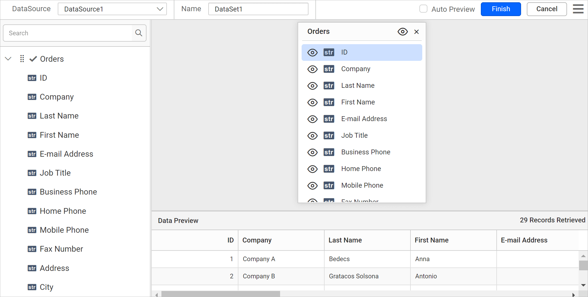

# Connect to Excel data source

To use spreadsheet data in {{site.productNameTM}}, create an Excel data source that retrieves data from an Excel file or an external URL. You can import entire worksheets or individual tables.

## What file requirements must my Excel workbook meet?

{{site.productNameTM}} requires Excel files that meet the following prerequisites:

1. {{site.productNameTM}} supports connecting Excel workbooks created with version 2007 and later with `.xlsx` and `.xls` file extensions.

2. The prepared workbook must be structured. Create it with unique column names, and keep the values in a row in the same data type as the corresponding columns.

3. {{site.productNameTM}} considers the first row values of your worksheet as column names by default. Provide unique and meaningful column names in your spreadsheet to make your data easy to identify.

4. You can upload a maximum file size of 20 MB.

## How do I create an Excel data source?

To create an Excel data source in the {{site.productNameTM}} Web Report Designer, open the **Data** configuration panel and choose the Excel connection type.

1. Click the **Data** icon in the configuration panel.
   
2. In the `DATA` configuration panel, click the `NEW DATA` button.
   
3. In the connection type panel, choose the `Excel` data source type.
   
4. Specify the data source name without special characters in the **Name** field.
   

You can connect Excel data using the following two options:

* **File Path** - Load from disk.
* **External** - Load from external URL.

### How do I load an Excel file from disk?

To load an Excel file from disk in the {{site.productNameTM}} Web Report Designer, upload the file, choose an extract type, and connect.

1. Choose the `File` option in the `Type` field. The upload option appears, as shown in the following image.
   
2. Click the three-dotted button to open the upload box. Browse the Excel file and click open.
   
3. Choose an `Extract Type`. To learn about each type, see [Importing data](./../../../manage-data/data-connectors/excel-data-source/#importing-data).
   
4. Click `Connect` to open the query design pane. The query design pane shows the worksheets/tables in a tree view on the left side pane.
   
5. Drag and drop the worksheet/table you want to analyze from the left pane in the query design view page and execute.
   
    > NOTE: The Excel data source does not allow multiple joins across sheets or tables.
6. Click `Finish` to save the data source with a relevant name and continue designing the report.
   

### How do I load Excel data from an external URL?

To load Excel data from an external URL in the {{site.productNameTM}} Web Report Designer, specify the URL, choose an extract type, and connect.

1. Choose the `External` option in the `Type` field.
   
2. Specify an external URL in the `External` text area.
   
3. Choose an `Extract Type`. To learn about each type, see [Importing data](./../../../manage-data/data-connectors/excel-data-source/#importing-data).
   
4. Click `Connect` to open the query design pane. The query design pane shows the worksheets/tables in a tree view on the left side pane.
   
5. Drag and drop the table from the left pane in the query design view page and execute.
   
6. Click `Finish` to save the data source with a relevant name and continue designing the report.
   

## Importing data

{{site.productNameTM}} imports Excel data as `Worksheets` and `Tables`.

* Worksheets: Choose `Worksheets` to fetch an entire worksheet of data along with tables.
* Table: Choose `Tables` to fetch tables from Excel worksheets.

> NOTE: The import type feature is only available for the version 2007 and later with .xlsx extension format.

### How do I import worksheets?

The {{site.productNameTM}} Excel data connector connects data from different worksheets. The following Excel file has two worksheets.

To connect an entire worksheet along with tables, choose `Worksheets` in Extract type.

Click `Connect`. The query designer shows the worksheets in a tree view on the left side pane.

### How do I import tables?

The {{site.productNameTM}} `Excel` data connector connects multiple tables across the worksheets. In the following workbook, the `Order Details` worksheet has two different tables.

To connect one or more tables from your worksheets, choose `Tables` in Extract type.

Click `Connect`. The query designer shows the tables in a tree view on the left side pane.

## What are the limitations of the Excel data source?

The {{site.productNameTM}} Excel data source has the following limitations:

1. You cannot connect an Excel file with formats other than the .xls and .xlsx extensions.
2. You cannot connect an empty worksheet.
3. Inserted images, charts, shapes, or non-data elements in the file are not shown.
4. You cannot connect a password protected worksheet.
5. You cannot execute an SQL query on Excel data within the code mode of the query design pane.

## Frequently asked questions

### What is the maximum Excel file size I can upload?

You can upload a maximum file size of 20 MB.

### Can I join multiple sheets or tables in an Excel data source?

No. The Excel data source does not allow multiple joins across sheets or tables.

### Can I connect a password protected worksheet?

No. You cannot connect a password protected worksheet.

## See also

* [Connect to CSV data source](./../../data-connectors/csv-data-source/)
* [Connect to JSON data source](./../../data-connectors/json-data-source/)
* [Connect to XML data source](./../../data-connectors/xml-data-source/)
