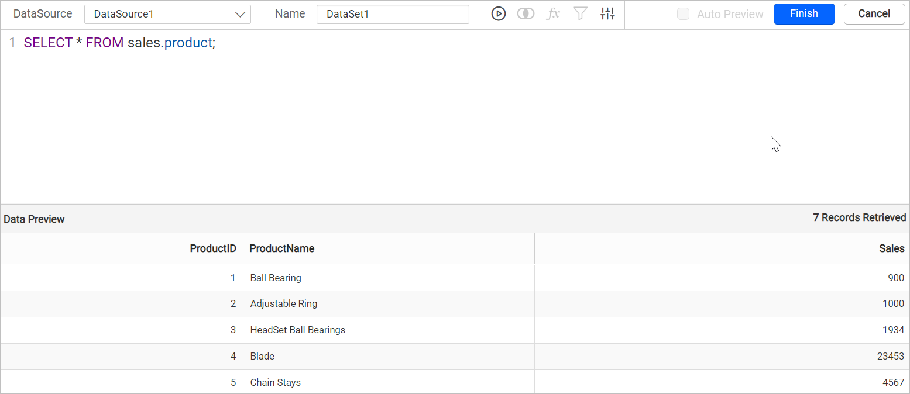

# Connect to Google Cloud SQL data source

To visualize and analyze Google Cloud SQL data in {{site.productNameTM}}, create a Google Cloud SQL data source from the **Data** configuration panel in the Web Report Designer. {{site.productNameTM}} supports the MySQL and PostgreSQL database engines for Google Cloud SQL.

## How do I create a Google Cloud SQL data source?

To create a Google Cloud SQL data source in the {{site.productNameTM}} Web Report Designer, open the **Data** configuration panel and choose the Google Cloud SQL connection type.

1. Click the **Data** icon in the configuration panel.
   
2. In the `DATA` configuration panel, click the `NEW DATA` button.
   
3. In the connection type panel, choose the `Google Cloud SQL` data source type.
   

### How do I configure the basic options?

When you create a new data source in the Web Report Designer, the `NEW DATASOURCE` panel shows the basic options.

1. Specify the data source name without special characters in the **Name** field.
2. Select a database engine you want to use with the given Google Cloud SQL Server from the Database Engine drop-down.
3. Enter a valid Google Cloud SQL server or host name in the **Server Name** field.
4. Enter a valid Google Cloud SQL username in the **UserName** text box.
5. Enter a valid Google Cloud SQL password in the **Password** text box.
6. Select a database that you want to query in the listed database associated with the given Google Cloud SQL server in the database drop-down.
   
7. Click `Connect` to open the query design pane.
8. Enter the required query and execute it. The corresponding values appear in a grid for preview.

   

9. Click `Finish` to save the data source with a relevant name and continue designing the report.

#### Google Cloud SQL supported database engine in {{site.productNameTM}}

{{site.productNameTM}} supports the following Google Cloud SQL database engines:

* MySQL
* PostgreSQL

The following image shows the **Database Engine** drop-down.

## Frequently asked questions

### Which database engines does Google Cloud SQL support in {{site.productNameTM}}?

{{site.productNameTM}} supports the MySQL and PostgreSQL database engines for Google Cloud SQL.

### How do I preview Google Cloud SQL data?

Click `Connect`, enter the required query, and execute it. The corresponding values appear in a grid for preview.

## See Also

* [Connect to MySQL data source](./../../data-connectors/mysql-data-source/)
* [Connect to PostgreSQL data source](./../../data-connectors/postgresql-data-source/)
* [Connect to Google BigQuery data source](./../../data-connectors/google-bigquery-data-source/)
