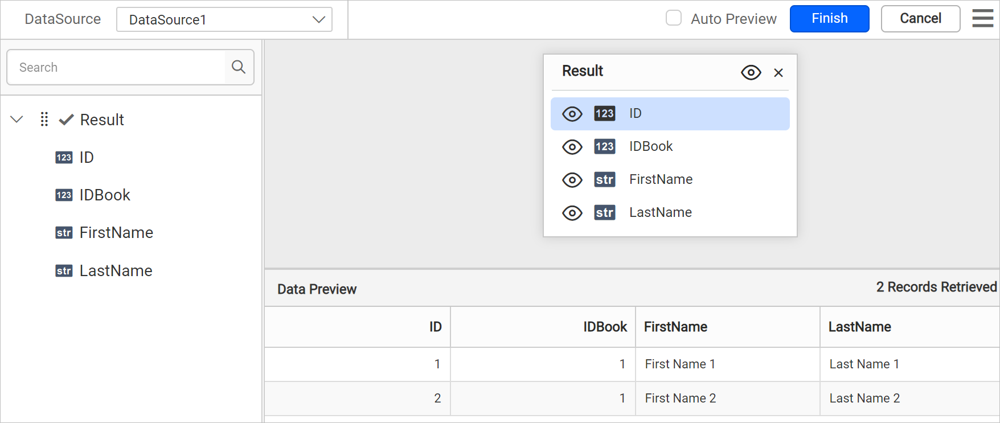
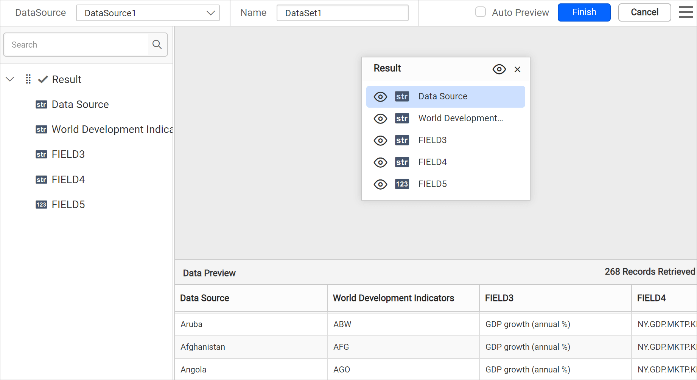
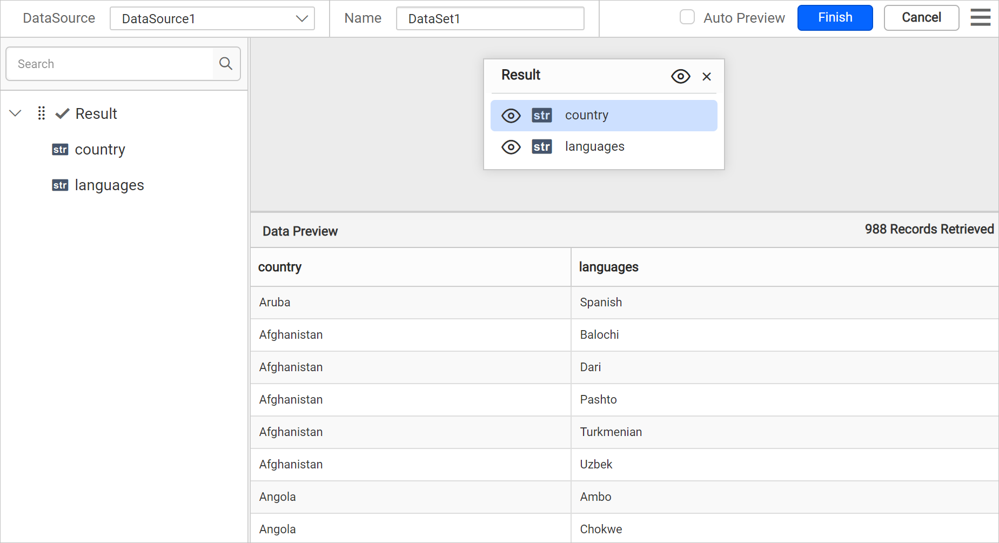

# Connect to JSON data source

To use JSON data in {{site.productNameTM}}, create a JSON data source that retrieves data from a JSON file, a string in JSON format, or an external URL.

## How do I create a JSON data source?

To create a JSON data source in the {{site.productNameTM}} Web Report Designer, open the **Data** configuration panel and choose the JSON connection type.

1. Click the **Data** icon in the configuration panel.
   
2. In the `DATA` configuration panel, click the `NEW DATA` button.
   
3. In the connection type panel, choose the `JSON` data source type.
   
4. Specify the data source name without special characters in the **Name** field.
   

You can connect JSON data using the following three options:

* **Inline** - Inline data.
* **File Path** - Load from disk.
* **External** - Load from external URL.


### Inline data

To use inline JSON data in the {{site.productNameTM}} Web Report Designer, paste a JSON string into the `Inline` text area.

1. Choose `Inline` in the `Type` drop-down.
2. Specify a string that contains JSON data in the `Inline` text area.

   ```json
   [
   {
      "ID": 1,
      "IDBook": 1,
      "FirstName": "First Name 1",
      "LastName": "Last Name 1"
   },
   {
      "ID": 2,
      "IDBook": 1,
      "FirstName": "First Name 2",
      "LastName": "Last Name 2"
   }
   ]

   ```

3. Click `Connect` to open the query design pane. The query design pane shows the specified JSON data's structure in the left pane.
   
4. Drag and drop the table from the left pane in the query design view page and execute.
   
5. Click `Finish` to save the data source with a relevant name and continue designing the report.
   

### Load from disk

To load a JSON file from disk in the {{site.productNameTM}} Web Report Designer, upload the file and connect.

1. Choose the `File` option in the `Type` field. The upload option appears, as shown in the following image.
   
2. Click the three-dotted button to open the upload box. Browse the JSON file and click open.
   
3. Click `Connect` to open the query design pane.
   
4. The query design pane shows the specified JSON data's structure in the left pane.
   
5. Drag and drop the table from the left pane in the query design view page and execute.
   
6. Click `Finish` to save the data source with a relevant name and continue designing the report.
   

### Load from external URL

To load JSON data from an external URL in the {{site.productNameTM}} Web Report Designer, specify the URL and connect.

1. Choose the `External` option in the `Type` field.
   
2. Specify an external URL in the `External` text area.
   
3. Click `Connect` to open the query design pane. The query design pane shows the specified JSON data's structure in the left pane.
4. Drag and drop the table from the left pane in the query design view page and execute.
   
5. Click `Finish` to save the data source with a relevant name and continue designing the report.
   

   > **Note:**
   > * In schema tree, the nested fields in the JSON data will be shown as flat structure.
   > * When the JSON data contains duplicate key names at different levels, {{site.productNameTM}} ensures uniqueness and avoids conflicts by appending the parent keys to each field name using the following format: `<fieldName>__<topLevelParentKey>_<nextParentKey>_..._<immediateParentKey>_`.

## Frequently asked questions

### How are nested JSON fields shown?

In the schema tree, the nested fields in the JSON data are shown as a flat structure.

### How does {{site.productNameTM}} handle duplicate JSON key names?

{{site.productNameTM}} appends the parent keys to each field name to ensure uniqueness, using the format `<fieldName>__<topLevelParentKey>_<nextParentKey>_..._<immediateParentKey>_`.

## See also

* [Formatting Columns](./../../../transforming-data/formatting-columns/)
* [Dataset Parameter](./../../../transforming-data/link-a-query-parameter-with-a-report-parameter/)
* [Connect to CSV data source](./../../data-connectors/csv-data-source/)
