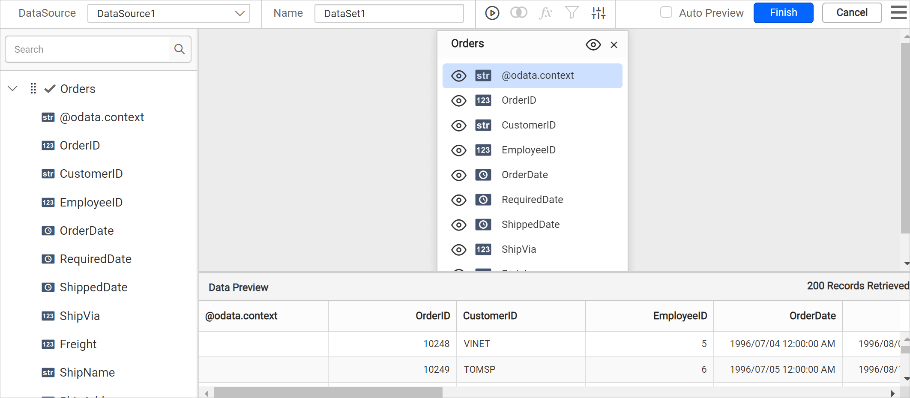
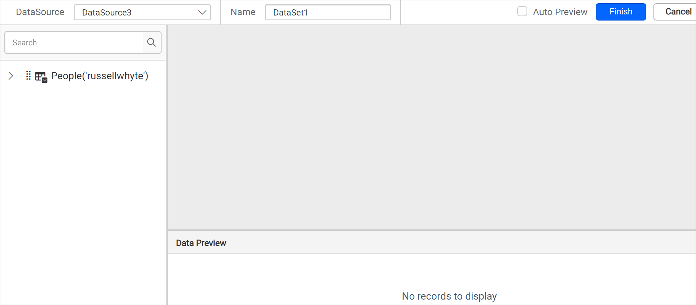

# Connect to OData data source

Bold Reports® supports connecting OData web services through REST API. You can set the method, headers, data format, and authentication, and pass dynamic values with expressions.

## How do I choose the OData data source?

To choose the OData data source in the Bold Reports® Web Report Designer, open the **Data** configuration panel and select the OData connection type.

1. Click the **Data** icon in the configuration panel.
   
2. In the `DATA` configuration panel, click the `NEW DATA` button.
   
3. In the connection type panel, choose the `OData` data source type.
   

## How do I create an OData data source?

After you click the data source, the Bold Reports® `NEW DATASOURCE` configuration panel opens. Follow these steps to create an OData data source:

1. Specify the data source name without special characters in the **Name** field.
   
2. Enter a valid OData REST API endpoint in the URL textbox. Refer to the [OData API documentation](https://www.odata.org/documentation/) for more details.

   Example: `https://services.odata.org/V4/Northwind/Northwind.svc/Orders`.
3. Choose a **Method** from the drop-down for the provided REST API. Options are *GET* and *POST*.
4. If the REST API requires it, provide key value pairs in **Headers**.
5. Choose a **Data Format** from the drop-down based on the response of your provided REST API. Options are JSON and XML.
6. Choose an **Authentication Type** supported by the data source. Options are `Basic http authentication` and `None`. Learn more about [Authentication Types](./../../../manage-data/data-connectors/odata-data-source/#authentication-types).

   If you choose the `GET` method type, the basic configuration looks similar to the following image.

   

   Based on the REST API service you use, pass the headers, parameters or raw data, data format, and authentication type.

7. Click `Connect` to open the query design pane. The left pane shows the key fields of JSON data retrieved from the OData Rest API request.
   

8. Drag and drop the table from the left pane in the query design view page and execute. The corresponding values appear in a grid for preview.
   

   > Note: In schema tree, the nested fields in the specified OData service will be shown as flat structure.

9. Click `Finish` to save the data source with a relevant name and continue designing the report.

## Which data formats can I use?

The Bold Reports® OData data source lets you choose the data format of the response for the provided Rest API in the Data format drop-down.

### CSV data format

When you select the CSV format in Bold Reports®, the `Separator` options appear, as shown in the following image. Choose the separator from the given options.

## Authentication types

The Bold Reports® OData data source supports two authentication types: **None** and **Basic HTTP Authentication**.

Use the **None** type in the following cases:

1. To connect OData services without any authentication, choose **None** under **Authentication Type**.
2. If your data source supports API Key/API Token authentication, pass these values under **Header(s)** by clicking **+Add**. Choose **None** under **Authentication Type**.

Use **Basic Http authentication** if your OData service requires a username and password to authenticate. Choose **Basic HTTP Authentication** under **Authentication Type** and input the username and password.

## How do I pass dynamic values?

Bold Reports® lets you pass dynamic values for the URL, headers, and parameters using [Expressions](./../../../compose-report/expressions/). To set an expression for a required field, click the square icon provided for that field. For example, follow these steps to set an expression for the URL field:

1. Click the square icon in the right corner of the URL field to open the expression menu.
   
2. Choose the `Expression` option from the menu.
   
3. The expression dialog opens.
   
4. Enter the required expression and click OK.
   
5. The square icon turns black and the URL field shows `<<Exp>>`.
   

To reset the expression, choose the `Reset` option from the menu. Specify other required connection settings and click `Connect`. When you click connect for the first time, you are prompted for an actual URL to load data in query design.

Enter a direct URL value instead of an expression and click `OK`.

The query design view opens.

Similarly, you can set and reset expressions for all the fields that support expressions.

## Which sample queries can I try?

You can try the following sample OData URLs with the Bold Reports® OData data source:

[https://services.odata.org/V4/Northwind/Northwind.svc/Order_Details](https://services.odata.org/V4/Northwind/Northwind.svc/Order_Details)

[https://services.odata.org/V4/Northwind/Northwind.svc/Customers](https://services.odata.org/V4/Northwind/Northwind.svc/Customers)

[https://services.odata.org/V4/Northwind/Northwind.svc/Regions](https://services.odata.org/V4/Northwind/Northwind.svc/Regions)

[https://services.odata.org/V4/Northwind/Northwind.svc/Orders](https://services.odata.org/V4/Northwind/Northwind.svc/Orders)

[https://services.odata.org/TripPinRESTierService](https://services.odata.org/TripPinRESTierService)

## Configure Timeout setting

Bold Reports® lets you configure the timeout setting for the OData data source. The timeout setting offers greater flexibility and ensures that long-running API requests can complete without interruption. For a step-by-step guide to configuring the timeout setting, check the **How To** section of this guide.

> Timeout setting is not applicable in the Bold Reports® cloud version.

## Frequently asked questions

### Which HTTP methods does the OData data source support?

The OData data source supports the *GET* and *POST* methods.

### How do I use an API key with an OData service?

Pass the API Key/API Token values under **Header(s)** by clicking **+Add**, and choose **None** under **Authentication Type**.

### Can I configure the OData timeout in the cloud version?

No. The timeout setting is not applicable in the Bold Reports® cloud version.

## See also

* [Formatting Columns](./../../../transforming-data/formatting-columns/)
* [Dataset Parameter](./../../../transforming-data/link-a-query-parameter-with-a-report-parameter/)
* [Connect to Web API data source](./../../data-connectors/rest-api-data-source/)
