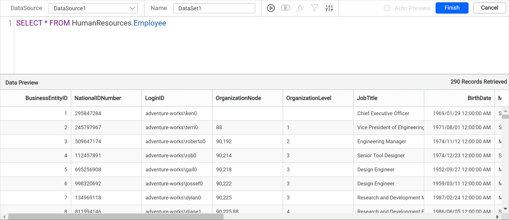

# Connect to ODBC data source

{{site.productNameTM}} lets you connect to a data source by using an ODBC Driver or DSN names. You enter a connection string and an authentication type, then query the data.

## How do I choose the ODBC data source?

To choose the ODBC data source in the {{site.productNameTM}} Web Report Designer, open the **Data** configuration panel and select the ODBC connection type.

1. Click the **Data** icon in the configuration panel.
   
2. In the `DATA` configuration panel, click the `NEW DATA` button.
   
3. In the connection type panel, choose the `ODBC` data source type.
   

## Connection properties

After you click the data source, the {{site.productNameTM}} `NEW DATASOURCE` configuration panel opens. Follow these steps to create an ODBC data source:

1. Specify the data source name without special characters in the **Name** field.
   

2. Enter a valid connection string and authentication type to connect with the specified data source.

### Connection string

A connection string is the text representation of connection properties for a data provider. {{site.productNameTM}} connects to the ODBC data source using either a system DSN name or a driver name.

To connect using System DSN, specify the connection string as in the following example:

```js
DSN=myDsn;Uid=myUsername;Pwd=;

```


To connect using the driver connection type, specify the connection string as in the following example:

```js
Driver=`{any odbc driver's name}`;OdbcKey1=someValue;OdbcKey2=someValue;

```


1. Click `Connect` to open the query design pane. Enter the required query and execute it. The corresponding values appear in a grid for preview.
   

   > Only query mode is supported for ODBC data source.

2. Click `Finish` to save the data source with a relevant name and continue designing the report.


### Authentication types

The {{site.productNameTM}} ODBC data source supports database credentials, prompted credentials, or no credentials.


**Authentication** - A user name and password must be supplied to access the database, the credentials might be for a database login. The credentials are passed to the data source for authentication.


Enable the Save password option to embed the credentials within the report when saving it in {{site.productNameTM}} Report Server.

> On report download action, the credentials will be not be saved with report data.

**Prompt** - When you configure a data source connection to use prompted credentials, each user who accesses the report must enter a user name and password on preview action to retrieve the data.


**None** - Choose the authentication type as `None` when the authentication details or any other arguments required to connect with the data source are provided in the connection string.

## Frequently asked questions

### Can I connect to ODBC with a DSN or a driver name?

Yes. You can connect to the ODBC data source using either a system DSN name or a driver name in the connection string.

### Does the ODBC data source support design view?

No. Only query mode is supported for the ODBC data source.

## See also

* [Connect to OLEDB data source](./../../data-connectors/oledb-data-source/)
* [Data connectors overview](./../../data-connectors/)
