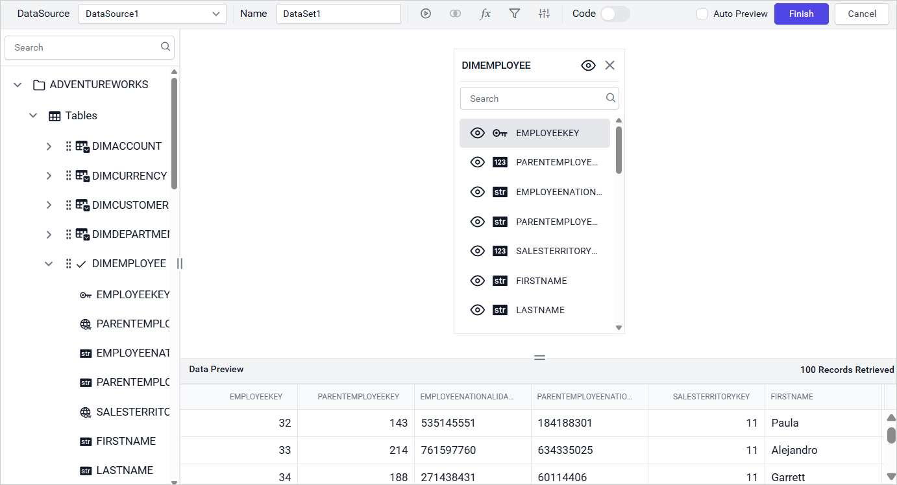

# Connect to Oracle data source

{{site.productNameTM}} supports these Oracle Database server versions: 12.2, 18c, 19c, 21c, and 23c.

Using the `Oracle` connection type in the {{site.productNameTM}} Web Report Designer, you can connect an Oracle database with basic options or a connection string.

## How do I choose the Oracle data source?

To choose the Oracle data source in the {{site.productNameTM}} Web Report Designer, open the **Data** configuration panel and select the Oracle connection type.

1. Click the **Data** icon in the configuration panel.
   
2. In the `DATA` configuration panel, click the `NEW DATA` button.
   
3. In the connection type panel, choose the `Oracle` data source type.
   

### How do I create an Oracle data source with basic options?

When you create a new data source in the Web Report Designer, the `NEW DATASOURCE` panel shows the basic options.

1. Specify the data source name without special characters in the **Name** field.
2. In the **Server Name** field, specify the remote server name, like `myserver.domain.com`.
3. In the **Service Instance Name** field (optional), specify the Oracle Service Identifier Name, like `ORA19`, `XE`.
   > The Service Instance Name field is marked optional to support flexibility across different Oracle environments. In local setups, it's not required due to SID-based connections. However, in Oracle Cloud, the Service Name is essential for routing the connection properly.
4. In the **Port** field, specify the Port number. The default port number is `1521`.
5. Specify the username of your Oracle server in the **Username** field.
6. Specify the password of your Oracle server in the **Password** field.
7. Enable the Save password option to embed the credentials within the report when saving it in {{site.productNameTM}} Report Server.
8. Choose or enter an existing valid database, e.g. ADVENTUREWORKS.
   
9. Click `Connect` to connect {{site.productNameTM}} with the Oracle database.
10. Drag and drop the table from the table schema in the query design view page.
    
11. Click `Finish` to save the data source with a relevant name and continue designing the report.
    

### How do I create an Oracle data source with advanced options?

The {{site.productNameTM}} advanced options let you build your own connection string for Oracle.

1. Click `Advanced Options` in the `New Data` panel.

   

2. The panel switches to Advanced Options. Enter a valid connection string, as shown below, and an authentication type to connect with the specified data source.

   ```js
   Data Source=(DESCRIPTION=(ADDRESS_LIST=(ADDRESS=(PROTOCOL=TCP)(HOST=MyHost)(PORT=MyPort)))(CONNECT_DATA=(SERVER=DEDICATED)(SERVICE_NAME=MyOracleSID)));
   ```

3. Set the connection string and input the username and password of the Oracle server.

   

4. Drag and drop the table from the table schema in the query design view page.

   

5. Click `Finish` to save the data source with a relevant name and continue designing the report.


> Click `Basic Options` to switch back to the basic connection settings.


#### Connection string

A connection string is the text representation of connection properties for a data provider. {{site.productNameTM}} uses it in the advanced options to connect to Oracle.

If the database is on your local computer, specify the connection string as follows:

```bash
Data Source=(DESCRIPTION=(ADDRESS_LIST=(ADDRESS=(PROTOCOL=TCP)(HOST=localhost)(PORT=1521)))(CONNECT_DATA=(SERVER=DEDICATED)(SERVICE_NAME=XE)))User ID=system;Password=1234
```

If the database is located in another server domain, specify the connection string as follows:

```bash
Data Source=(DESCRIPTION=(ADDRESS_LIST=(ADDRESS=(PROTOCOL=TCP)(HOST=myserver.domain.com)(PORT=1521)))(CONNECT_DATA=(SERVER=DEDICATED)(SERVICE_NAME=XE)))User ID=system;Password=1234
```

### Authentication types

The {{site.productNameTM}} Oracle data source supports Oracle database credentials, prompted credentials, or no credentials.


**Authentication** - A user name and password must be supplied to access the oracle database, the credentials might be for a database login. The credentials are passed to the data source for authentication.


Enable the Save password option to embed the credentials within the report when saving it in Report Server.

> On report download action, the credentials will be not be saved with report data.

**Prompt** - When you configure a data source connection to use prompted credentials, each user who accesses the report must enter a user name and password on preview action to retrieve the data.


**None** - Choose the authentication type as `None` when the authentication details or any other arguments required to connect with the data source are provided in the connection string.

## Frequently asked questions

### Which Oracle Database versions does {{site.productNameTM}} support?

{{site.productNameTM}} supports Oracle Database server versions 12.2, 18c, 19c, 21c, and 23c.

### What is the default Oracle port?

The default port number is `1521`.

### Is the Service Instance Name required?

The field is optional. In local setups it is not required due to SID-based connections, but in Oracle Cloud the Service Name is essential for routing the connection.

## See also

* [Connect to Amazon RDS data source](./../../data-connectors/amazon-rds-data-source/)
* [Connect to SQL Server data source](./../../data-connectors/sql-data-source/)
* [Data connectors overview](./../../data-connectors/)
