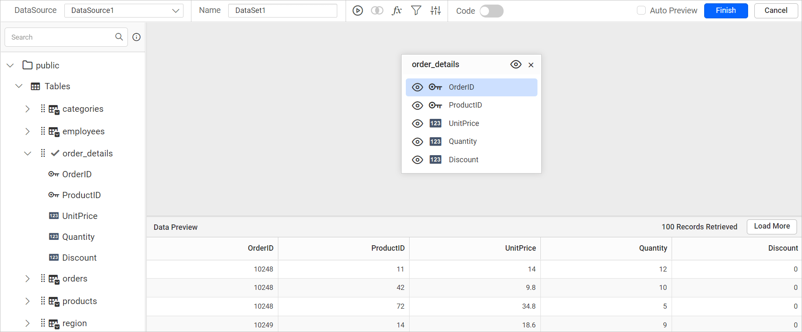

# Connect to PostgreSQL data source

To visualize and analyze PostgreSQL data in {{site.productNameTM}}, create a PostgreSQL data source from the **Data** configuration panel in the Web Report Designer. You can connect with basic options, advanced options, or through a secure SSH tunnel.

## How do I create a PostgreSQL data source?

To create a PostgreSQL data source in the {{site.productNameTM}} Web Report Designer, open the **Data** configuration panel and choose the PostgreSQL connection type.

1. Click the **Data** icon in the configuration panel.
   
2. In the `DATA` configuration panel, click the `NEW DATA` button.
   
3. In the connection type panel, choose the `PostgreSQL` data source type.
   

### How do I create a PostgreSQL data source with basic options?

When you create a new data source in the Web Report Designer, the `NEW DATASOURCE` panel shows the basic options.

1. Specify the data source name without special characters in the **Name** field.
2. In the **Server Name** field, specify the remote server name, like `myserver.domain.com`.
3. In the **Port** field, specify the Port number. The default port number is `5432`.
4. Specify the username of your PostgreSQL server in the **Username** field.
5. Specify the password of your PostgreSQL server in the **Password** field.
6. Enable the Save password option to embed the credentials within the report when saving it in {{site.productNameTM}} Report Server.
7. Choose or enter an existing valid database, e.g. Northwind.
   
8. Click `Connect` to connect {{site.productNameTM}} with the PostgreSQL database.
9. Drag and drop the table from the table schema in the query design view page.
   
10. Click `Finish` to save the data source with a relevant name and continue designing the report.
    

### How do I connect to PostgreSQL through an SSH tunnel?

{{site.productNameTM}} lets you connect to a PostgreSQL data source using a secure SSH tunnel. The SSH tunnel provides a more secure method for connecting, especially when you access remote databases over untrusted or insecure networks.


> Refer to [Configuring SSH tunnel for data connectors](./../../connection-settings/configuring-ssh-tunnel/) for more details.

### How do I create a PostgreSQL data source with advanced options?

The {{site.productNameTM}} advanced options let you build your own connection string for PostgreSQL.

1. Click `Advanced Options` in the `New Data` panel.

   

2. The panel switches to advanced options. Set the connection string and input the username and password of the PostgreSQL server.

   

3. Drag and drop the table from the table schema in the query design view page.

   

4. Click `Finish` to save the data source with a relevant name and continue designing the report.


> Click `Basic Options` to switch back to the basic connection settings.


#### Connection string

A connection string is the text representation of connection properties for a data provider. {{site.productNameTM}} uses it in the advanced options to connect to PostgreSQL.

If the database is on your local computer, specify the connection string as follows:

```bash
Host=localhost;Port=5432;Database=Northwind;User ID=postgres;Password=1234
```

If the database is located in another server domain, specify the connection string as follows:

```bash
Host=myserver.domain.com;Port=5432;Database=Northwind;User ID=postgres;Password=1234;
```

#### Authentication types for advanced connection

{{site.productNameTM}} advanced PostgreSQL connections support PostgreSQL server credentials, prompted credentials, or no credentials.


**PostgreSQL Server** - A user name and password must be supplied to access the PostgreSQL Server database, the credentials might be for a database login. The credentials are passed to the data source for authentication.


Enable the Save password option to embed the credentials within the report when saving it in Report Server.

> On report download action, the credentials will be not be saved with report data.

**Prompt** - When you configure a data source connection to use prompted credentials, each user who accesses the report must enter a user name and password on preview action to retrieve the data.


**None** - Choose the authentication type as `None` when the authentication details or any other arguments required to connect with the data source are provided in the connection string.

## Frequently asked questions

### What is the default PostgreSQL port?

The default port number is `5432`.

### Can I connect to PostgreSQL through an SSH tunnel?

Yes. {{site.productNameTM}} supports connecting to a PostgreSQL data source through a secure SSH tunnel.

## See also

* [Configuring SSH tunnel for data connectors](./../../connection-settings/configuring-ssh-tunnel/)
* [Connect to Amazon Aurora data source](./../../data-connectors/amazon-aurora-data-source/)
* [Connect to Google Cloud SQL data source](./../../data-connectors/google-cloud-sql-data-source/)
