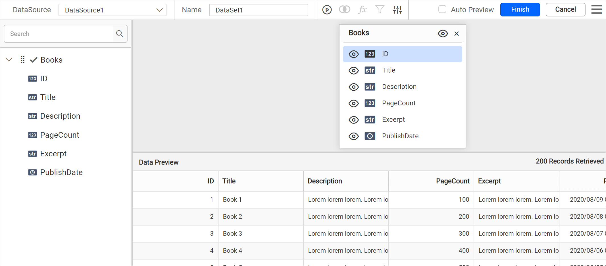
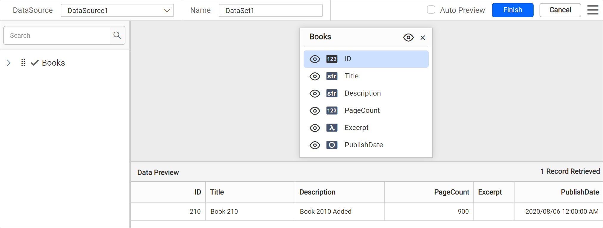
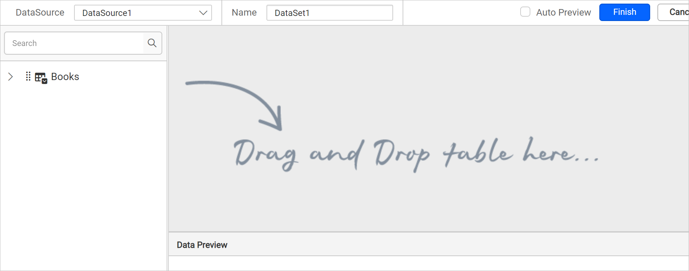
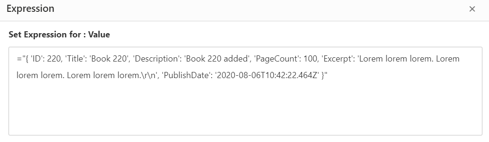
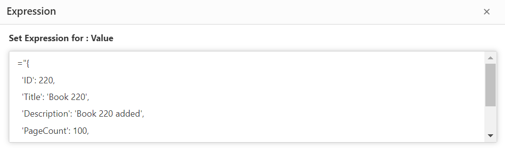
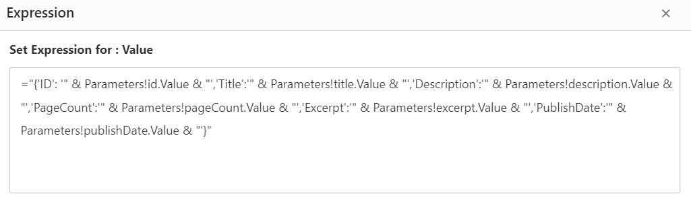

# Connect to Rest API data source

{{site.productNameTM}} supports connecting almost all web services that have a REST API interface. You can use GET or POST actions and pass dynamic values for the URL, headers, parameters, and raw data.

## How do I choose the web data source?

To choose the web data source in the {{site.productNameTM}} Web Report Designer, open the **Data** configuration panel and select the Web API connection type.

1. Click the **Data** icon in the configuration panel.
   
2. In the `DATA` configuration panel, click the `NEW DATA` button.
   
3. In the connection type panel, choose the `Web API` data source type.
   
4. After you click the data source, the `NEW DATASOURCE` configuration panel opens. Specify the data source name without special characters in the **Name** field.
   

## How do I connect with a GET action?

To connect the {{site.productNameTM}} web data source with a GET action, enter the endpoint and choose *GET* as the method.

1. Enter a valid REST API endpoint in the URL text box to perform GET action.
2. Choose *GET* in the **Method** drop-down.
3. Choose a **Data Format** from the drop-down based on the response of your provided REST API. Options are JSON, XML, and CSV.
4. Choose an **Authentication Type** supported by the data source. Options are `Basic http authentication` and `None`. Learn more about [Authentication Types](./../../../manage-data/data-connectors/rest-api-data-source/#authentication-types).

The basic connection details look similar to the following image.


If the REST API requires it, provide key value pairs in **Headers**.


Click `Connect` to open the query design pane. The query design pane shows a list of schemas in the left pane.


Drag and drop the table from the left pane in the query design view page and execute. The corresponding values appear in a grid for preview.



> **Note:**
> * In schema tree, the nested fields in the specified REST API will be shown as flat structure.
> * When the JSON or XML data contains duplicate key names at different levels, {{site.productNameTM}} ensures uniqueness and avoids conflicts by appending the parent keys to each field name using the following format: `<fieldName>__<topLevelParentKey>_<nextParentKey>_..._<immediateParentKey>_`.

Click `Finish` to save the data source with a relevant name and continue designing the report.


## How do I connect with a POST action?

To connect the {{site.productNameTM}} web data source with a POST action, enter the endpoint and choose *POST* as the method.

1. Enter a valid REST API endpoint in the URL text box to perform POST action.
2. Choose *POST* in the **Method** drop-down.
3. Choose a **Data Format** from the drop-down based on the response of your provided REST API. Options are JSON and XML.
4. Choose an **Authentication Type** supported by the data source. Options are `Basic http authentication` and `None`. Learn more about [Authentication Types](./../../../manage-data/data-connectors/rest-api-data-source/#authentication-types).

The connection details look similar to the following image.


Click `Connect` to open the query design pane.

Drag and drop the table from the left pane in the query design view page and execute. The results for posted data appear in a grid for preview.



> **Note:**
> * In schema tree, the nested fields in the specified REST API will be shown as flat structure.
> * When the JSON or XML data contains duplicate key names at different levels, {{site.productNameTM}} ensures uniqueness and avoids conflicts by appending the parent keys to each field name using the following format: `<fieldName>__<topLevelParentKey>_<nextParentKey>_..._<immediateParentKey>_`.

Click `Finish` to save the data source with a relevant name and continue designing the report.


## How do I pass a dynamic value for the URL?

The {{site.productNameTM}} web data source lets you pass dynamic values for the URL with an expression. Follow these steps to set an expression for the URL field:

1. Click the square icon in the right corner of the URL field to open the expression menu.
   
2. Choose the `Expression` option from the menu.
   
3. The expression dialog opens.
   
4. Enter the required expression and click OK.
   
5. The square icon turns black and the URL field shows `<<Exp>>`.
   

To reset the expression, choose the `Reset` option from the menu. Specify other required connection settings and click `Connect`. When you click connect for the first time, you are prompted for an actual URL to load data in query design.


Enter a direct URL value instead of an expression and click `OK`.


The query design view opens.



## How do I pass headers?

The {{site.productNameTM}} web data source lets you pass the required headers for the REST API URL in the `Headers` property. To add headers, follow these steps:

1. Click `+ ADD` to add a new header.
   

2. Enter the valid key and its value required to connect with the REST API.


Similarly, you can add multiple headers and pass values for them.

### How do I pass dynamic values for headers?

During report processing, {{site.productNameTM}} lets you pass dynamic values for each key in headers using expressions. To set an expression for headers, follow these steps:

1. Click the square icon in the right corner of the *Value* field to open the expression menu.
   
2. Choose the `Expression` option from the menu.
   
3. The expression dialog opens.
   
4. Enter the required expression and click OK.
   
5. The square icon turns black and the value field shows `<<Exp>>`.
   

To reset the expression, choose the `Reset` option from the menu. Specify other required connection settings and click `Connect`. When you click connect for the first time, you are prompted for valid header values to load data in query design.


Enter valid header values instead of an expression and click `OK`.


{{site.productNameTM}} fetches field information from the specified REST API URL and opens the query design view.


## How do I pass parameters?

The {{site.productNameTM}} web data source shows the parameter option when you choose the *POST* method. To add a parameter, follow these steps:

1. Click `+ ADD` to add a new parameter.
   

2. Enter the property name and its value to post the data.


### How do I pass dynamic values for parameters?

During report processing, {{site.productNameTM}} lets you pass dynamic values for each parameter using expressions. To set an expression for a parameter value, follow these steps:

1. Click the square icon in the right corner of the *Value* field to open the expression menu.
   
2. Choose the `Expression` option from the menu.
   
3. The expression dialog opens.
   
4. Enter the required expression and click OK.
   
5. The square icon turns black and the value field shows `<<Exp>>`.
   

To reset the expression, choose the `Reset` option from the menu. Specify other required connection settings and click `Connect`. When you click connect for the first time, you are prompted for direct values to load data in query design.


Enter values instead of an expression and click `OK`.


{{site.productNameTM}} posts the information to the specified REST API URL and opens the query design view.


## How do I pass raw data?

The {{site.productNameTM}} web data source lets you post raw data with the **POST** method. To specify a raw value, follow these steps:

1. Choose the **POST** method and switch the `Raw` radio button. A text area with an option to set an expression appears.

   

2. Enter the direct value in the text area, for example:

```json
{
  "ID": 220,
  "Title": "Book 220",
  "Description": "Book 220 added",
  "PageCount": 100,
  "Excerpt": "Lorem lorem lorem. Lorem lorem lorem. Lorem lorem lorem.\r\n",
  "PublishDate": "2020-08-06T10:42:22.464Z"
}
```

### How do I pass dynamic values for raw data?

During report processing, {{site.productNameTM}} lets you pass raw data directly using expressions. To set an expression for a raw value, follow these steps:

1. Click the square icon in the right corner of the *Raw* field to open the expression menu.
   
2. Choose the `Expression` option from the menu. The expression dialog opens.
   
3. Enter the required expression and click OK.
   
4. The square icon turns black and the value field shows `<<Exp>>`.
   

To reset the expression, choose the `Reset` option from the menu. Specify other required connection settings and click `Connect`. When you click connect for the first time, you are prompted for raw data to load data in query design.


Enter valid data and click `OK`.


{{site.productNameTM}} posts the data to the specified REST API URL and opens the query design view.


### What syntax do I use for expressions in raw data?

{{site.productNameTM}} accepts the following syntaxes for expressions in raw data.

**Syntax 1**: When passing data as JSON object, it should be enclosed with in double quotes, the key/value strings should be enclosed within single quotes. Otherwise, it can follow any syntax which supports the Client-Server transaction.

   ```json
   = "{'ItemType':'Dataset','ReportReferences':['3fe0ea1c-b6a1-4b20-95dd-158edd24ae4b']}"
   ```

   

**Syntax 2**: To use the Parameters, Data fields, or Variables along with a Json object, follow this syntax.

   ```json
   ="{'ItemType':'Dataset','ReportReferences':['" & Parameters!ReportParameter1.Value & "']}"
   ```

   

> Double quotes identify whether the data is a whole string value.

## Expression Format

{{site.productNameTM}} requires expressions in a single line format, not in multiple lines. For example, when you provide a JSON object as input, format it as a single line rather than multiple lines, as shown below:

```html
="{ 'ID': 220, 'Title': 'Book 220', 'Description': 'Book 220 added', 'PageCount': 100, 'Excerpt': 'Lorem lorem lorem. Lorem lorem lorem. Lorem lorem lorem.\r\n', 'PublishDate': '2020-08-06T10:42:22.464Z' }"
```



**Incorrect format** :

```html
="{
  'ID': 220,
  'Title': 'Book 220',
  'Description': 'Book 220 added',
  'PageCount': 100,
  'Excerpt': 'Lorem lorem lorem. Lorem lorem lorem. Lorem lorem lorem.\r\n',
  'PublishDate': '2020-08-06T10:42:22.464Z'
}"
```



To use the Parameters with a Json object, follow this syntax:

```html
="{'ID': '" & Parameters!id.Value & "','Title':'" & Parameters!title.Value & "','Description':'" & Parameters!description.Value & "','PageCount':'" & Parameters!pageCount.Value & "','Excerpt':'" & Parameters!excerpt.Value & "','PublishDate':'" & Parameters!publishDate.Value & "'}"
```



## How do I use pagination?

Pagination allows a REST API to conserve resources, improve response times, and optimize the user experience. To get better response times for huge records in {{site.productNameTM}}, append pagination properties to the URL or specify them as `Headers`. For example, you can append the pagination parameter in the URL as follows:

```html
https://demo.net/rest/api/2/Books?id=1278&startAt=0&maxResults=33&fields=title,author,price
```

## Which data formats can I use?

The {{site.productNameTM}} web data source lets you choose the data format of the response for the provided Rest API in the Data format drop-down.


### CSV data format

When you select the CSV format in {{site.productNameTM}}, the `Separator` options appear, as shown in the following image. Choose the separator from the given options.


## Authentication types

The {{site.productNameTM}} web data source supports two authentication types: **None** and **Basic HTTP Authentication**.

Use the **None** type in the following cases:

1. If your data source supports authentication directly through REST API URL, choose **None** under **Authentication Type**.
2. If your data source supports API Key/API Token authentication, pass these values under **Header(s)** by clicking **+Add**. Choose **None** under **Authentication Type**.

Use **Basic Http authentication** if your data source requires a username and password to authenticate. Choose **Basic HTTP Authentication** under **Authentication Type** and input the username and password.

## Configure Timeout setting

{{site.productNameTM}} lets you configure the timeout setting for the REST API data source. The timeout setting offers greater flexibility and ensures that long-running API requests can complete without interruption. For a step-by-step guide to configuring the timeout setting, check the **How To** section of this guide.

> Timeout setting is not applicable in the {{site.productNameTM}} cloud version.

## Frequently asked questions

### Which data formats does the REST API data source support?

For the GET action, the data format options are JSON, XML, and CSV. For the POST action, the options are JSON and XML.

### How do I use an API key with a REST API?

Pass the API Key/API Token values under **Header(s)** by clicking **+Add**, and choose **None** under **Authentication Type**.

### Can I write an expression across multiple lines?

No. Expressions must be in a single line format, not in multiple lines.

## See also

* [Formatting Columns](./../../../transforming-data/formatting-columns/)
* [Dataset Parameter](./../../../transforming-data/link-a-query-parameter-with-a-report-parameter/)
* [Connect to OData data source](./../../data-connectors/odata-data-source/)
