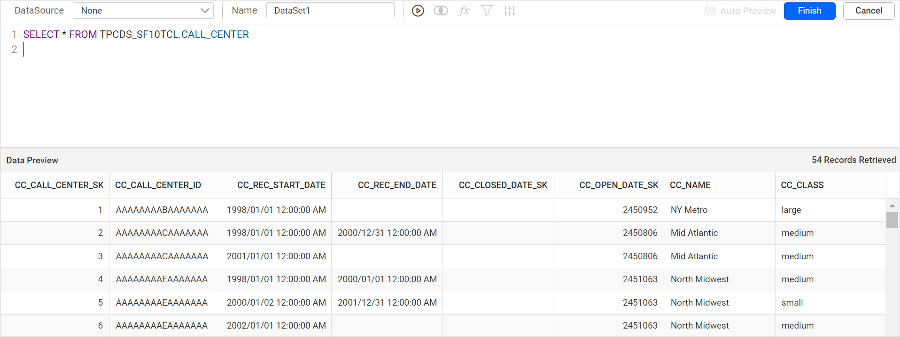

# Connect to Snowflake data source

The `Snowflake` connection type in the {{site.productNameTM}} Web Report Designer lets you connect to a Snowflake database and use its data in your reports.

## How do I choose the Snowflake data source?

You choose the Snowflake data source from the **Data** panel of the {{site.productNameTM}} Web Report Designer.

1. Click the **Data** icon in the configuration panel.
   
2. In the `DATA` configuration panel, click the `NEW DATA` button.
   
3. In the connection type panel, choose the `Snowflake` data source type.
   

## How do I set the connection properties?

After you click the data source, the Web Report Designer opens the `NEW DATASOURCE` configuration panel. Follow these steps to create a Snowflake data source:

1. Specify the data source name without special characters in the **Name** field.
   

2. Enter a valid connection string, as shown below, and the authentication type to connect with the data source.

   ```js
   scheme=https;port=MyPort;account=myAccount;host=MyHost;db=SNOWFLAKE_SAMPLE_DATA;user=myUsername;password=myPassword;warehouse=myWarehouse;
   ```

   

3. Click `Connect` to open the query design pane.
4. Enter the required query and execute it. The grid shows the corresponding values for preview.
   

   > Only query mode is supported for Snowflake data source.

5. Click `Finish` to save the data source with a relevant name and continue designing the report.
   

### Which authentication types can I use?

The Snowflake data source in {{site.productNameTM}} supports database credentials, prompted credentials, or no credentials.


**Authentication** - You must supply a user name and password to access the database. The credentials might be for a database login. The credentials are passed to the data source for authentication.


Enable the Save password option to embed the credentials within the report when saving it in {{site.productNameTM}} Report Server.

> On report download action, the credentials will be not be saved with report data.

**Prompt** - When you configure a data source connection to use prompted credentials, each user who accesses the report must enter a user name and password on preview to retrieve the data.


**None** - Choose the authentication type `None` when the connection string already provides the authentication details or any other arguments required to connect with the data source.

## Frequently asked questions

### Does the Snowflake data source support a query designer mode?

No. Only query mode is supported for the Snowflake data source in the {{site.productNameTM}} Web Report Designer.

### Are saved credentials included when I download a report?

No. On report download, the credentials are not saved with the report data.

## See also

* [Connect to an XML data source](./../xml-data-source/)
* [Connect to a Microsoft SQL Server data source](./../sql-data-source/)
* [Create an embedded data source](./../../datasource/create-an-embedded-data-source/)
