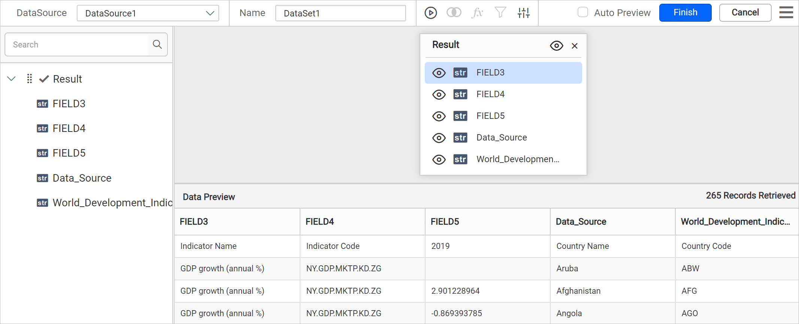
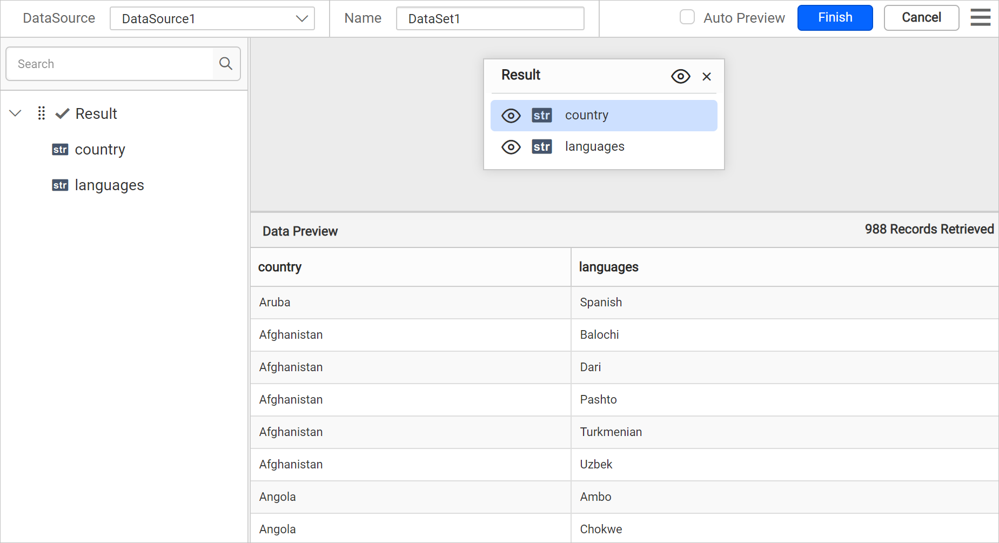

# Connect to XML data source

The XML data source in the Bold Reports<sup>®</sup> Web Report Designer retrieves data from an XML file, a string in XML format, or an external URL so you can use it in reports.

## How do I create an XML data source?

You create an XML data source from the **Data** panel of the Bold Reports<sup>®</sup> Web Report Designer. Follow these steps:

1. Click the **Data** icon in the configuration panel.
   
2. In the `DATA` configuration panel, click the `NEW DATA` button.
   
3. In the connection type panel, choose the `XML` data source type.
   
4. Specify the data source name without special characters in the **Name** field.
   

## Which XML source types can I use?

The Bold Reports<sup>®</sup> XML data source connects to XML data using the following three options:

* **Inline** - Inline data.
* **File Path** - Load from disk.
* **External** - Load from external URL.


### How do I use inline XML data?

You use inline XML data by pasting an XML string into the `Inline` text area of the XML data source.

1. Choose `Inline` in the `Type` drop-down.
2. Specify a string that contains XML data in the `Inline` text area.

   ```xml
   <?xml version="1.0" encoding="UTF-8"?>
   <root>
      <element>
         <FirstName>First Name 1</FirstName>
         <ID>1</ID>
         <IDBook>1</IDBook>
         <LastName>Last Name 1</LastName>
      </element>
      <element>
         <FirstName>First Name 2</FirstName>
         <ID>2</ID>
         <IDBook>1</IDBook>
         <LastName>Last Name 2</LastName>
      </element>
   </root>

   ```

3. Click `Connect` to open the query design pane. The left pane of the query design pane shows the structure of the XML data.
   
4. Drag the table from the left pane to the query design view and execute it.
   
5. Click `Finish` to save the data source with a relevant name and continue designing the report.
   

### How do I load XML data from disk?

You load XML data from disk by choosing the `File` type and uploading an XML file to the Web Report Designer.

1. Choose the `File` option in the `Type` field. The upload option appears, as shown below.
   
2. Click the three-dotted button to open the upload box. Browse to the XML file and click open.
   
3. Click `Connect` to open the query design pane.
   
4. Review the left pane of the query design pane, which shows the structure of the XML data.
   
5. Drag the table from the left pane to the query design view and execute it.
   
6. Click `Finish` to save the data source with a relevant name and continue designing the report.
   

### How do I load XML data from an external URL?

You load XML data from an external URL by choosing the `External` type and entering the URL in the XML data source.

1. Choose the `External` option in the `Type` field.
   
2. Specify an external URL in the `External` text area.
   
3. Click `Connect` to open the query design pane. The left pane of the query design pane shows the structure of the XML data.
4. Drag the table from the left pane to the query design view and execute it.
   
5. Click `Finish` to save the data source with a relevant name and continue designing the report.
   

> **Note:**
> * In schema tree, the nested fields in the XML data will be shown as flat structure.
> * When the XML data contains duplicate key names at different levels, Bold Reports<sup>®</sup> ensures uniqueness and avoids conflicts by appending the parent keys to each field name using the following format: `<fieldName>__<topLevelParentKey>_<nextParentKey>_..._<immediateParentKey>_`.

## Frequently asked questions

### How are nested XML fields shown in the schema tree?

The Bold Reports<sup>®</sup> Web Report Designer shows nested fields in the XML data as a flat structure in the schema tree.

### What happens when XML data has duplicate key names?

Bold Reports<sup>®</sup> appends the parent keys to each field name to keep names unique and avoid conflicts.

## See also

[Formatting Columns](./../../../transforming-data/formatting-columns/)

[Dataset Parameter](./../../../transforming-data/link-a-query-parameter-with-a-report-parameter/)

[Connect to a Snowflake data source](./../snowflake-data-source/)
