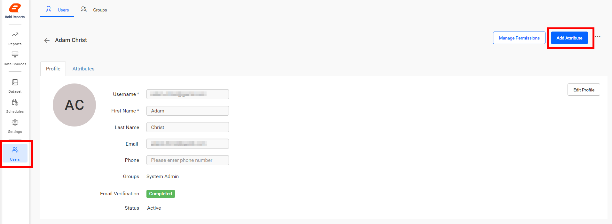
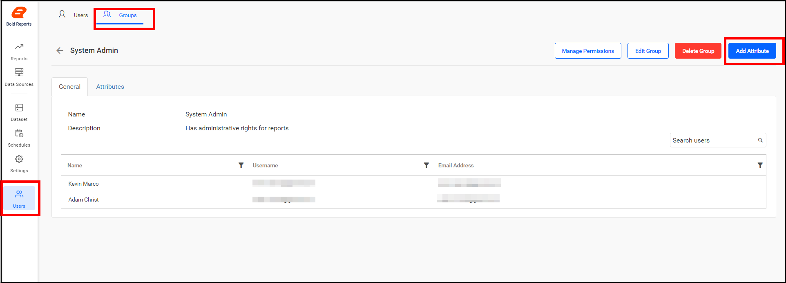
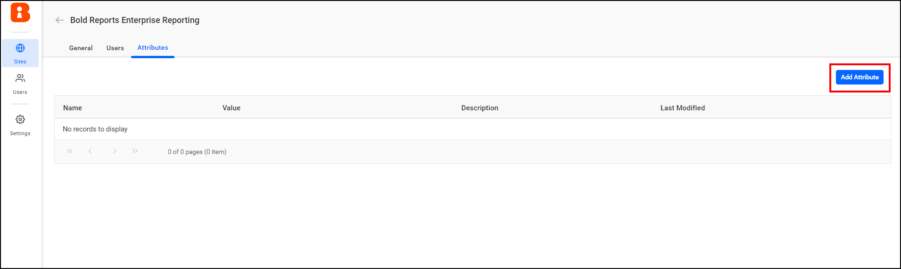
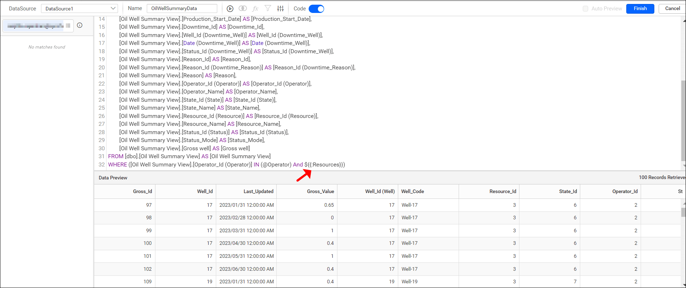
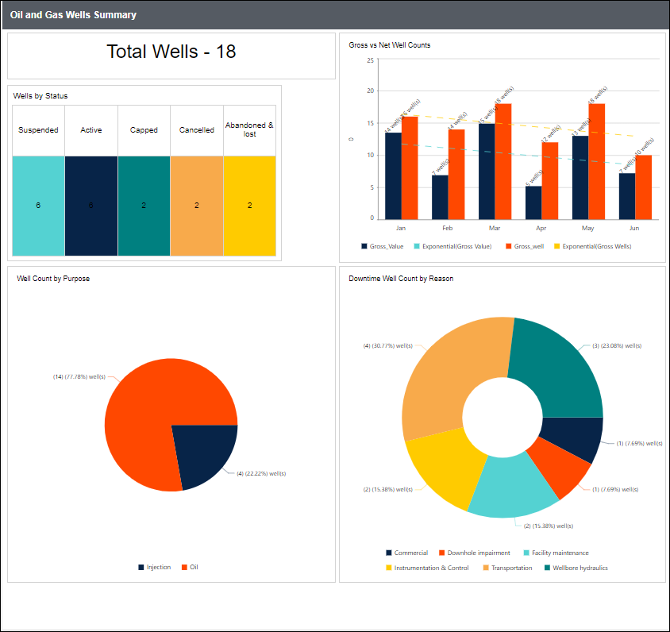
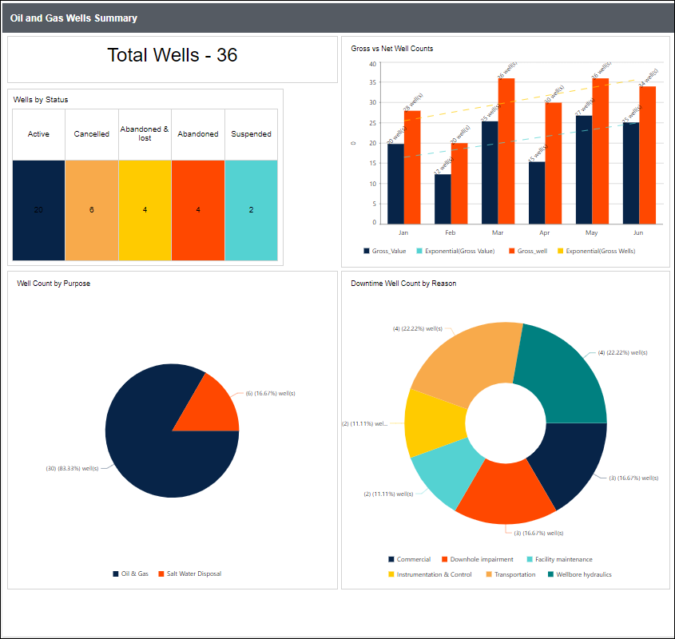

# Configuring Custom Attribute

A custom attribute in {{site.productNameTM}} Report Server is a piece of code that acts like a parameter and is replaced anywhere in the query, varied by the users. The attribute name is replaced by the code, which is saved for each user so that reports render based on it.

## What is the custom attribute hierarchy?

{{site.productNameTM}} Report Server defines custom attributes at three levels:

  1. User level

  2. Group level

  3. Site level

The user level attribute has higher priority than the other levels. The user level can override the group and site level attributes. The group level attribute can also override the site level attribute.

## How do I set a user level attribute?

A site admin sets the user level attribute for a user in the Report Server user management profile page. The user's attribute listing also shows the attributes inherited from the group and site levels.

## How do I set a group level attribute?

A site admin sets the group level attribute for a group in the Report Server group profile page. The group's attribute listing also shows the attributes inherited from the site level.

## How do I set a site level attribute?

The UMS admin sets the site level attribute for a site in the Report Server site details page.

## How do I add a custom attribute?

A custom attribute in Report Server is a name-value pair associated with users, groups, and sites. The custom attribute window has the following fields.

Name – Name of the attribute.

Value – Value of the attribute.

Description – Explaining the purpose for this attribute.

Encrypt – Store it as encrypted one in database and the value will be shown as dots in the grid.

## How do I apply a custom attribute for different users?

Each Report Server user can hold a different value for the same custom attribute name. For example, the user **Adam** has the custom attribute value **Resource_Name IN (‘Oil’,‘Injection’)** with the attribute name **Resources**.

The user **Christ** has the custom attribute value **Resource_Name IN (‘Oil & Gas’,‘Salt Water Disposal’)** with the attribute name **Resources**.

## Where can I use a custom attribute?

You can use a {{site.productNameTM}} custom attribute in the following areas:

  1. Custom Query.
  2. Web Connection window.

## 1. Custom Query

You use a custom attribute in a custom query by entering the custom attribute name in code view with the following syntax.

Syntax: `${{:AttributeName}}`.

In a simple report created for **Adam**, the data is retrieved based on the condition for the column `Resource_Name` given in the custom attribute **Resources**.

For **Christ**, the data is retrieved based on the condition for the column `Resource_Name` given in the custom attribute **Resources**.

## 2. Web Connection window

You can use a custom attribute in the following sections of the web connection window:

  1. URL.
  2. Header(s).
  3. Parameter(s).
  4. Raw.
  5. User Name.
  6. Password.

Use the following syntax for the custom attribute.

Syntax: `${{:AttributeName}}`.

In the simple report created here, data is retrieved based on the condition for the column `country`.

## Frequently asked questions

### Which custom attribute level has the highest priority?

The user level attribute has the highest priority in {{site.productNameTM}} Report Server. It can override the group and site level attributes.

### Can I hide a custom attribute value?

Yes. Select **Encrypt** to store the value encrypted in the database. The value is shown as dots in the grid.

## See also

* [Create an embedded dataset](./../create-an-embedded-dataset/)
* [Dataset parameters](./../dataset-parameters/)
* [Add a filter to a dataset](./../add-a-filter-to-a-dataset/)
