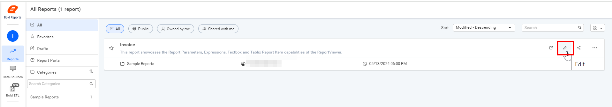
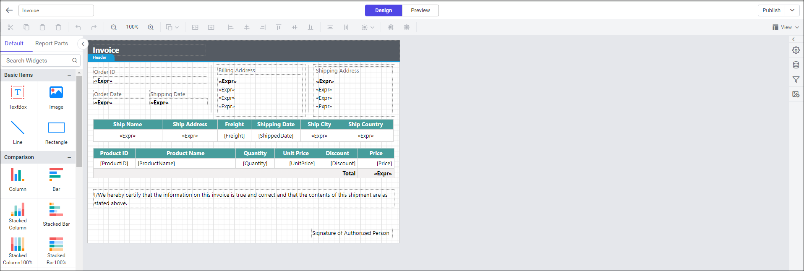
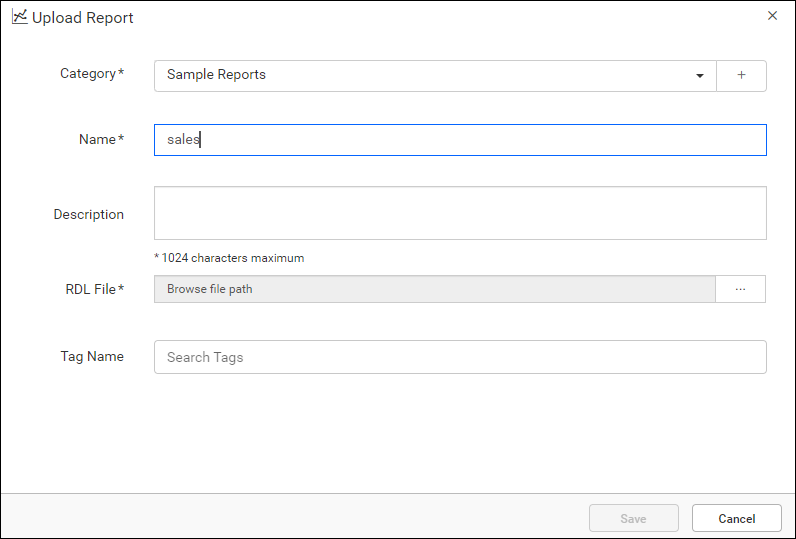
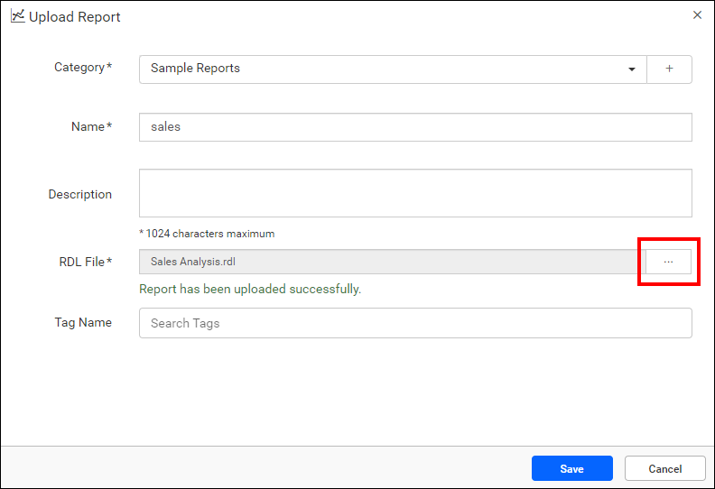
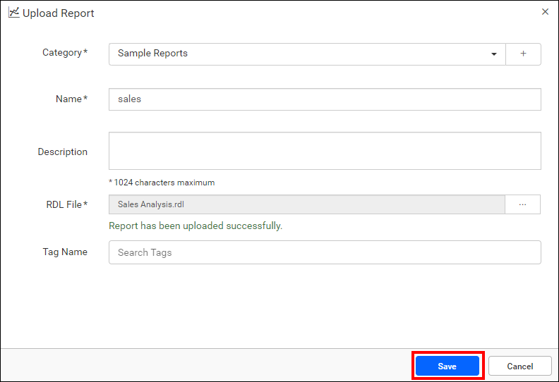

# Open a report in {{site.productNameTM}} Web Report Designer

You can open existing reports for editing in the Web Report Designer of {{site.productNameTM}} On-Premises Edition, or upload a local report first.

## Edit an existing report

You open an existing report in the {{site.productNameTM}} Web Report Designer by clicking the `Edit Icon` of the report.

The report opens in the Web Report Designer in a new tab.

## How do I upload a report from my computer?

To edit a report that is on your local machine, upload it to the {{site.productNameTM}} on-premise server first. Then, edit the report using the [edit option](./../open-report/#edit-an-existing-report).

1. Click the `[+]` icon in the left side panel, then select the `Upload Report` option.
    

2. Select a category for the report, and fill in the name and description fields.
    

3. Browse for the report RDL file.
    

4. Click `Save`.
    

## Frequently asked questions

### Where does the report open when I click Edit?

The report opens in the {{site.productNameTM}} Web Report Designer in a new tab.

### Can I edit a report file that is on my computer?

Yes. Upload the RDL file to the on-premise server first, then open it with the edit option.

## See also

* [Preview a report](./../preview-report/)
* [Publish a report](./../publish-report/)
* [Design an RDL report in the Web Report Designer](./../design-rdl-report-in-web-report-designer/)
