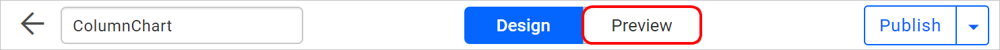
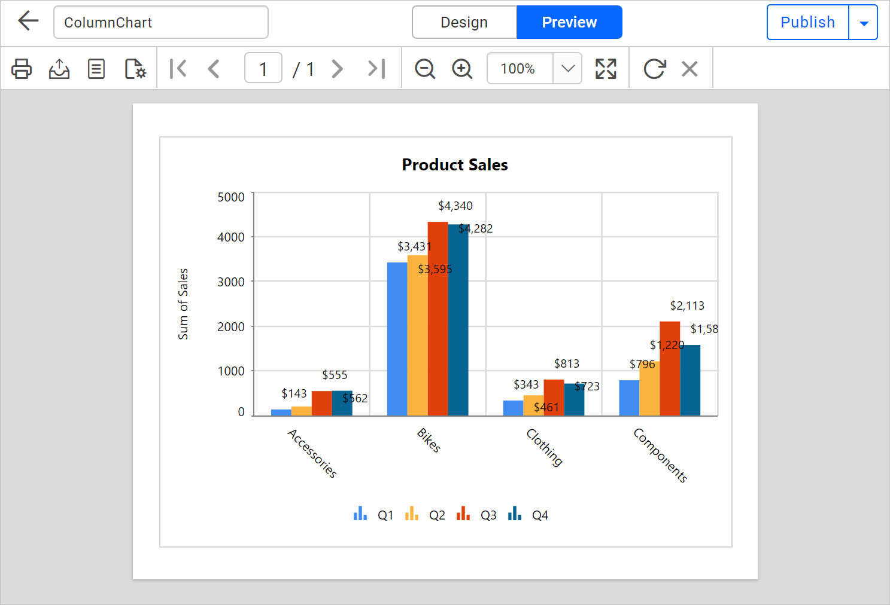

# Preview a Report

You preview a report in the {{site.productNameTM}} Web Report Designer by clicking the **Preview** button. The output appears in the built-in Report Viewer.

## How do I preview a report?

You preview a report from the header of the {{site.productNameTM}} Web Report Designer page with the following steps:

1. Click the **Preview** button in the header of the report designer page.
   

2. View the report, which is previewed using the inbuilt Report Viewer.
   

## Frequently asked questions

### Which viewer shows the report preview?

The {{site.productNameTM}} Web Report Designer previews the report using the inbuilt Report Viewer.

### Where is the Preview button?

The **Preview** button is in the header of the report designer page.

## See also

* [Publish a report](./../publish-report/)
* [Open a report](./../open-report/)
* [Design an RDL report in the Web Report Designer](./../design-rdl-report-in-web-report-designer/)
