# Publish a report from {{site.productNameTM}} Web Report Designer

You publish a report from the {{site.productNameTM}} Web Report Designer by clicking **Publish** and choosing a destination category on the on-premises Report Server.

## How do I publish a report to an on-premises enterprise server?

You publish a report to the {{site.productNameTM}} on-premises Report Server from the **Publish** dialog of the Web Report Designer.

1. Click the **Publish** button in the top-right corner of the Web Report Designer, or open the **Publish** dropdown and select **Publish As**.
   
2. In the Publish dialog, click the **Browse** icon in the File Location box to choose the destination category.
   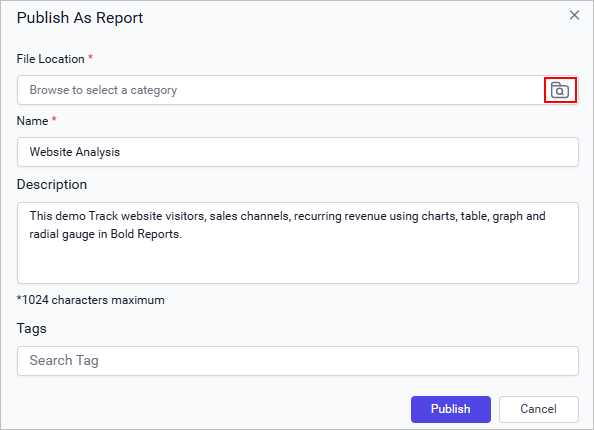
3. In the Browse dialog, select an existing [category](#publish-a-report-to-a-category) or [subcategory](#publish-a-report-to-a-subcategory) to organize the report.
   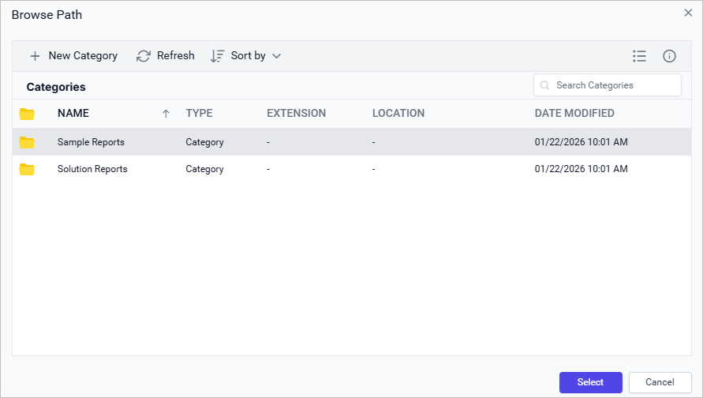
4. Optionally, publish the report to a [new category](#create-a-new-category) or [subcategory](#create-a-new-subcategory) from the Browse dialog.
   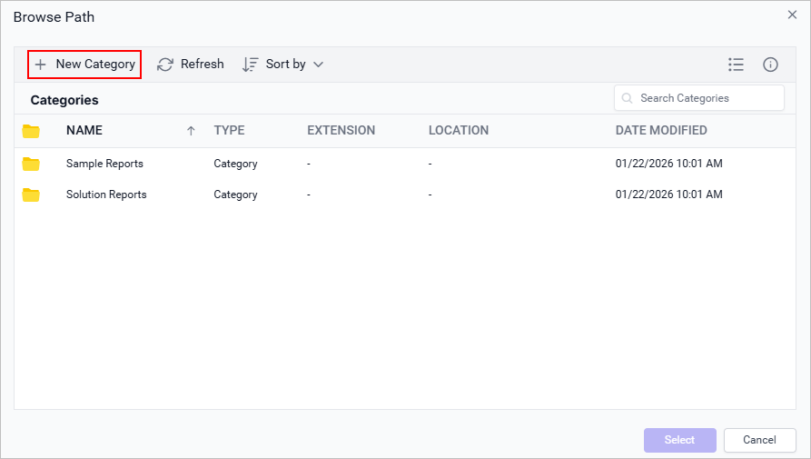

### Publish a report to a category

You publish a report to a Report Server category by selecting the category in the Browse dialog.

1. In the Browse dialog, **single-click** the category where you want to publish the report, and then click **Select**.
   
2. Check the File Location box in the Publish dialog, which shows the selected path.
   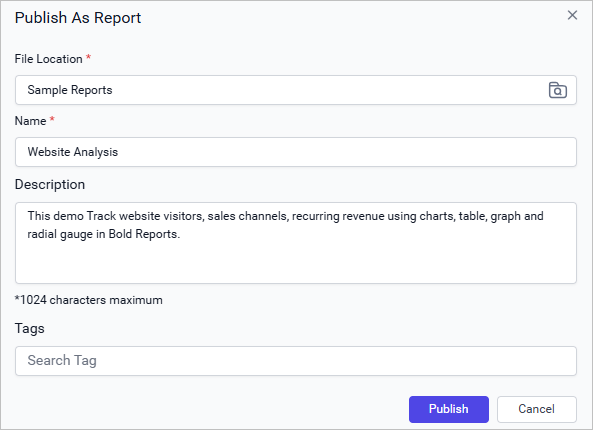
3. Click Publish to save the report to the selected category.

### Publish a report to a subcategory

You publish a report to a Report Server subcategory by expanding its parent category in the Browse dialog.

1. In the Browse dialog, **double-click** the parent category to expand it.
   
2. Review the subcategories of the selected category, which are now displayed.
   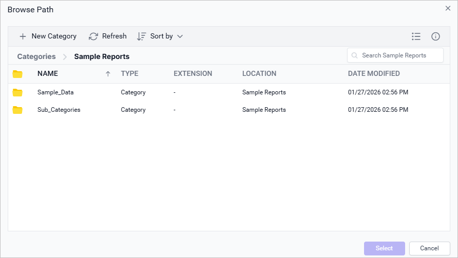
3. Choose the required subcategory and click **Select**.
   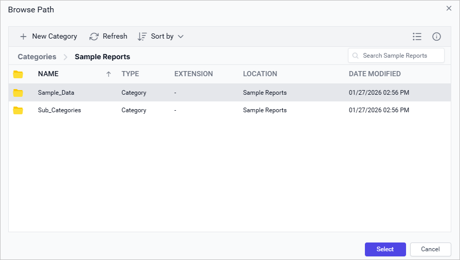
4. Check the Publish dialog, which shows the selected subcategory path.
   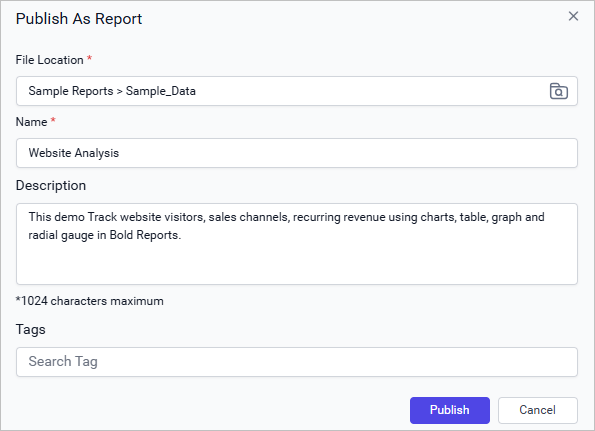
5. Click Publish to save the report to the selected subcategory.

### What happens if a report with the same name exists?

If a report with the same name already exists at the target location, the Web Report Designer shows a confirmation message asking whether to replace it.
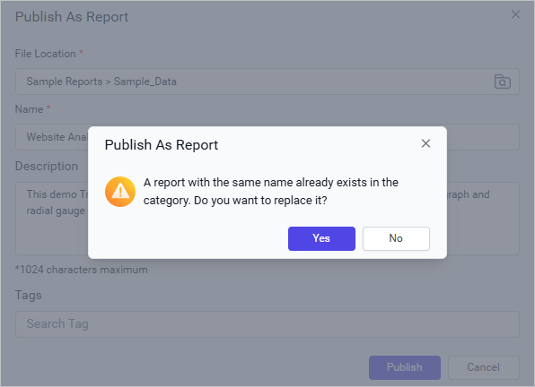

Click `Yes` to replace the existing report, or click `No` to change the report name in the **Name** field.

> If you are editing a report stored on the server, clicking `Publish` replaces the existing report.

## Create categories from the Publish dialog

The Browse dialog of the {{site.productNameTM}} Web Report Designer lets you create categories or subcategories directly while you publish a report.

### Create a new category

You create a new Report Server category with the **New Category** option in the Browse dialog.

1. In the Browse dialog, click **New Category** to open the New Category dialog.
   
2. Enter the required details and click **Save**.
   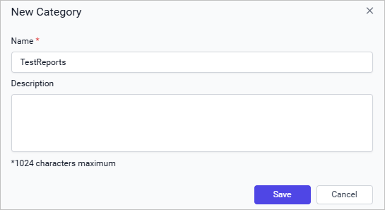
3. Check the Browse dialog. The category list refreshes and the new category appears.
   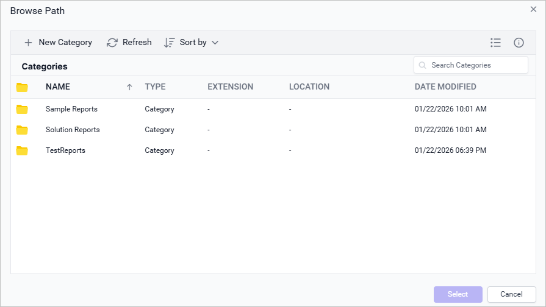

### Create a new subcategory

You create a new Report Server subcategory by expanding a parent category and using the **New Category** option.

1. In the Browse dialog, **double-click** the parent category to expand it.
   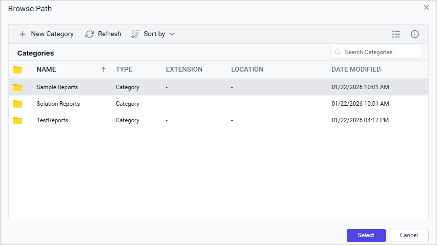
2. Click **New Category** to open the New Category dialog.
   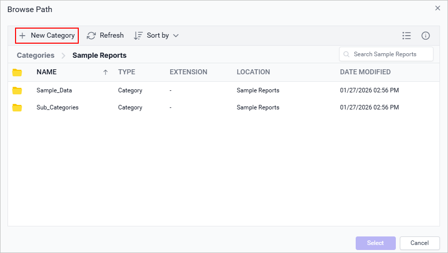
3. Enter the required details and click **Save**.
   
4. Check the Browse dialog. The subcategory list refreshes and the new subcategory appears.
   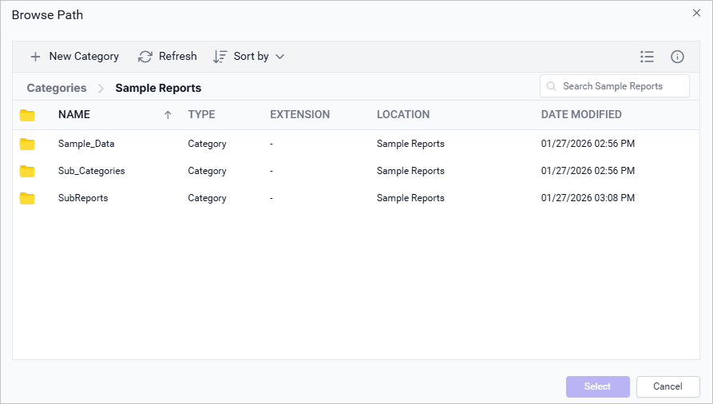

> {{site.productNameTM}} supports up to three levels of subcategories.

## How do I refresh the category list?

The Refresh button in the {{site.productNameTM}} Browse dialog reloads the category list from the server.
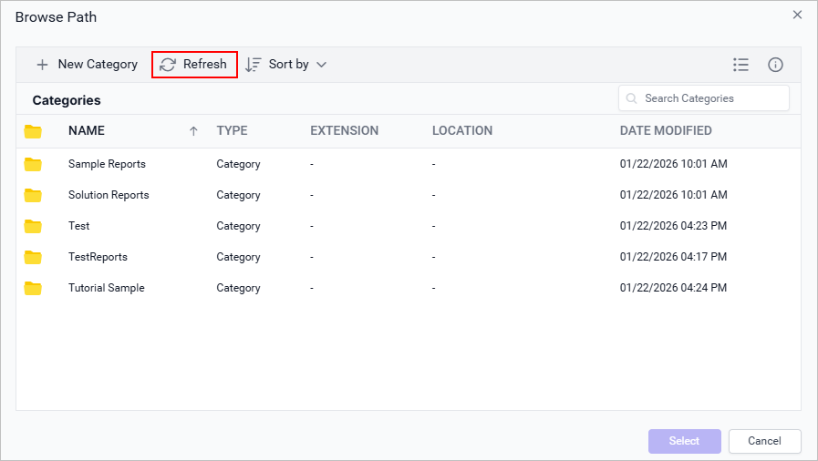

## How do I search for a category?

The Search box in the {{site.productNameTM}} Browse dialog finds a specific category when you type a keyword. The list is filtered instantly to help you locate the category.
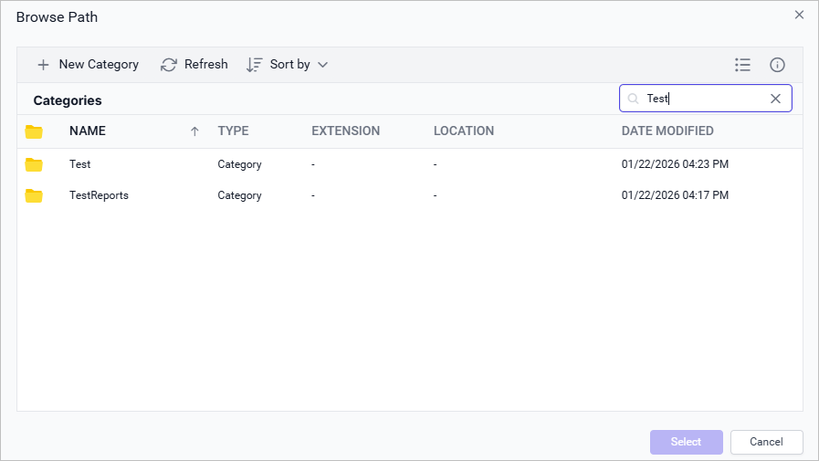

## How do I download the report?

You download a published report from the {{site.productNameTM}} on-premises server home page. Click `Actions` in the report's grid context menu and select `Download Report` to download the report in `.rdl` format.

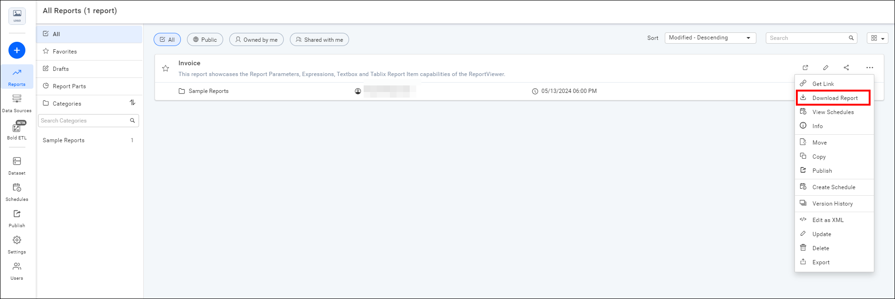

## Frequently asked questions

### How many subcategory levels can I create?

{{site.productNameTM}} supports up to three levels of subcategories.

### What happens when I publish a report I opened from the server?

If you are editing a report stored on the server, clicking `Publish` replaces the existing report.

## See also

* [Open a report](./../open-report/)
* [Preview a report](./../preview-report/)
* [Design an RDL report in the Web Report Designer](./../design-rdl-report-in-web-report-designer/)
