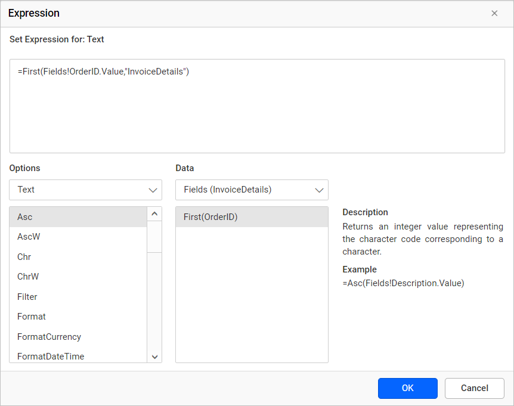
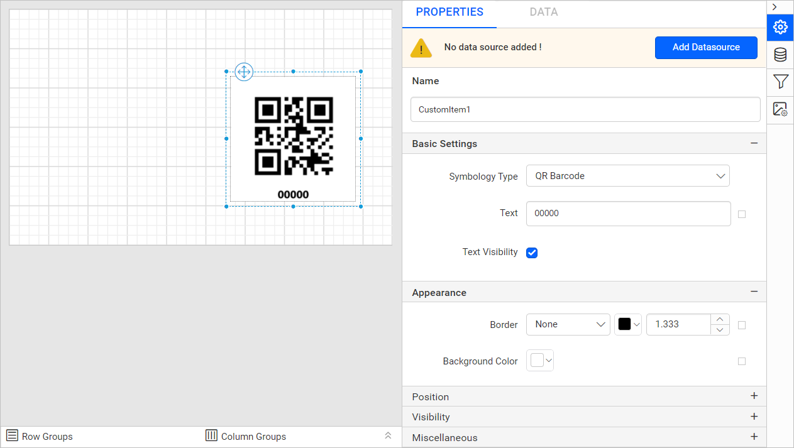

# Barcode report item in {{site.productNameTM}}

The barcode report item in the {{site.productNameTM}} Web Report Designer represents data in a visual, machine-readable form. You can build reports that display a barcode to make tasks like tracking shipping orders and employee identification numbers easier.

## What are one-dimensional barcodes?

One-dimensional barcodes in {{site.productNameTM}} represent data in the widths and spacings of printed parallel lines. That is why they are also called linear barcodes or symbolics. Linear barcodes are read in one direction (horizontally). Linear symbolics allow the coding of small amounts of information content (a maximum of 20-30 digits or symbols).

### How do I add a one-dimensional barcode to the report?

You add a one-dimensional barcode from the `Barcodes` category of the Web Report Designer item panel.

1. Find the one-dimensional barcode report item, which is listed in the item panel under the `Barcodes` category.
   
2. Drag the 1-D barcode report item from the item panel and drop it into the design area.
   
3. Review the properties panel. Once you drop the barcode item into the design area, its item properties are listed in the properties panel.
   

### Properties

The properties required to generate 1D barcodes in the Web Report Designer are listed under the `Basic Settings` category in the properties panel.

Symbology Type

The `Symbology Type` drop-down list provides the supported 1D barcode symbologies.

To change the type of an existing 1D barcode in the report, select the barcode item and choose the symbology type in the drop-down. The report design then renders the selected 1D barcode type.

Text

The `Text` property specifies the value to be encoded in the barcode.

Each barcode type requires a different type and length of input value for encoding, so provide valid values for the 1D barcode type. The [Supported Barcode Types](./../../report-items/barcode/supported-barcode-types/) section lists the supported barcode types and their valid input values.
If you provide invalid values, the barcode item displays an error message, as shown below.

You can also encode values in barcodes dynamically by using `Expressions`.

In the expression builder, create an expression using built-in functions or data fields and click `OK`.

The expression value is then encoded in the barcode at run time. Refer to the [Set Expression](./../../compose-report/properties-panel/#set-expression) and [Reset Expression](./../../compose-report/properties-panel/#reset-expression) sections to open the set or reset expression menu in the properties panel.

Text Visibility

The `Text Visibility` property shows or hides the label text of the barcode. The label shows the value of the barcode. The following images show the `Code39` barcode with and without label text.

Rotation

The `Rotation` property determines how a 1D barcode is displayed within the report. You can select the required orientation from the Rotation drop-down menu.

To update the orientation of a 1D barcode, select the barcode item in the Web Report Designer and choose a rotation value from the Rotation list. The barcode is displayed according to the selected orientation in both the design view and the generated report.

1. `None` - Displays the 1D barcode in its default orientation.
   
2. `90` - Displays the 1D barcode rotated 90 degrees clockwise.
   
3. `180` - Displays the 1D barcode rotated 180 degrees from its default orientation.
   
4. `270` - Displays the 1D barcode rotated 270 degrees clockwise.
   

## What are two-dimensional barcodes?

Two-dimensional (2D) barcodes in {{site.productNameTM}} code large amounts of information in a barcode, potentially up to several pages worth. Such a barcode consists of square cells, dots, hexagons, and other geometrical figures.

### How do I add a two-dimensional barcode to the report?

You add a two-dimensional barcode from the `Barcodes` category of the Web Report Designer item panel.

1. Find the two-dimensional barcode report item, which is listed in the item panel under the `Barcodes` category.
   
2. Drag the 2-D barcode report item from the item panel and drop it into the design area.
   
3. Review the properties panel. Once you drop the barcode item into the design area, its item properties are listed in the properties panel.
   

### Properties

The properties required to generate a 2D barcode item in the Web Report Designer are listed under the `Basic Settings` category in the properties panel.

Symbology Type

The `Symbology Type` drop-down list provides the supported 2D barcode symbologies.

To change the type of an existing 2D barcode in the report, select the barcode item and choose the symbology type in the drop-down. The report design then renders the selected 2D barcode type.

Text

The `Text` property specifies the value to be encoded in the 2D barcode.

You can also encode values in barcodes dynamically by using `Expressions`.

In the expression builder, create an expression using built-in functions or data fields and click `OK`.

The expression value is then encoded in the barcode at run time. Refer to the [Set Expression](./../../compose-report/properties-panel/#set-expression) and [Reset Expression](./../../compose-report/properties-panel/#reset-expression) sections to open the set or reset expression menu in the properties panel.

Text Visibility

The `Text Visibility` property shows or hides the label text of the barcode. The label shows the value of the barcode. The following images show the `QR` barcode with and without label text.

> Note: The `Text Visibility` property is only supported for QR Barcode.

The [Supported Barcode Types](./../../report-items/barcode/supported-barcode-types/) section lists the supported barcode types and their valid input values.

Correction Level

The `Correction Level` property determines the amount of error recovery applied to a 2D barcode. A higher correction level improves the barcode's ability to be decoded successfully even when parts of the symbol are missing, damaged, or difficult to scan. This property is supported for the `QR Barcode` and `PDF417` symbology types.

QR Barcode

The `QR Barcode` symbology type supports multiple correction level options that you can select from the Correction Level drop-down list.

* Low - The `Low` correction level provides a basic level of error correction while maximizing the amount of data that can be stored in the barcode.

* Medium - The `Medium` correction level provides a moderate level of error correction while maintaining a balance between data capacity and damage recovery.

* Quartile - The `Quartile` correction level provides a high level of error correction, allowing the barcode to remain readable even when a significant portion of it is damaged or obscured.

* High - The `High` correction level provides the highest level of error correction, allowing the barcode to remain readable even when a larger portion of it is damaged or obscured.

PDF417

The `PDF417` symbology type supports multiple correction level options that you can select from the `Correction Level` drop-down list. The available options include `Auto` and error correction levels ranging from `Level 0` to `Level 8`.

* Auto - The `Auto` option automatically selects an appropriate correction level based on the barcode content and the amount of data being encoded.

* Level's - The `Level 0` through `Level 8` options provide increasing levels of error correction for the PDF417 barcode. Higher levels improve the barcode's ability to remain readable when parts of the barcode are damaged, distorted, or obscured. As the correction level increases, the barcode can recover more data, but the generated barcode may become larger and more complex.

Rotation

The `Rotation` property specifies the angle at which the 2D barcode is displayed. The selected rotation setting is applied when rendering the barcode in the report. The `Rotation` drop-down list provides the supported rotation options.

To change the orientation of an existing 2D barcode, select the barcode item and choose the required rotation value from the Rotation drop-down list.

1. `None` - Displays the 2D barcode in its default orientation.
   
2. `90` - Displays the 2D barcode rotated 90 degrees clockwise.
   
3. `180` - Displays the 2D barcode rotated 180 degrees from its default orientation.
   
4. `270` - Displays the 2D barcode rotated 270 degrees clockwise.
   

## General properties

The general properties of the {{site.productNameTM}} barcode report item set its name, appearance, links, position, visibility, and other options in the properties panel.

### Name

The `Name` property provides a unique name for the barcode item in the report.

### Appearance

The border style, color, width, and background color properties style the barcode and customize its appearance in the report design. These properties are listed under the `Appearance` category in the properties panel.

### Link

The Linking property in {{site.productNameTM}} lets you create interactive and user-friendly reports by adding actions such as **Hyperlink** and **Report Linking**. Refer to the [Linking](./../../compose-report/link-data/) section to know more about linking.

### Border

The border properties add or customize the border around a barcode item to visually separate it in the report design. To set border properties for the barcode item using the properties panel, refer to the [Border Properties](./../../compose-report/common-properties/#border-properties) section.

### Background color

The background color property colors the barcode background. To set the background color using the properties panel, refer to the [Background color](./../../compose-report/common-properties/#background-color) section.

### Position

The Position property sets the width, height, left, and top position of the barcode in the report design. To handle these properties using the properties panel, refer to the [Position](./../../compose-report/common-properties/#position) section.

### Visibility

The Visibility property conditionally shows or hides the barcode report item on report preview or export. To set the visibility of the barcode item using the properties panel, refer to the [Visibility](./../../compose-report/common-properties/#visibility) section.

### Miscellaneous

The miscellaneous properties of the barcode report item include the tooltip, bookmark, and custom style.

#### Tooltip

The Tooltip property displays informative text or a value when the user hovers over the report item in report preview. To set a tooltip for the barcode item using the properties panel, refer to the [Tooltip](./../../compose-report/common-properties/#tooltip) section.

#### Bookmark

Bookmark links allow users to navigate to different parts of an SSRS report. You can add bookmarks to each textbox, image, table, or chart, or to the unique group values displayed in a tablix, to direct users to specified locations in the report. The value of the bookmark property can be your own string or an expression. Refer to the [Bookmark](./../../compose-report/bookmark/) section to configure bookmarks in the report design.

You can set static or dynamic text as the value for the bookmark property. To set and reset dynamic text, refer to the [Set Expression](./../../compose-report/properties-panel/#set-expression) and [Reset Expression](./../../compose-report/properties-panel/#reset-expression) sections.

#### Custom Style

The `Custom Style` property enables the use of external CSS for styling report items, providing more flexibility than the built-in styling options. Use this property to meet specific design requirements and maintain consistent styling across multiple reports. For a step-by-step guide on setting up custom styles in your report, check the **How To*** section of this guide.

## How do I set an expression?

You can set an expression for some properties of the barcode report item to process the property values based on expressions. To set expressions for the report item properties, refer to the [Set Expression](./../../compose-report/properties-panel/#set-expression) section.

## How do I reset an expression?

You reset an expression applied to a barcode report item property with the `Reset` option. Refer to the [Reset Expression](./../../compose-report/properties-panel/#reset-expression) section.

## What are advanced properties?

Advanced properties are nested properties that some report item properties contain in the {{site.productNameTM}} Web Report Designer. To open and handle nested properties, refer to the [Advanced Properties](./../../compose-report/properties-panel/#advanced-properties) section.

## Frequently asked questions

### How much data can a one-dimensional barcode hold?

Linear symbolics in {{site.productNameTM}} allow the coding of small amounts of information content, a maximum of 20-30 digits or symbols.

### Which 2D barcodes support the Correction Level property?

The `Correction Level` property is supported for the `QR Barcode` and `PDF417` symbology types.

### Which 2D barcode supports Text Visibility?

The `Text Visibility` property is only supported for QR Barcode among 2D barcodes.

## See also

* [Supported barcode types](./../../report-items/barcode/supported-barcode-types/)
* [Design an SSRS RDL report using barcode](./../../report-items/barcode/design-ssrs-rdl-report-using-barcode/)
