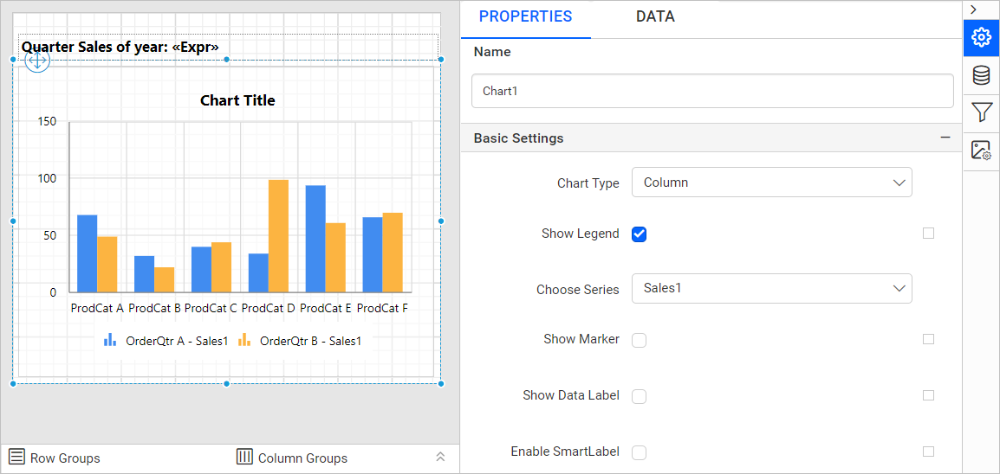

# Add filters to chart data region

Filters on a chart data region in the {{site.productNameTM}} Web Report Designer include or exclude specific values. Filters also provide a different view of the dataset in multiple data regions.

## In what order are filters processed?

{{site.productNameTM}} processes the filters applied in the report parts first on the dataset, then on the data region, and then on groups when it processes the report.

## Is there a video?

Yes. Prefer watching over reading? Check out this video on applying filters to a chart data region:

`youtube: https://www.youtube.com/watch?v=flTC8rMX-ec`

## How do I set a filter on a chart category group?

You set a filter on a chart category group from the `DATA` tab of the {{site.productNameTM}} Web Report Designer properties panel.

1. Select the chart data region in the design area.
   
2. Switch to the `DATA` tab.
   
3. In the `DATA` assign panel, under the column section, click the `Settings` icon.
   
4. Click the `Filters...` option in the menu. The filter dialog opens, as shown below.
   
5. Refer to the [Filter Data](./../../../compose-report/filter-data/) section, create the required filter expression in the filter dialog, and click `OK`.
   

In the above image, the filter equation filters the data in the data region based on the `Product Category` data field.

## What does the filtered chart look like?

On report preview, the {{site.productNameTM}} chart displays the sales of `Q1`, `Q2`, `Q3`, and `Q4` based on the applied filters and the `OrderYear` and `ProductCategory` report parameters.

## Can I filter a chart series group?

Yes. You can set filters on a `chart series group` in the same way as on a category group.

> Download the [chart filters report design](https://github.com/boldreports/resources/tree/master/docs/report-designer/chart/add-filters-to-chart-data-region.rdl)

## See also

* [Area chart](./../area-chart/)
* [Chart axis properties](./../axis/)
* [Add a filter to a dataset](./../../../manage-data/dataset/add-a-filter-to-a-dataset/)
