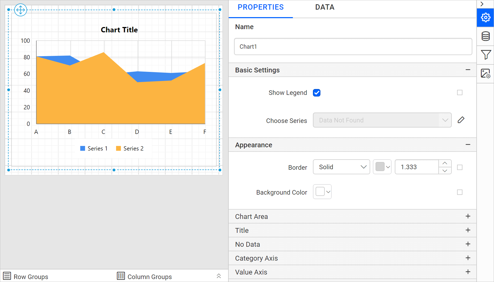
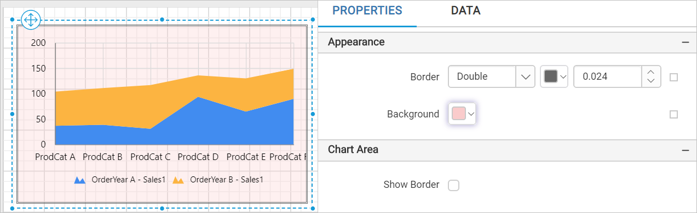
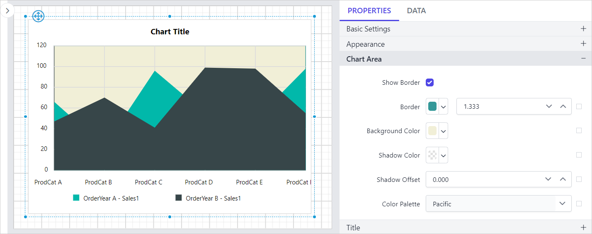

# Area Chart in Bold Reports<sup>®</sup> Web Report Designer

A stacked area chart in the Bold Reports<sup>®</sup> Web Report Designer compares multiple measures through filled curves stacked one after the other vertically.

## How do I add an area chart to the report?

Area charts in the Bold Reports<sup>®</sup> Web Report Designer are listed under the `Distribution` category in the item panel. Drag the area chart from the item panel and drop it into the design area.


The area chart is rendered in the design area, and the chart properties are listed in the properties panel.



> Here, `Stacked Area` chart is used for demonstration.

## How do I create the data?

The area chart in the Web Report Designer needs a dataset bound to the chart data region to present data. This example uses the following dataset query.

```sql
SELECT PC.Name AS ProdCat, PS.Name AS SubCat, DATEPART(yy, SOH.OrderDate) AS OrderYear, 'Q' + DATENAME(qq, SOH.OrderDate) AS OrderQtr,SUM(SOD.UnitPrice * SOD.OrderQty) AS Sales
FROM Production.ProductSubcategory PS INNER JOIN
Sales.SalesOrderHeader SOH INNER JOIN
Sales.SalesOrderDetail SOD ON SOH.SalesOrderID = SOD.SalesOrderID INNER JOIN
Production.Product P ON SOD.ProductID = P.ProductID ON PS.ProductSubcategoryID = P.ProductSubcategoryID INNER JOIN
Production.ProductCategory PC ON PS.ProductCategoryID = PC.ProductCategoryID
WHERE (SOH.OrderDate BETWEEN '1/1/2002' AND '12/31/2003')
GROUP BY DATEPART(yy, SOH.OrderDate), PC.Name, PS.Name, 'Q' + DATENAME(qq, SOH.OrderDate), PS.ProductSubcategoryID
```

> Refer to the [Create Data](./../../../manage-data/dataset/create-an-embedded-dataset/) section and create the dataset using the above query. This example uses the `AdventuresWorks` database.

## How do I assign data to the area chart?

A stacked area chart in Bold Reports<sup>®</sup> needs a minimum of 1 value element and 1 column element. Drop the measure or expression field that you want to analyze into the `Y Values` section. Drop the dimension that categorizes the measure into the `Columns` section. To categorize based on a series, also drop the respective dimension into the `Rows` section.

To configure data in the area chart, follow these steps:

1. Focus on the chart report item placed in the design area to bind data to it.
2. Click the `Properties` icon in the configuration panel to open the property pane. Switch to the `DATA` tab.
   
3. Choose a data in the drop-down list, which lists the available data in the report.
   
4. Review the fields. Numeric columns and numeric expressions are listed under the `Measures` section. Other types of columns and dimension expressions are listed under the `Dimensions` section.
   
5. **Drag and Drop Measure Element**:
   Drag the numeric column (measure element) or the numeric expression column from the `Measure` section and drop it in the `Y Values` section.
   
   The report item design then looks like the following image.
   
6. **Aggregate Options**:
   Click the `Settings` icon (highlighted below) to open the aggregation type drop-down list.
   
   Set the aggregation type that computes the selected column.
   
7. **Drag and Drop Dimension Element**:
   Drag the dimension element from the `Dimensions` section and drop it into the `Column` section to measure it against the selected numeric column(s) in the `Y Value(s)` section.
   
   The report item design then looks like the following image.
   
8. **Grouping**:
   Group the added column element with another column by adding the respective dimension element into the Row(s) section.
   
   The report item design then looks like the following image.
   

## How do I format the area chart?

You format the area chart in the Bold Reports<sup>®</sup> Web Report Designer with the settings in the `Properties` tab, so the view illustrates what you need.

To format the area chart, follow these steps:

1. Drag the area chart into the design area and resize it to the required size.
2. Configure the data for the area chart.
3. Focus on the area chart and click the `Properties` icon in the configuration panel to open the property pane.
   

The property pane lists the properties available for the report item with their default values.

### Name

The Name property provides a unique name for the chart item in the report.


### Basic Settings

The Basic Settings category of the area chart contains the Show Legend and Choose Series properties.


#### Show Legend

A legend is text that describes the plotted data. Use this property to toggle the visibility of the legend in the chart and customize the legend text appearance. To set or reset legend properties, refer to the [Show Legend](./../../../report-items/chart/legend/) property.

#### Choose Series

The `Choose Series` drop-down lists the series in the chart, and you can add multiple series. To customize a series appearance, choose the required series name in the drop-down.


Refer to the [Series](./../../../report-items/chart/series/) section to customize each series using the properties panel.

### Appearance

The border style, color, width, and background color properties style the chart and customize its appearance in the report design. These properties are listed under the `Appearance` category in the properties panel.




### Chart Area

The Chart Area properties, such as border width, color, shadow color, shadow offset, and background color, customize the area of the chart design.


These properties are listed under the `Chart Area` category.




Use the [Color Palette](./../../../report-items/chart/color-palette/) property to customize the color of the chart.

### Title

The chart title is customized by editing the `Title Text` property of the chart.

To show or hide the chart title, toggle the `Show Chart Title` checkbox.


These properties customize the font color, font text, font style, border, background, and position of the title in the chart design.

### No Data

The No Data property displays static text when the dataset returns empty or zero rows at run time.


To set or reset no data message properties, refer to the [No Data Message](./../../../report-items/chart/no-data-message/) property section.

### Category Axis

The category axis displays text labels instead of numbers. To use the categorical axis, toggle the `Enable Axis` checkbox under the `Category Axis` category in the chart properties.


To set or reset axis properties, refer to the [Axis Properties](./../../../report-items/chart/axis/) property.

### Value Axis

The value axis uses a numerical scale and displays numbers as labels. To use the value axis, toggle the `Enable Axis` checkbox under the `Value Axis` category in the chart properties.


To set or reset axis properties, refer to the [Axis Properties](./../../../report-items/chart/axis/) property.

### Grid line

The Grid line properties apply to the category and value axes of the area chart.


#### Category Axis

To show the grid line for the category axis, enable the `Category Axis` checkbox.


You can also enable the `Minor Grid Lines` and customize the major and minor gridline style and color in the `Advanced Options` menu.


#### Value Axis

To show the grid line for the value axis, enable the `Value Axis` checkbox.


You can also enable the `Minor Grid Lines` and customize the major and minor gridline style and color in the `Advanced Options` menu.


### Page break

The page break property controls the amount of information on each page when you preview the report. Follow these steps to apply the page break property to the chart report item.

1. Choose a `Break Location` type in the drop-down. The Break Location property specifies where the page break occurs.
   

2. To prevent predefined page breaks from being applied during report preview, enable the `Break Disabled` property checkbox. You can also control the application of page breaks during report preview by using expressions. For details on setting and resetting page breaks dynamically, refer to the [Set Expression](./../../../compose-report/properties-panel/#set-expression) and [Reset Expression](./../../../compose-report/properties-panel/#reset-expression) sections.

   

3. To restart page numbering on each page, enable the `Page Number Reset` property checkbox.
   

### Data Element

The Data element properties control the visibility of a report item when you export the report in XML format. They are listed in the properties panel under the `Data Element` category.


#### Name

The `Name` field assigns a custom name to the chart element. The chart report item is exported with the provided name.


> Note: The name cannot contain spaces, and it must begin with a letter followed by letters, numbers, or the underscore character (_).

#### Output

The `Output` property controls the visibility of the chart when you export the report. The options perform the following operations:

* **Auto** or **Output** - Exports the chart report item.
* **NoOutput** - Does not export the chart report item.


### Miscellaneous

The Miscellaneous category of the area chart contains the page name, document map, bookmark, custom attributes, tooltip, and custom style properties.

#### Page name

The page name property names the first worksheet of the Excel workbook when you export the report to Excel format.


 You can set static or dynamic text as the page name. To set and reset dynamic text, refer to the [Set Expression](./../../../compose-report/properties-panel/#set-expression) and [Reset Expression](./../../../compose-report/properties-panel/#reset-expression) sections.

#### Document Map

A document map is a navigational feature that displays a separate side pane with a set of navigational links in a hierarchical structure when you view a report. A user can click the content in the list to navigate to the report page that displays that item. Refer to the [Document Map](./../../../compose-report/document-map/) section to configure a document map in the report design.

You can set static or dynamic text as the value for the document map property. To set and reset dynamic text, refer to the [Set Expression](./../../../compose-report/properties-panel/#set-expression) and [Reset Expression](./../../../compose-report/properties-panel/#reset-expression) sections.

#### Bookmark

Bookmark links allow users to navigate to different parts of an SSRS report. You can add bookmarks to each textbox, image, table, or chart, or to the unique group values displayed in a tablix, to direct users to specified locations in the report. The value of the bookmark property can be your own string or an expression. Refer to the [Bookmark](./../../../compose-report/bookmark/) section to configure bookmarks in the report design.

You can set static or dynamic text as the value for the bookmark property. To set and reset dynamic text, refer to the [Set Expression](./../../../compose-report/properties-panel/#set-expression) and [Reset Expression](./../../../compose-report/properties-panel/#reset-expression) sections.

#### Custom attributes

The Custom attributes property sets the values for chart custom properties. To assign values for custom properties using the properties panel, refer to the [Custom Properties](./../../../compose-report/common-properties/#custom-properties) section.

#### Tooltip

The Tooltip property displays informative text or a value when the user hovers over the report item in report preview. To set a tooltip for the chart item using the properties panel, refer to the [Tooltip](./../../../compose-report/common-properties/#tooltip) section.

#### Custom Style

The `Custom Style` property enables the use of external CSS for styling report items, providing more flexibility than the built-in styling options. Use this property to meet specific design requirements and maintain consistent styling across multiple reports. For a step-by-step guide on setting up custom styles in your report, check the **How To** section of this guide.


## How do I preview the report?

You preview the area chart report from the Bold Reports<sup>®</sup> Web Report Designer design view.

1. Check the final report design, which looks like the following image.
   
2. Preview the report. The report preview looks like the following image.
   

> Download the [area chart report design](https://github.com/boldreports/resources/tree/master/docs/report-designer/chart/area.rdl).

## Frequently asked questions

### What data does a stacked area chart need?

A stacked area chart in Bold Reports<sup>®</sup> needs a minimum of 1 value element in the `Y Values` section and 1 column element in the `Columns` section.

### Where is the area chart in the item panel?

Area charts are listed under the `Distribution` category in the item panel of the Web Report Designer.

### Can I stop the chart from exporting to XML?

Yes. Set the `Output` property under `Data Element` to **NoOutput** so the chart report item is not exported.

## See also

* [Chart axis properties](./../axis/)
* [Add filters to a chart data region](./../add-filters-to-chart-data-region/)
* [Create an embedded dataset](./../../../manage-data/dataset/create-an-embedded-dataset/)
