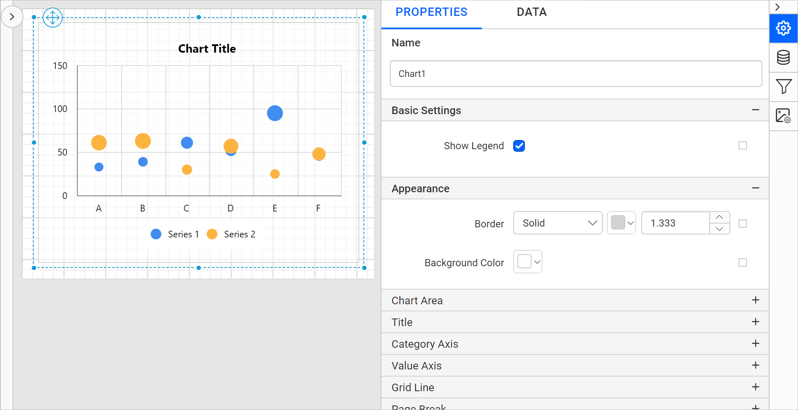
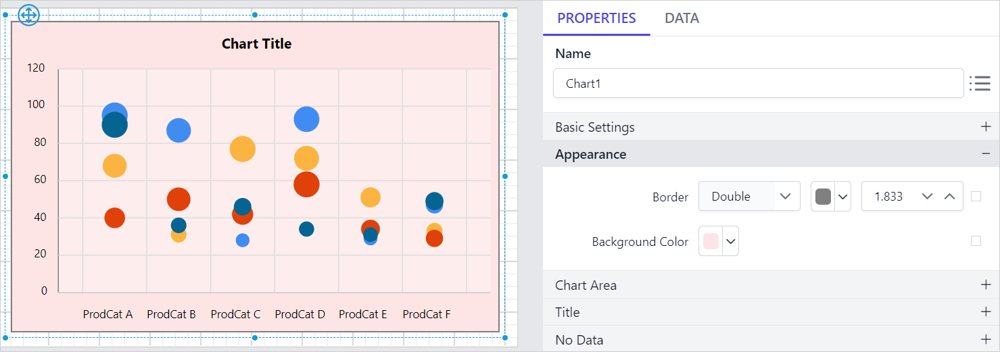
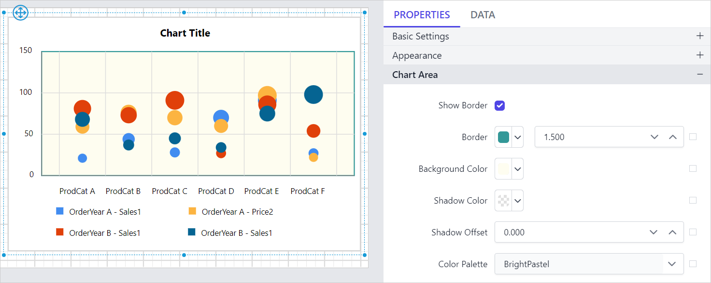

# Add a Bubble Chart in the {{site.productNameTM}} Web Report Designer

You add a **Bubble Chart** to a report in the {{site.productNameTM}} Web Report Designer by dragging it from the item panel. Use it to compare a large number of data points shown as bubbles, where bubble size shows the difference. The bubble chart requires two values per data point. By default, the bubble chart displays data points as circles.

## How do I add a bubble chart to the report?

The {{site.productNameTM}} Web Report Designer lists the bubble chart under the `Distribution` category in the item panel.

Drag and drop the bubble chart from the item panel into the design area.


The bubble chart renders in the design area, and the properties panel lists the chart properties.



## How do I create data for the bubble chart?

To present data in a {{site.productNameTM}} bubble chart, create a dataset and bind data to the chart data region. This example uses the following dataset query to create the dataset.

```sql
SELECT PC.Name AS ProdCat, PS.Name AS SubCat, DATEPART(yy, SOH.OrderDate) AS OrderYear, 'Q' + DATENAME(qq, SOH.OrderDate) AS OrderQtr,SUM(SOD.UnitPrice * SOD.OrderQty) AS Sales
FROM Production.ProductSubcategory PS INNER JOIN
Sales.SalesOrderHeader SOH INNER JOIN
Sales.SalesOrderDetail SOD ON SOH.SalesOrderID = SOD.SalesOrderID INNER JOIN
Production.Product P ON SOD.ProductID = P.ProductID ON PS.ProductSubcategoryID = P.ProductSubcategoryID INNER JOIN
Production.ProductCategory PC ON PS.ProductCategoryID = PC.ProductCategoryID
WHERE (SOH.OrderDate BETWEEN '1/1/2002' AND '12/31/2003')
GROUP BY DATEPART(yy, SOH.OrderDate), PC.Name, PS.Name, 'Q' + DATENAME(qq, SOH.OrderDate), PS.ProductSubcategoryID
```

> To create a dataset with this query, see [Create an embedded dataset](./../../../manage-data/dataset/create-an-embedded-dataset/). This example uses the `AdventuresWorks` database.

## How do I assign data to the bubble chart?

The {{site.productNameTM}} bubble chart requires 3 fields (x, y, and size) to plot a point. The size field specifies the size of each bubble segment.

To configure data in a bubble chart, follow these steps:

1. Select the chart report item in the design area to bind data to it.

2. Click the `Properties` icon in the configuration panel to open the property pane. Then, switch to the `DATA` tab.

   

3. Choose a dataset in the dropdown list. The dropdown lists the data available in the report.

   

4. Review the fields. The `Measures` section lists numeric columns and numeric expressions. The `Dimensions` section lists other types of columns and dimension expressions.

   

5. **Drag and Drop Measure Element**:

   Drag the numeric column (measure element) or the numeric expression column from the `Measure` section and drop it in the `Y Values` section.

   

   You can add multiple numeric columns in the `Y-value` section.

   

6. **Aggregate Options**:

   Click the `Settings` icon (highlighted in the image) to open the aggregation type dropdown list.

   

   Set the aggregation type that computes the selected column.

   

7. **Expression field**:

   Set the expression that visualizes data in the bubble chart. Click the `Settings` icon (highlighted in the image) to open the aggregation type dropdown list.

   

   Click the `Expression` menu to open the expression editor.

   

   In the expression editor, enter the required expression and click `OK`.

   

   The label in the `Y-Value` section for the respective field now displays the `<<Expr>>` tag.

   

8. **Drag and Drop Dimension Element**:

   Drag the dimension element from the `Dimensions` section and drop it into the `Column` section. The dimension measures against the numeric column(s) selected in the `Y Value(s)` section.

   

9. **Grouping**:

   Group the added column element with another column by adding the respective dimension element into the Row(s) section.

   

   The following image shows the chart design after grouping.

   

10. **Size**:

    Define the bubble size by adding a value into the Size section.

    

## How do I format the bubble chart?

You format a bubble chart in the {{site.productNameTM}} Web Report Designer through the settings in the `Properties` tab.

To format a bubble chart, follow these steps:

1. Drag and drop the bubble chart into the design area and resize it to the required size.
2. Configure the data for the bubble chart.
3. Select the bubble chart and click the `Properties` icon in the configuration panel to open the property pane.

   

The property pane lists the properties available for the report item with their default values.

### Name

The **Name** property provides a unique name for the bubble chart item in the report.


### Basic Settings

The **Basic Settings** category of the bubble chart contains the **Show Legend** and **Choose Series** properties shown in the following image.


#### Show Legend

A chart legend is text that describes the plotted data. You can toggle the visibility of the legend in the chart and customize the legend text appearance. To set or reset legend properties, see the [Show Legend](./../../../report-items/chart/legend/) property.

#### Choose Series

The bubble chart lists all series you add in the `Choose Series` dropdown. To customize a series appearance, choose the required series name in the dropdown.


To customize each series using the properties panel, see [Series](./../../../report-items/chart/series/).

### Appearance

The bubble chart **Appearance** properties (border style, color, width, and background color) style the chart and customize its appearance in the report design. The properties panel lists these properties under the `Appearance` category.




### Chart Area

The bubble chart **Chart Area** properties, such as border width, color, shadow color, shadow offset, and background color, customize the area of the chart design.


The properties panel lists these properties under the `Chart Area` category.




Use the [Color Palette](./../../../report-items/chart/color-palette/) property to customize the color of the chart.

### Title

The bubble chart title is customized by editing the `Title Text` property of the chart.

To show or hide the chart title, toggle the `Show Chart Title` checkbox.


Use these properties to customize the font color, font text, font style, border, background, and position of the title in the chart design.

### No Data

The bubble chart **No Data** property displays static text when a dataset returns empty or zero rows at run time.


To set or reset no data message properties, see the [No Data Message](./../../../report-items/chart/no-data-message/) property section.

### Category Axis

The bubble chart **Category axis** displays text labels instead of numbers. To use the categorical axis, toggle the `Enable Axis` checkbox under the `Category Axis` category in the chart properties.


To set or reset axis properties, see the [Axis Properties](./../../../report-items/chart/axis/) property.

### Value Axis

The bubble chart **Value axis** uses a numerical scale and displays numbers as labels. To use the value axis, toggle the `Enable Axis` checkbox under the `Value Axis` category in the chart properties.


To set or reset axis properties, see the [Axis Properties](./../../../report-items/chart/axis/) property.

### Grid line

You can set the bubble chart **Grid line** properties for the category axis and the value axis.


#### Category Axis

To show the grid line for the category axis, enable the `Category Axis` checkbox.


You can also enable the `Minor Grid Lines` and customize the major and minor gridline style and color in the `Advanced Options` menu.


#### Value Axis

To show the grid line for the value axis, enable the `Value Axis` checkbox.


You can also enable the `Minor Grid Lines` and customize the major and minor gridline style and color in the `Advanced Options` menu.


### Page break

The bubble chart **page break** property controls the amount of information on each page when you preview the report. To apply the page break property to the chart report item, follow these steps:

1. Choose a `Break Location` type in the dropdown. The **Break Location** property specifies where the page break occurs.

   
2. To prevent predefined page breaks from being applied during report preview, enable the `Break Disabled` property checkbox. You can also control page breaks during report preview with expressions. For details on setting and resetting page breaks dynamically, see the [Set Expression](./../../../compose-report/properties-panel/#set-expression) and [Reset Expression](./../../../compose-report/properties-panel/#reset-expression) sections.

   
3. To restart page numbering on each page, enable the `Page Number Reset` property checkbox.

   

### Data Element

The bubble chart **Data element** properties control the visibility of a report item when you export the report in XML format. The properties panel lists them under the `Data Element` category.


#### Name

The `Name` field assigns a custom name to the chart element. The chart report item exports with the provided name.


> Note: The name cannot contain spaces, and it must begin with a letter followed by letters, numbers, or the underscore character (_).

#### Output

The `Output` property controls the visibility of the chart when you export the report. Each option performs the following operation:

* **Auto** or **Output** - Exports the chart report item.
* **NoOutput** - Does not export the chart report item.


### Miscellaneous

The bubble chart **Miscellaneous** category contains the page name, document map, bookmark, custom attributes, tooltip, and custom style properties.

#### Page name

The **page name** property names the first worksheet of the Excel workbook when you export the report to Excel format.


You can set static or dynamic text as the page name. To set and reset dynamic text, see the [Set Expression](./../../../compose-report/properties-panel/#set-expression) and [Reset Expression](./../../../compose-report/properties-panel/#reset-expression) sections.

#### Document Map

A **document map** is a navigational feature that displays a separate side pane with a set of navigational links in a hierarchical structure when you view a report. A user can click the content in the list to navigate to the report page that displays that item. To configure the document map in the report design, see the [Document Map](./../../../compose-report/document-map/) section.

You can set static or dynamic text as the value for the document map property. To set and reset dynamic text, see the [Set Expression](./../../../compose-report/properties-panel/#set-expression) and [Reset Expression](./../../../compose-report/properties-panel/#reset-expression) sections.

#### Bookmark

Bookmark links let users navigate to different parts of an SSRS report. You can add bookmarks to each textbox, image, table, or chart, or to the unique group values displayed in a tablix, to direct users to specified locations in the report. The value of the bookmark property can be your own strings or an expression. To configure bookmarks in the report design, see the [Bookmark](./../../../compose-report/bookmark/) section.

You can set static or dynamic text as the value for the bookmark property. To set and reset dynamic text, see the [Set Expression](./../../../compose-report/properties-panel/#set-expression) and [Reset Expression](./../../../compose-report/properties-panel/#reset-expression) sections.

#### Custom attributes

The **custom attributes** property sets the values for chart custom properties. To create and assign values for custom properties using the properties panel, see the [Custom Properties](./../../../compose-report/common-properties/#custom-properties) section.

#### Tooltip

The **Tooltip** property displays informative text or values when the user hovers over the report item in the report preview. To set a tooltip for a chart item using the properties panel, see the [Tooltip](./../../../compose-report/common-properties/#tooltip) section.

#### Custom Style

The `Custom Style` property enables external CSS for styling report items, giving more flexibility than the built-in styling options. Use this property to meet specific design requirements and keep styling consistent across multiple reports. For a step-by-step guide on setting up custom styles in your report, see the **How To** section of this guide.


## How do I preview the bubble chart report?

You preview the bubble chart report from the design view of the {{site.productNameTM}} Web Report Designer.

1. Review the final report design, shown in the following image.

   
2. Preview the report. The following image shows the report preview.

   

> Download the [bubble chart report design file from GitHub](https://github.com/boldreports/resources/tree/master/docs/report-designer/chart/bubble-chart.rdl).

## Frequently asked questions

### Where is the bubble chart in the item panel?

The {{site.productNameTM}} Web Report Designer lists the bubble chart under the `Distribution` category in the item panel.

### How do I set the bubble size?

Add a value into the Size section of the `DATA` tab. The size field specifies the size of each bubble segment.

## See also

* [Chart legend properties](./../../../report-items/chart/legend/)
* [Chart series properties](./../../../report-items/chart/series/)
* [Chart axis properties](./../../../report-items/chart/axis/)
* [Chart color palette](./../../../report-items/chart/color-palette/)
