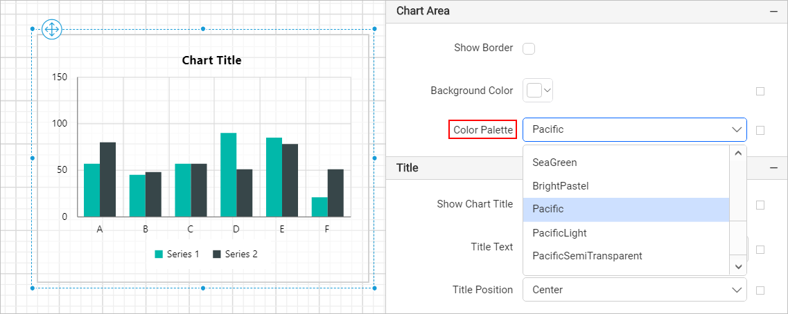
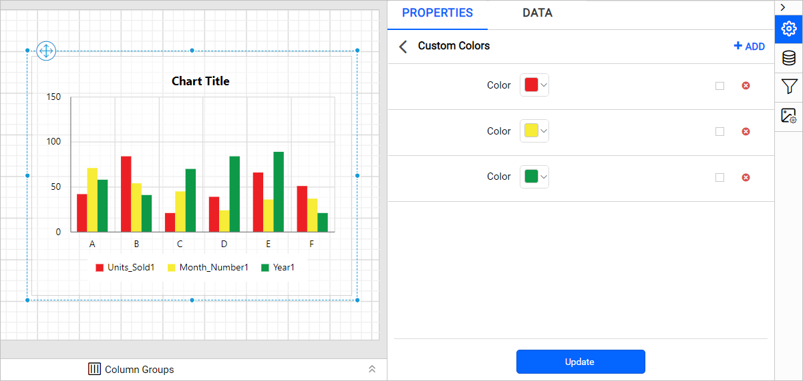

# Customize Chart Colors with the {{site.productNameTM}} Color Palette

In the {{site.productNameTM}} Web Report Designer, you customize the chart series color with the color palette property. You can change the color palette for a chart series by choosing from a predefined set of color palettes or defining a custom palette. The **Color Palette** property is listed under the `Chart Area` category in the chart properties panel.

## How do I use a built-in color palette?

The {{site.productNameTM}} Web Report Designer lets you switch between the predefined color palette options available in the `Color Palette` dropdown.

## Define custom color palette

You define a custom color palette for a {{site.productNameTM}} chart in the **Custom Colors** panel. To define custom colors, follow these steps:

1. Select the `Custom` option from the `Color Palette` dropdown.

    

2. Find the `Custom Colors` field, which now displays under the color palette dropdown.

    

3. Click the edit icon on the right side of the `Custom Colors` property.

    

4. The **Custom Colors** panel opens.

    

5. Click the ADD icon in the top-right corner. A new **Color** field is added to the panel.

    

6. Set the desired color in the color field.

    

7. Click **Update**.

Repeat these steps to define multiple color sets or edit existing color sets. In the following example, three colors are added in the custom colors panel. The chart applies them based on the number of series.

### How do I set colors with expressions?

You can set a custom chart color based on dynamic values by using [Expressions](./../../../compose-report/expressions/). Click the square icon on the right side of each field to open the expression menu.

> Note: To set and reset expressions for custom colors, see the [Set Expressions](./../../../compose-report/properties-panel/#set-expression) and [Reset Expressions](./../../../compose-report/properties-panel/#reset-expression) sections.

### How do I delete a color set?

You delete a custom color set from the **Chart Custom Colors** panel. Follow these steps:

1. Click the edit icon for the `Custom Colors` property. The **Chart Custom Colors** panel lists the available color sets.
2. Click the `Delete` icon in the right corner of the required color set.
3. Click **Update**.

## Frequently asked questions

### Where is the Color Palette property?

The **Color Palette** property is listed under the `Chart Area` category in the chart properties panel of the {{site.productNameTM}} Web Report Designer.

### How are custom colors applied to a chart?

The chart applies the colors in the custom colors panel based on the number of series.

## See also

* [Chart series properties](./../../../report-items/chart/series/)
* [Chart legend properties](./../../../report-items/chart/legend/)
* [Bar chart](./../../../report-items/chart/bar-chart/)
