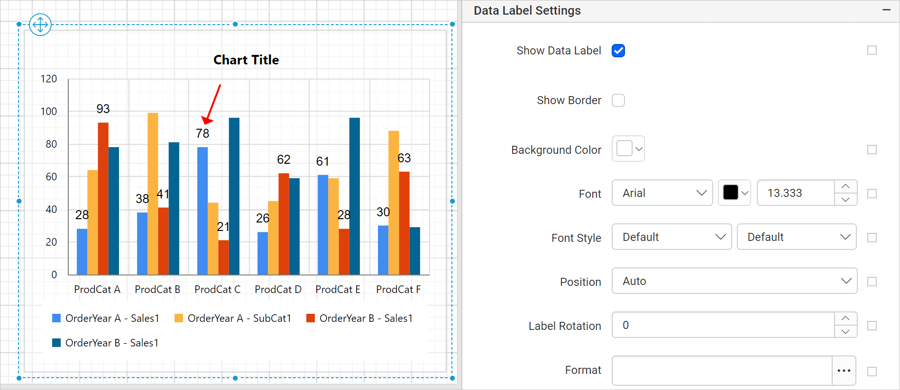

# Chart Data Labels in the Bold Reports® Web Report Designer

In the Bold Reports® Web Report Designer, you add data labels to a chart series by using the `Show Data Label` property. The labels appear at the top of the data point, by default.

## How do I show or hide a data label?

To show or hide a data label in a Bold Reports® chart series, toggle the `Show Data Label` checkbox in the properties panel.

When you enable the `Show Data Label` checkbox, the label displays in the respective series of the chart. In the following image, the `Sales1` series is selected in the `Choose Series` dropdown, so the data label is enabled for that specific series in the chart design.

You can also enable or disable the data label based on dynamic values by using `Expressions`. To open the set or reset expression menu in the properties panel, see the [Set Expression](./../../../compose-report/properties-panel/#set-expression) and [Reset Expression](./../../../compose-report/properties-panel/#reset-expression) sections.

## Show border

The **Show Border** property sets a border for data labels in the chart. To enable the data label border, toggle the `Show Border` checkbox.

The default border is now enabled for the data label.

A set of border properties also becomes enabled in the properties list.

Use the border color and width properties to customize the border for the data label. You can also set border properties based on dynamic values by using `Expressions`. To open the set or reset expression menu in the properties panel, see the [Set Expression](./../../../compose-report/properties-panel/#set-expression) and [Reset Expression](./../../../compose-report/properties-panel/#reset-expression) sections.

## Background color

The **Background color** property sets the background color for the chart data label.

The background color property is then applied to the data label.

You can also apply the background color based on dynamic values by using `Expressions`. To open the set or reset expression menu in the properties panel, see the [Set Expressions](./../../../compose-report/properties-panel/#set-expression) and [Reset Expressions](./../../../compose-report/properties-panel/#reset-expression) sections.

## Font

The data label **Font** properties (font family, font size, and font color) customize the labels.

You can also apply font properties based on dynamic values by using `Expressions`. To open the set or reset expression menu in the properties panel, see the [Set Expressions](./../../../compose-report/properties-panel/#set-expression) and [Reset Expressions](./../../../compose-report/properties-panel/#reset-expression) sections.

## Font Style and Weight

The **Font Style and Weight** properties set the style and weight for the legend text.

You can also apply font style and weight properties based on dynamic values by using `Expressions`. To open the set or reset expression menu in the properties panel, see the [Set Expressions](./../../../compose-report/properties-panel/#set-expression) and [Reset Expressions](./../../../compose-report/properties-panel/#reset-expression) sections.

## Position

The data label `Position` property places the label at the top, center, or bottom of the segment for chart types such as column, bar, stacked bar, stacked column, 100% stacked bar, and 100% stacked column.

In the following image, the data labels are center positioned in the chart series.

For chart types such as Pie, Doughnut, Pyramid, and Funnel, you can position the label inside or outside the perimeter of the series with the label position option. Use the `CustomAttributes` property in the chart report item to position the label for these chart types.

For Pie and Doughnut charts, use the following values.

| Position           | Value  |
|-----------------------|-----------------------|
| Outside                |PieLabelStyle=Outside|
| Inside               |PieLabelStyle=Inside|

For Pyramid and Funnel charts, use the following values.

| Position           | Value  |
|-----------------------|-----------------------|
| Outside                |PyramidLabelStyle=Outside|
| Inside               |PyramidLabelStyle=Inside|

You can also set the position property based on dynamic values by using `Expressions`. To open the set or reset expression menu in the properties panel, see the [Set Expression](./../../../compose-report/properties-panel/#set-expression) and [Reset Expression](./../../../compose-report/properties-panel/#reset-expression) sections.

## Label Rotation

The `Lable Rotation` property rotates chart data labels.

Increase or decrease the value in the `Label Rotation` property field to set the rotation angle for the data label.

You can also set the label rotation property based on dynamic values by using `Expressions`. To open the set or reset expression menu in the properties panel, see the [Set Expression](./../../../compose-report/properties-panel/#set-expression) and [Reset Expression](./../../../compose-report/properties-panel/#reset-expression) sections.

## Format

The data label **Format** property formats data label values. To open the format dialog, click the icon highlighted in the following image, or type the format directly in the textbox.

To apply **Number**, **Currency**, **Date**, **Time**, **Scientific**, **Percentage**, or **Custom** formats using the format dialog, follow the steps in the [Format](./../../../compose-report/format-data/) section.

You can also set the format property based on dynamic values by using `Expressions`. To open the set or reset expression menu in the properties panel, see the [Set Expression](./../../../compose-report/properties-panel/#set-expression) and [Reset Expression](./../../../compose-report/properties-panel/#reset-expression) sections.

## Label

The data label **Label** property accepts case-sensitive, chart-specific keywords that represent an item in the chart. The `Label` property dropdown lists the following chart keywords.

|Chart Keyword| Description|
|-------------|------------|
|#VALX |X value of the data point.|
|#VALY |Y value of the data point.|
|#VALY2 |Y value #2 of data point.|
|#VALY3 |Y value #3 of data point.|
|#VALY4 |Y value #4 of data point.|
|#VALY5 |Y value #5 of data point.|
|#VALY6 |Y value #6 of data point.|
|#AXISLABEL |Axis data point label.|
|#INDEX |Data point index.|
|#PERCENT |Percentage of the data point Y value.|
|#TOTAL |Total of all Y values in the series.|

For example, to show the values in the data labels as percentages, choose the `#PERCENT` keyword in the dropdown.

You can also set the label property based on dynamic values by using `Expressions`. To open the set or reset expression menu in the properties panel, see the [Set Expression](./../../../compose-report/properties-panel/#set-expression) and [Reset Expression](./../../../compose-report/properties-panel/#reset-expression) sections.

> If the `Use Value as Label` checkbox is enabled, the `Label` property has no effect on the data label.

## Use Value as Label

The **Use Value as Label** checkbox displays the actual values of the series in the data label on report preview. Toggle this checkbox to turn it on or off.

> If this checkbox is enabled, the `Label` property has no effect on the data label.

You can enable or disable this property based on dynamic values by using `Expressions`. To open the set or reset expression menu in the properties panel, see the [Set Expression](./../../../compose-report/properties-panel/#set-expression) and [Reset Expression](./../../../compose-report/properties-panel/#reset-expression) sections.

## See also

* [Chart series properties](./../../../report-items/chart/series/)
* [Chart legend properties](./../../../report-items/chart/legend/)
* [Pie chart](./../../../report-items/chart/pie-chart/)
* [Funnel chart](./../../../report-items/chart/funnel-chart/)
