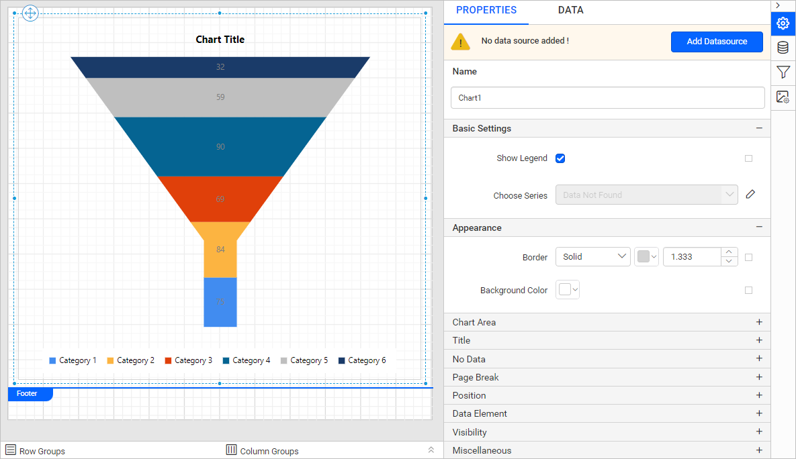
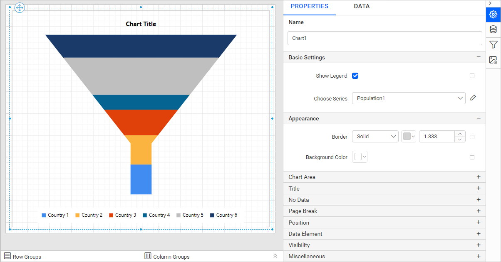
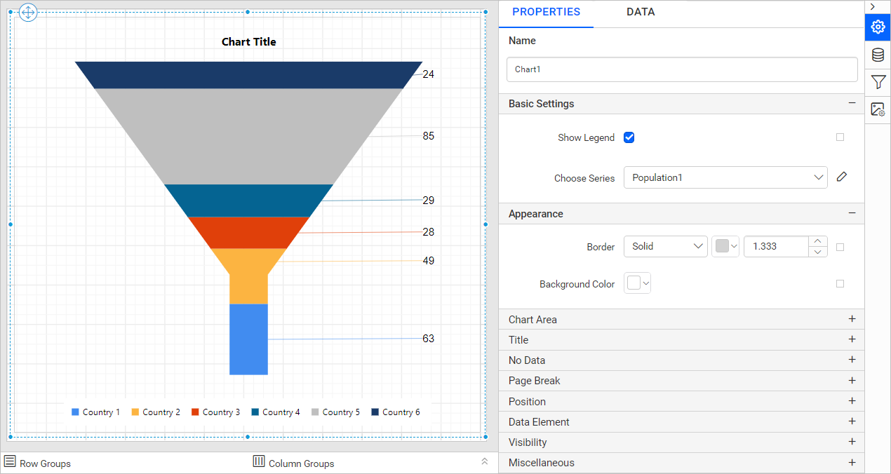
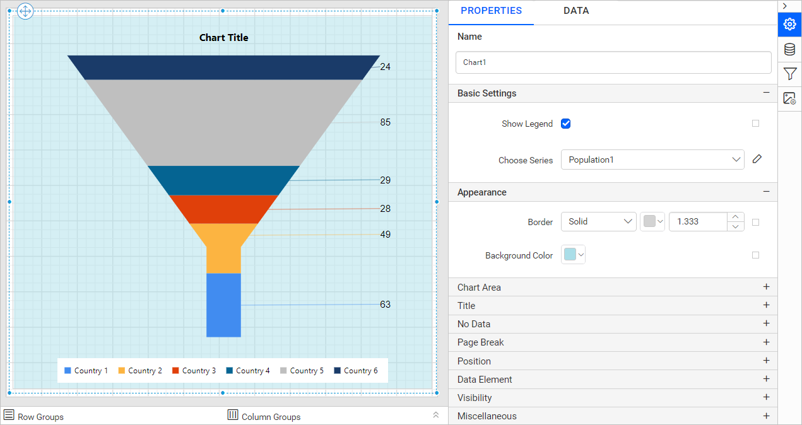
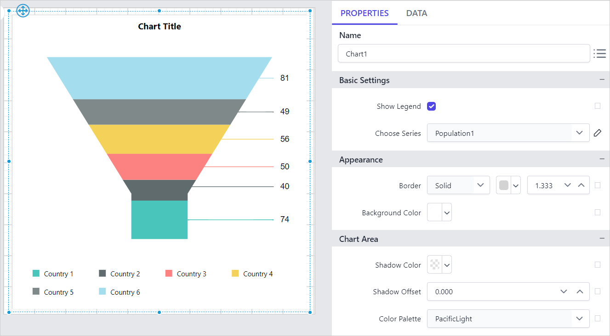
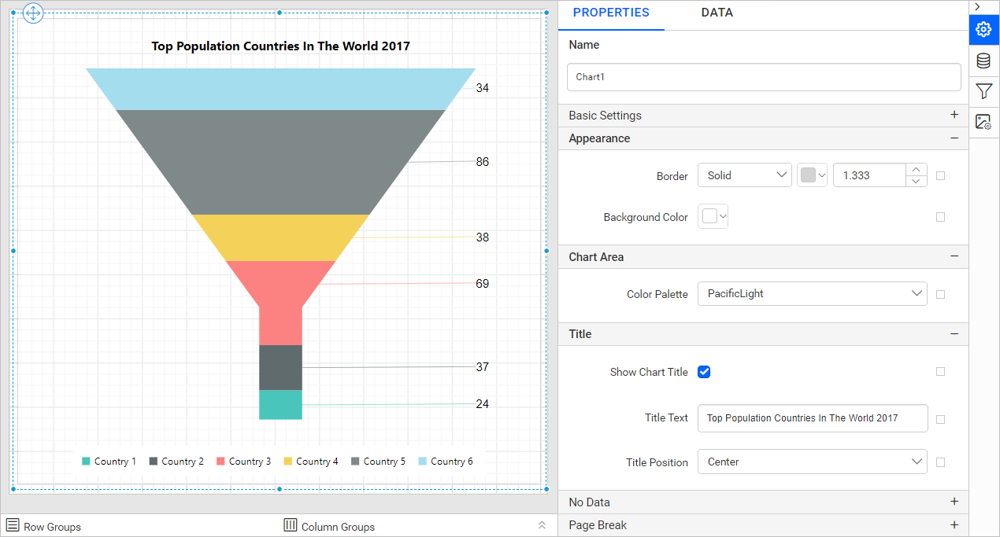

# Add a Funnel Chart in the {{site.productNameTM}} Web Report Designer

You add a **Funnel Chart** to a report in the {{site.productNameTM}} Web Report Designer by dragging it from the item panel. Use it to show values across multiple stages in a process, with each stage in a different color. You can make proportional comparisons between values shown in a progressively decreasing manner.

## How do I add a funnel chart to the report?

The {{site.productNameTM}} Web Report Designer lists the funnel chart under the `Proportion` category in the item panel.

Drag and drop the funnel chart from the item panel into the design area.


The funnel chart renders in the design area, and the properties panel lists the chart properties.



## How do I create data for the funnel chart?

To present data in a {{site.productNameTM}} funnel chart, create a dataset and bind data to the chart data region. This example uses the following JSON data to create the dataset.

```json
[
      { "Country":"China", "Population":1409517397 },
      { "Country":"India", "Population":1339180127 },
      { "Country":"UnitedStates", "Population":324459463 },
      { "Country":"Indonesia", "Population":263991379 },
      { "Country":"Brazil", "Population":209288278 },
      { "Country":"Pakistan", "Population":197015955 },
      { "Country":"Nigeria", "Population":190886311 },
      { "Country":"Bangladesh", "Population":164669751 },
      { "Country":"Russia", "Population":143989754 },
      { "Country":"Mexico", "Population":129163276 },
      { "Country":"Japan", "Population":127484450 },
      { "Country":"Ethiopia", "Population":104957438 },
      { "Country":"Philippines", "Population":104918090 },
      { "Country":"Egypt", "Population":97553151 },
      { "Country":"Vietnam", "Population":95540800 },
      { "Country":"Germany", "Population":82114224 }
]
```

> For more information, see [Create an embedded dataset](./../../../manage-data/dataset/create-an-embedded-dataset/). This example creates a dataset using [JSON inline data](./../../../manage-data/data-connectors/json-data-source/#inline-data) to design the report.

## How do I assign data to the funnel chart?

The {{site.productNameTM}} **Funnel Chart** needs a minimum of one value element and one column element to render. Drop the measure or expression field you want to analyze into the `Y Value(s)` section. Drop the dimension that categorizes the measure into the `Column` section. To categorize the measure by a series, drop the respective dimension into the `Row(s)` section.

To configure data in a funnel chart, follow these steps:

1. Select the chart report item in the design area to bind data to it.

2. Click the `Properties` icon in the configuration panel to open the property pane. Then, switch to the `DATA` tab.

   

3. Choose a dataset in the dropdown list. The dropdown lists the data available in the report.

   

4. Review the fields. The `Measures` section lists numeric columns and numeric expressions. The `Dimensions` section lists other types of columns and dimension expressions.

   

5. **Drag and Drop Measure Element**:

   Drag the numeric column (measure element) or the numeric expression column from the `Measure` section and drop it in the `Y Values` section.

   

   The following image shows the report item design after you add the Y value field.

   

6. **Aggregate Options**:

   Click the `Settings` icon (highlighted in the image) to open the aggregation type dropdown list.

   

   Set the aggregation type that computes the selected column.

   

7. **Drag and Drop Dimension Element**:

   Drag the dimension element from the `Dimensions` section and drop it into the `Column` section. The dimension measures against the numeric column(s) selected in the `Y Value(s)` section.

   

   The following image shows the report item design after you add the dimension field.

   

8. **Grouping**:

   You can also group the added column element with another column by adding the respective dimension element into the `Row(s)` section.

9. **Formatting Column and Row(s) sections**:

   You can also [Filter](./../../../compose-report/filter-data/), [Sort](./../../../compose-report/sort-data/), or [Group](./../../../compose-report/group-data/) the Column or Row(s) sections using expressions.

## How do I format the funnel chart?

You format a funnel chart in the {{site.productNameTM}} Web Report Designer through the settings in the `Properties` tab.

To format a funnel chart, follow these steps:

1. Drag and drop the funnel chart into the design area and resize it to the required size.
2. Configure the data for the funnel chart.
3. Select the funnel chart and click the `Properties` icon in the configuration panel to open the property pane.

   

The property pane lists the properties available for the report item with their default values.

### Name

The **Name** property provides a unique name for the funnel chart item in the report.


### Basic Settings

The **Basic Settings** category of the funnel chart contains the **Show Legend** and **Choose Series** properties shown in the following image.


#### Show Legend

A chart legend is text that describes the plotted data. You can toggle the visibility of the legend in the chart and customize the legend text appearance. To set or reset legend properties, see the [Show Legend](./../../../report-items/chart/legend/) property.

#### Choose Series

The funnel chart lists all series you add in the `Choose Series` dropdown. To customize a series appearance, choose the required series name in the dropdown.


To edit the selected series, click the edit button.


In this example, the `Data Label Settings` properties have the `Show Data Label` property enabled and the `Format` set to `#,0;(#,0)`.




To customize each series using the properties panel, see [Series](./../../../report-items/chart/series/).

### Appearance

The funnel chart **Appearance** properties (border style, color, width, and background color) style the chart and customize its appearance in the report design. The properties panel lists these properties under the `Appearance` category.




### Chart Area

The funnel chart **Chart Area** property customizes the area of the chart design.


Use the [Color Palette](./../../../report-items/chart/color-palette/) property to customize the color of the chart. The `Color Palette` property is listed under the `Chart Area` category.

In this example, the `Color Palette` is set to `PacificLight`. The following image shows the design.



### Title

To show or hide the funnel chart title, toggle the `Show Chart Title` checkbox. Customize the **chart title** by editing the `Title Text` property of the chart. You can customize the font color, font text, font style, border, background, and position of the title in the chart design.




### No Data

The funnel chart **No Data** property displays static text when a dataset returns empty or zero rows at runtime.


To set or reset no data message properties, see the [No Data Message](./../../../report-items/chart/no-data-message/) property section.

### Page break

The funnel chart **page break** property controls the amount of information on each page when you preview the report. To apply the page break property to the chart report item, follow these steps:

1. Choose a `Break Location` type in the dropdown. The **Break Location** property specifies where the page break occurs.

   

2. To prevent predefined page breaks from being applied during report preview, enable the `Break Disabled` property checkbox. You can also control page breaks during report preview with expressions. For details on setting and resetting page breaks dynamically, see the [Set Expression](./../../../compose-report/properties-panel/#set-expression) and [Reset Expression](./../../../compose-report/properties-panel/#reset-expression) sections.

   

3. To restart page numbering on each page, enable the `Page Number Reset` property checkbox.

   

### Data Element

The funnel chart **Data element** properties control the visibility of a report item when you export the report in XML format. The properties panel lists them under the `Data Element` category.


#### Name

The `Name` field assigns a custom name to the chart element. The chart report item exports with the provided name.


> Note: The name cannot contain spaces, and it must begin with a letter followed by letters, numbers, or the underscore character (_).

#### Output

The `Output` property controls the visibility of the chart when you export the report. Each option performs the following operation:

* **Auto** or **Output** - Exports the chart report item.
* **NoOutput** - Does not export the chart report item.


### Miscellaneous

The funnel chart **Miscellaneous** category contains the page name, tooltip, document map, bookmark, and custom style properties.

#### Page name

The **page name** property names the first worksheet of the Excel workbook when you export the report to Excel format.


You can set static or dynamic text as the page name. To set and reset dynamic text, see the [Set Expression](./../../../compose-report/properties-panel/#set-expression) and [Reset Expression](./../../../compose-report/properties-panel/#reset-expression) sections.

#### Tooltip

The **Tooltip** property displays informative text or values when the user hovers over the report item in the report preview. To set a tooltip for a chart item using the properties panel, see the [Tooltip](./../../../compose-report/common-properties/#tooltip) section.

#### Document Map

A **Document Map** is a navigational feature that displays a separate side pane with a set of navigational links in a hierarchical structure when you view a report. A user can click the content in the list to navigate to the report page that displays that item. To configure the document map in the report design, see the [Document Map](./../../../compose-report/document-map/) section.

You can set static or dynamic text as the value for the document map property. To set and reset dynamic text, see the [Set Expression](./../../../compose-report/properties-panel/#set-expression) and [Reset Expression](./../../../compose-report/properties-panel/#reset-expression) sections.

#### Bookmark

Bookmark links let users navigate to different parts of an SSRS report. You can add bookmarks to each textbox, image, table, or chart, or to the unique group values displayed in a tablix, to direct users to specified locations in the report. The value of the bookmark property can be your own strings or an expression. To configure bookmarks in the report design, see the [Bookmark](./../../../compose-report/bookmark/) section.

You can set static or dynamic text as the value for the bookmark property. To set and reset dynamic text, see the [Set Expression](./../../../compose-report/properties-panel/#set-expression) and [Reset Expression](./../../../compose-report/properties-panel/#reset-expression) sections.

#### Custom Style

The `Custom Style` property enables external CSS for styling report items, giving more flexibility than the built-in styling options. Use this property to meet specific design requirements and keep styling consistent across multiple reports. For a step-by-step guide on setting up custom styles in your report, see the **How To** section of this guide.


## How do I preview the funnel chart report?

You preview the funnel chart report from the design view of the {{site.productNameTM}} Web Report Designer.

1. Review the final design view of the report, shown in the following image.

   

2. Preview the report. The following image shows the report preview.

   

> Download the [funnel chart report design file from GitHub](https://github.com/boldreports/resources/tree/master/docs/report-designer/chart/funnel-chart.rdl).

## Frequently asked questions

### Where is the funnel chart in the item panel?

The {{site.productNameTM}} Web Report Designer lists the funnel chart under the `Proportion` category in the item panel.

### When should I use a funnel chart?

Use a funnel chart to show values across multiple stages in a process. It supports proportional comparisons between values shown in a progressively decreasing manner.

## See also

* [Chart data labels](./../../../report-items/chart/data-label/)
* [Chart series properties](./../../../report-items/chart/series/)
* [Pyramid chart](./../../../report-items/chart/pyramid-chart/)
* [Chart color palette](./../../../report-items/chart/color-palette/)
