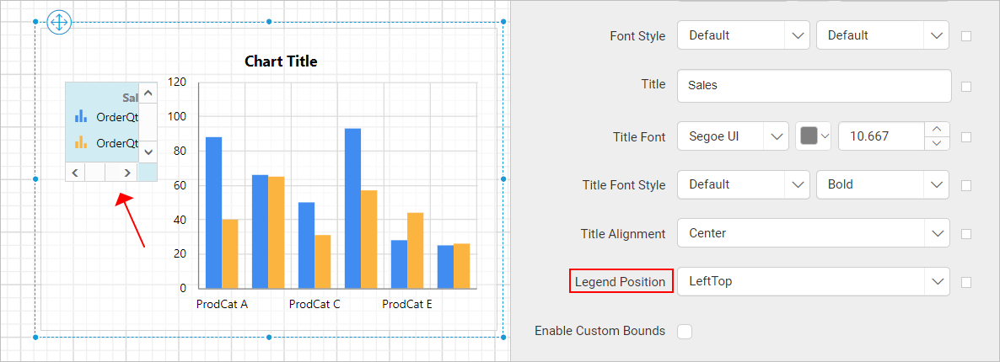

# Chart Legend in the {{site.productNameTM}} Web Report Designer

In the {{site.productNameTM}} Web Report Designer, a chart legend is text that describes the plotted data. You can toggle the visibility of the legend and customize the legend appearance in the chart design. The **Show Legend** property is listed under the basic settings category in the chart properties panel.

## How do I show or hide the legend?

To show or hide the legend on a {{site.productNameTM}} chart surface, toggle the `Show Legend` checkbox in the properties panel.

When you enable the `Show Legend` checkbox, the chart legend displays at the bottom position of the chart area.

You can also enable or disable the legend based on dynamic values by using `Expressions`. To open the set or reset expression menu in the properties panel, see the [Set Expression](./../../../compose-report/properties-panel/#set-expression) and [Reset Expression](./../../../compose-report/properties-panel/#reset-expression) sections.

## How do I format the legend?

You customize the {{site.productNameTM}} chart legend appearance through the properties in the `Advanced` menu of the show legend property. Follow these steps:

1. Click the square icon on the right side of the `Show Legend` checkbox.
2. Click the `Advanced` option in the menu.

The legend properties now display in the `Advanced Options` category.

### Show border

The legend **Show Border** property sets a border for the legend area in the chart. To enable the legend border, toggle the `Show Border` checkbox.

The default border is now enabled for the legend area.

A set of border properties also becomes enabled in the `Advanced Options` category.

Use the border color and width properties to customize the border for the legend area. You can also set border properties based on dynamic values by using `Expressions`. To open the set or reset expression menu in the properties panel, see the [Set Expression](./../../../compose-report/properties-panel/#set-expression) and [Reset Expression](./../../../compose-report/properties-panel/#reset-expression) sections.

### Background color

The legend **Background color** property sets the background color for the legend area.

The background color property is then applied to the legend area.

You can also apply the background color based on dynamic values by using `Expressions`. To open the set or reset expression menu in the properties panel, see the [Set Expressions](./../../../compose-report/properties-panel/#set-expression) and [Reset Expressions](./../../../compose-report/properties-panel/#reset-expression) sections.

### Font

The legend **Font** properties (font family, font size, and font color) customize the legend text.

You can also apply font properties based on dynamic values by using `Expressions`. To open the set or reset expression menu in the properties panel, see the [Set Expressions](./../../../compose-report/properties-panel/#set-expression) and [Reset Expressions](./../../../compose-report/properties-panel/#reset-expression) sections.

### Font Style and Weight

The legend **Font Style and Weight** properties set the style and weight for the legend text.

You can also apply font style and weight properties based on dynamic values by using `Expressions`. To open the set or reset expression menu in the properties panel, see the [Set Expressions](./../../../compose-report/properties-panel/#set-expression) and [Reset Expressions](./../../../compose-report/properties-panel/#reset-expression) sections.

## How do I add a legend title?

The legend **Title** property adds a title to the {{site.productNameTM}} chart legend. Enter the required title text in the title property textbox.

The chart legend area then shows the title text you entered.

You can also apply title text based on dynamic values by using `Expressions`. To open the set or reset expression menu in the properties panel, see the [Set Expressions](./../../../compose-report/properties-panel/#set-expression) and [Reset Expressions](./../../../compose-report/properties-panel/#reset-expression) sections.

### Legend position

The **Legend position** property places the legend in different positions inside the chart area. The `Legend Position` dropdown lists the supported positioning patterns.

By default, the legend is placed in the `BottomCenter` position. In the following image, the legend is positioned at the `LeftTop` position inside the chart area.

### Enable custom bounds

The **Enable Custom Bounds** property customizes the size and position of the chart legend inside the chart area. To set or reset the size and position of the legend, toggle the `Enable Custom Bounds` checkbox. When you enable the checkbox, the `Advanced Options` menu lists the position and size properties.

Increase or decrease the width, height, left, and top values as required to position the legend in the chart area.

> If the custom bounds property is enabled, the `Legend position` property has no effect.

## Frequently asked questions

### Where does the chart legend appear by default?

When you enable `Show Legend`, the legend displays at the bottom of the chart area. The default `Legend Position` is `BottomCenter`.

### Why does the Legend position setting have no effect?

The `Legend position` property has no effect when the custom bounds property is enabled.

## See also

* [Chart data labels](./../../../report-items/chart/data-label/)
* [Chart series properties](./../../../report-items/chart/series/)
* [Chart color palette](./../../../report-items/chart/color-palette/)
