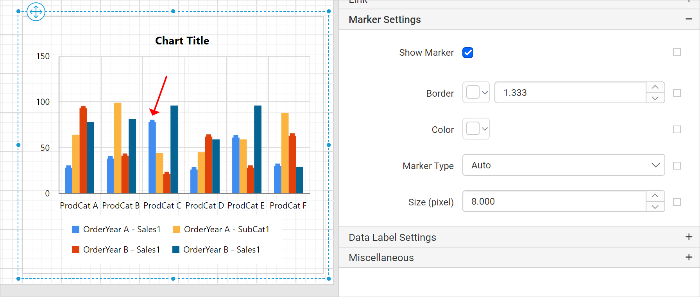

# Customize chart markers in the {{site.productNameTM}} Web Report Designer

In the {{site.productNameTM}} Web Report Designer, chart data markers give the user information about each data point. You can add a shape and label to adorn each data point.

## How do I show or hide a marker?

In the Web Report Designer, you show or hide markers in a chart series by toggling the `Show Marker` checkbox in the properties panel.

When you enable the `Show Marker` checkbox, the Web Report Designer displays the marker in the respective series of the chart. In the following image, the `Sales1` series is selected in the `Choose Series` drop-down, so the marker is enabled for that specific series in the chart design.

You can also enable or disable the marker based on dynamic values by using `Expressions`. To open the set or reset expression menu in the properties panel, refer to the [Set Expression](./../../../compose-report/properties-panel/#set-expression) and [Reset Expression](./../../../compose-report/properties-panel/#reset-expression) sections.

## Border

The Border property in the Web Report Designer sets the border color and width for the data marker in the chart design.

The following image shows the border color and width applied to the markers in the chart design.

## Color

The Color property in the Web Report Designer sets the color for the chart marker.

The following image shows the color property applied to the marker in the chart design.

You can also apply marker color based on dynamic values by using `Expressions`. To open the set or reset expression menu in the properties panel, refer to the [Set Expressions](./../../../compose-report/properties-panel/#set-expression) and [Reset Expressions](./../../../compose-report/properties-panel/#reset-expression) sections.

## Marker type

The `Marker Type property` in the Web Report Designer lets you add different shapes to the chart marker, such as rectangle, circle, and diamond. Choose the required shape in the drop-down.

In the following design, the `Circle` shape is applied to the marker.

You can also apply marker shapes based on dynamic values by using `Expressions`. To open the set or reset expression menu in the properties panel, refer to the [Set Expressions](./../../../compose-report/properties-panel/#set-expression) and [Reset Expressions](./../../../compose-report/properties-panel/#reset-expression) sections.

## Size

The Size property in the Web Report Designer customizes the size of the marker in the chart design.

Increase or decrease the size value in the Size property. The following image shows the resized marker in the chart design.

## Frequently asked questions

### Can I show markers for only one chart series?

Yes. In the Web Report Designer, select the series in the `Choose Series` drop-down and enable the `Show Marker` checkbox, so the marker is enabled for that specific series.

### Can I set marker properties based on dynamic values?

Yes. You can enable or disable the marker, and apply marker color and shape, based on dynamic values by using `Expressions`.

## See also

* [Chart series properties](./../series/)
* [Chart data labels](./../data-label/)
* [Line with markers chart](./../line-with-markers/)
