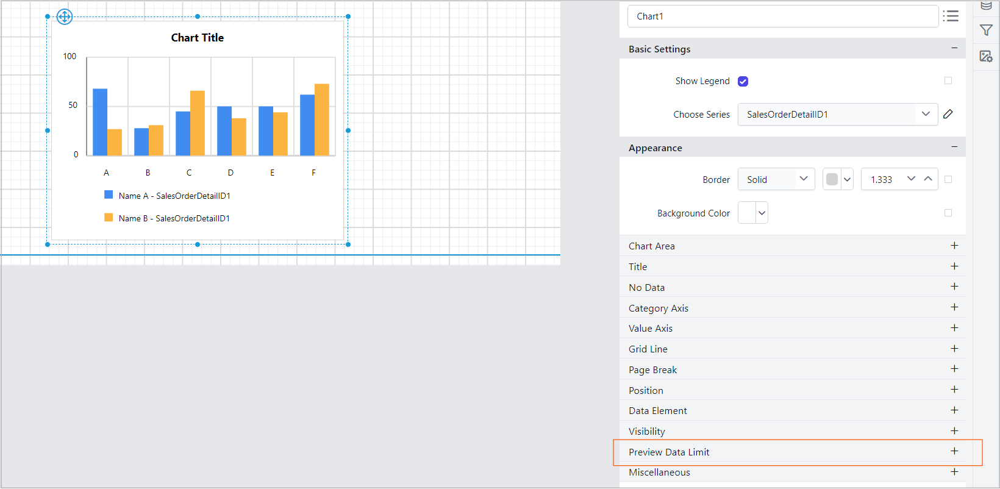
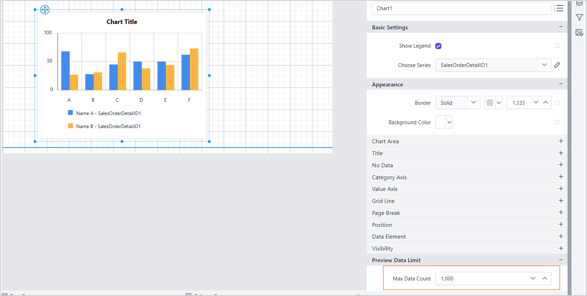
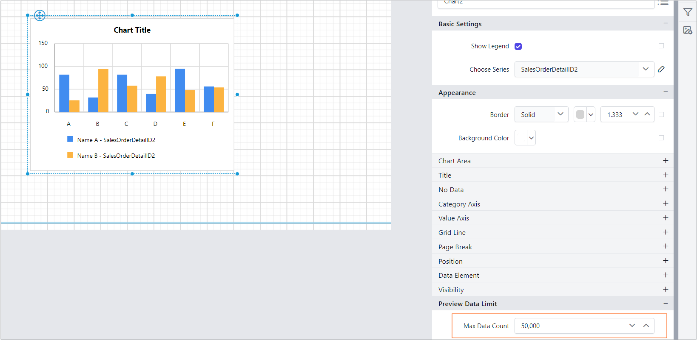
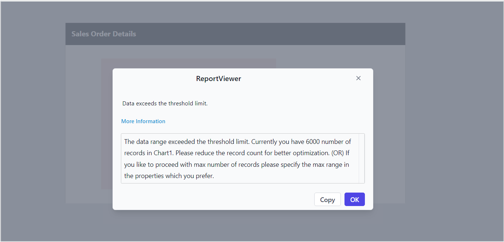

# Manage the max data count for chart report items in Bold Reports®

In the Bold Reports® Web Report Designer, the `MaxDataCount` property sets the maximum number of data points that a chart can display. When handling millions or billions of data points, rendering charts in the preview can take significant time, potentially leading to UI crashes.

## Why does the chart have a max data count?

The `MaxDataCount` property in the Bold Reports® Web Report Designer helps prevent preview issues by displaying a user-friendly error message when the threshold limit is exceeded. Based on this message, you are informed and can then apply filters to the dataset to optimize performance and ensure smooth report rendering.

**NOTE:** This user-friendly message is applicable only in the designer UI, ensuring that users are informed at design time to make necessary adjustments for smooth report generation.

## How do I configure the Max Data Count property?

You configure the Max Data Count property in the `Preview Data Limit` section of the Web Report Designer `Properties` pane.

1. Select the chart and go to the `Properties` pane.
2. Navigate to the `Preview Data Limit` section.

    

3. Set a `Max Data Count` for the chart report item.

    

## What is the default Max Data Count value?

The Web Report Designer shows the default value for `MaxDataCount` in the following image.

## What happens when the data exceeds the limit?

If the data exceeds the Max Data Count limit, the Web Report Designer displays a user-friendly error message in the designer UI. The message indicates that the data exceeds the allowable range.

## What are the best practices for Max Data Count?

Use these Bold Reports® best practices to balance chart performance and data size:

1. For **smaller datasets**, use the default Max Data Count setting for optimal performance.
2. For **larger datasets**, adjust the property only if necessary to avoid design-time or runtime performance issues and consider **filtering** your data source to reduce the data count to faster the rendering process.

By leveraging the `MaxDataCount` property, you can create efficient and user-friendly reports that balance performance and data visualization.

## Frequently asked questions

### Is the Max Data Count message shown in the report preview at runtime?

No. The user-friendly message is applicable only in the designer UI, so you are informed at design time.

### What should I do when a chart exceeds the Max Data Count?

Apply filters to the dataset to reduce the data count. This optimizes performance and ensures smooth report rendering.

## See also

* [Add filters to a chart data region](./../add-filters-to-chart-data-region/)
* [Sort data in a chart data region](./../sort-data-in-chart-data-region/)
* [Chart no data message](./../no-data-message/)
