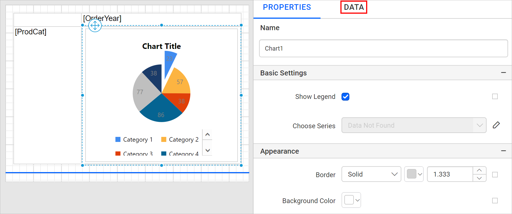
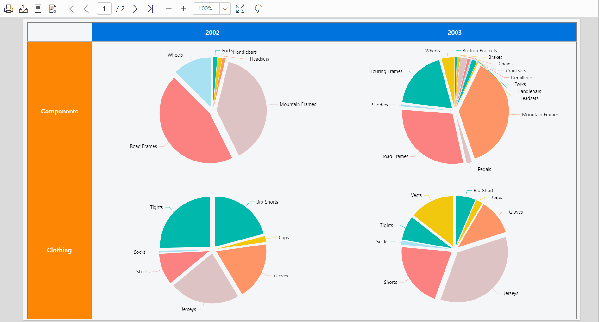

# Nest a chart inside a data region in the Bold Reports<sup>®</sup> Web Report Designer

In the Bold Reports<sup>®</sup> Web Report Designer, you can place a chart inside another data region, such as a tablix, to link both data regions to the same dataset. This provides different views of the same data. The following steps design the sales of each product sub-category, for each product category group and order year, by using a chart and a matrix data region.

## How do I create the dataset?

To present data in the matrix format in the Web Report Designer, create a dataset and bind data to the matrix data region. This example uses the following dataset query for dataset creation.

```sql
SELECT PC.Name AS ProdCat, PS.Name AS SubCat, DATEPART(yy, SOH.OrderDate) AS OrderYear, 'Q' + DATENAME(qq, SOH.OrderDate) AS OrderQtr,SUM(SOD.UnitPrice * SOD.OrderQty) AS Sales
FROM Production.ProductSubcategory PS INNER JOIN
Sales.SalesOrderHeader SOH INNER JOIN
Sales.SalesOrderDetail SOD ON SOH.SalesOrderID = SOD.SalesOrderID INNER JOIN
Production.Product P ON SOD.ProductID = P.ProductID ON PS.ProductSubcategoryID = P.ProductSubcategoryID INNER JOIN
Production.ProductCategory PC ON PS.ProductCategoryID = PC.ProductCategoryID
WHERE (SOH.OrderDate BETWEEN '1/1/2002' AND '12/31/2003')
GROUP BY DATEPART(yy, SOH.OrderDate), PC.Name, PS.Name, 'Q' + DATENAME(qq, SOH.OrderDate), PS.ProductSubcategoryID
```

> Refer to the [Create Data](./../../../manage-data/dataset/create-an-embedded-dataset/) section and create a dataset using the above query. The `AdventuresWorks` database is used here.

## How do I add a matrix to the report?

The Web Report Designer lists the matrix report item in the item panel under the `Data Regions` category.


Drag and drop the matrix report item into the design area from the item panel. The properties of the matrix report item are listed in the properties panel. By default, it is named `Tablix1`.


The matrix initially has an empty default row group, column group, and a data cell.


### How do I assign data to the matrix?

In the Web Report Designer, assign the dataset to the `Dataset` property of the matrix report item.


Refer to the [Assign fields](./../../../report-items/tablix/assign-data-to-tablix-data-region/) section and assign the `ProdCat` and `OrderYear` fields in the initial matrix design. The first field that you assign to the row group or column group replaces the initial empty default row group or column group. In the following image, the `ProdCat` field is assigned to the row group. Notice the `Row Grouping pane`.


Similarly, assign `OrderYear` to the column group.


## How do I add a chart into the matrix?

To add a chart into a matrix cell in the Web Report Designer, follow these steps:

1. Drag and drop a rectangle and place it inside the second row, last cell.
   
   > Use rectangles to control the sizing of the inserted chart item.
2. Drag an `Exploded-pie` chart from the item panel and place it inside the rectangle.
   
3. The chart is placed inside the rectangle within the table cell, as shown below.
   
4. Resize the chart and matrix design as required.
   

## How do I assign data to the chart?

To assign data to the nested chart in the Web Report Designer, select the chart report item in the table cell. The chart properties are listed in the properties panel. Then, click the `DATA` tab.



Based on the dataset assigned to the parent matrix report item, the dataset fields are listed in the `DATA` assign panel. The numeric columns and numeric expressions are listed under the `Measures` section. Other types of columns and dimension expressions are listed under the `Dimensions` section.


Drag the `Sales` field from the `Measures` section and drop it in the `Y Values` section.


Then, drag the `SubCat` field from the `Dimensions` section and drop it into the `Column` section. This field is measured against the selected numeric column(s) in the `Y Value(s)` section.


## How do I format the matrix?

In the following Web Report Designer design, the background color and font styles of the matrix cells are changed to improve the report design.


> Refer to the [Cell Properties](./../../../report-items/tablix/cell-properties/#cell-properties) to style the matrix cell.

## How do I format the chart?

To format the nested chart in the Web Report Designer, select the chart in the table cell. The chart properties are listed in the properties panel.

1. Disable the show legend checkbox.

    

2. Disable the chart title property.

    

3. Edit the `Sales` series properties.

    

4. Under `Data Label Settings`, enable the chart data label checkbox.

    

5. Set the data label text value as `#AXISLABEL` in the `Label` property.

    

    Refer to the [Show Data Label](./../../../report-items/chart/data-label/) section to customize the data label in the chart.

6. To set the label position for the pie chart, set the `PieLabelStyle=Outside` custom attributes property.

    

    

7. Set the series color using the `Color Palette` property.

    

You can further customize the appearance of the chart using the chart properties in the properties panel.

## What does the final design look like?

To finish the nested chart design in the Web Report Designer, resize the tablix data region to the required size in the design area. The final design looks like the following image.


## How do I preview the report?

To see the report preview in the Web Report Designer, click the **Preview** button in the top-right corner of the report header.



> Download the [chart nested data region report design file from GitHub](https://github.com/boldreports/resources/tree/master/docs/report-designer/chart/nested-data-region.rdl).

## Frequently asked questions

### Why place the chart inside a rectangle in the matrix cell?

Use rectangles to control the sizing of the inserted chart item.

### Which fields can the nested chart use?

The nested chart lists the dataset fields assigned to the parent matrix report item in the `DATA` assign panel.

## See also

* [Exploded pie chart](./../exploded-pie-chart/)
* [Chart data labels](./../data-label/)
* [Chart color palette](./../color-palette/)
