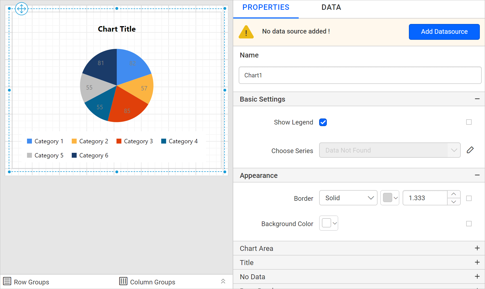
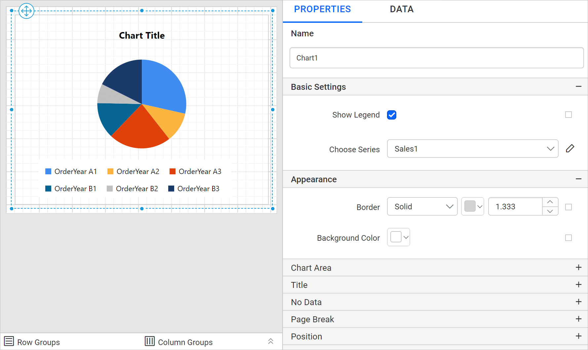
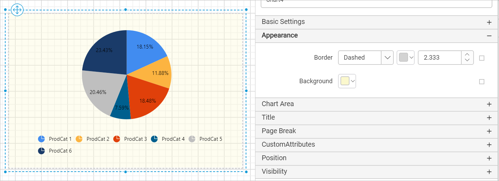

# Add a pie chart in the Bold Reports<sup>®</sup> Web Report Designer

You add a **Pie Chart** to a report in the Bold Reports<sup>®</sup> Web Report Designer by dragging it from the item panel. Use it to show the proportion of each item to the total as pie slices.

## How do I add a pie chart to the report?

The Web Report Designer lists the pie chart under the `Proportion` category in the item panel.

Drag and drop the `Pie` chart from the item panel into the design area.


The pie chart is rendered in the design area, and the chart properties are listed in the properties panel.



## How do I create data for the pie chart?

To present data in the pie chart in the Web Report Designer, create a dataset and bind data to the chart data region. This example uses the following dataset query for dataset creation.

```sql
SELECT PC.Name AS ProdCat, PS.Name AS SubCat, DATEPART(yy, SOH.OrderDate) AS OrderYear, 'Q' + DATENAME(qq, SOH.OrderDate) AS OrderQtr,SUM(SOD.UnitPrice * SOD.OrderQty) AS Sales
FROM Production.ProductSubcategory PS INNER JOIN
Sales.SalesOrderHeader SOH INNER JOIN
Sales.SalesOrderDetail SOD ON SOH.SalesOrderID = SOD.SalesOrderID INNER JOIN
Production.Product P ON SOD.ProductID = P.ProductID ON PS.ProductSubcategoryID = P.ProductSubcategoryID INNER JOIN
Production.ProductCategory PC ON PS.ProductCategoryID = PC.ProductCategoryID
WHERE (SOH.OrderDate BETWEEN '1/1/2002' AND '12/31/2003')
GROUP BY DATEPART(yy, SOH.OrderDate), PC.Name, PS.Name, 'Q' + DATENAME(qq, SOH.OrderDate), PS.ProductSubcategoryID
```

> Refer to the [Create Data](./../../../manage-data/dataset/create-an-embedded-dataset/) section and create a dataset using the above query. The `AdventuresWorks` database is used here.

## How do I assign data to the pie chart?

A pie chart in the Web Report Designer needs a minimum of 1 value element and 1 column element to showcase. Drop the measure or expression field that you want to analyze into the `Y Values` section. Drop the dimension that categorizes the measure onto the `Columns` section. To categorize based on a series, also drop the respective dimension onto the `Rows` section.

To configure data in the pie chart, follow these steps:

1. To bind data to a chart report item placed in the design area, focus on that report item.
2. Click the `Properties` icon in the configuration panel to open the property pane. Then, switch to the `DATA` tab.
   
3. The available data in the report is listed in the drop-down. Choose a data in the drop-down list.
   
4. The numeric columns and numeric expressions are listed under the `Measures` section. Other types of columns and dimension expressions are listed under the `Dimensions` section.
   
5. **Drag and Drop Measure Element**:
   Select and drag the numeric column (measure element) or the numeric expression column from the `Measure` section and drop it in the `Y Values` section.
   
   The report item design looks like the following image.
   
6. **Aggregate Options**:
   Click the `Settings` icon (highlighted in the following image) to open the aggregation type drop-down list.
   
   Set the aggregation type used to compute the selected column.
   
7. **Drag and Drop Dimension Element**:
   Select and drag the dimension element from the `Dimensions` section and drop it into the `Column` section. The dimension is measured against the selected numeric column(s) in the `Y Value(s)` section.
   
   The report item design looks like the following image.
   
8. **Grouping**:
   Group the added column element with another column by adding the respective dimension element into the Row(s) section.
   
   The report item design looks like the following image.
   

> Follow the above steps to assign data for other chart categories such as bar, line, area, pie and polar.

## How do I format the pie chart?

You format the pie chart in the Web Report Designer through the settings available in the `Properties` tab, for better illustration of the view that you require.

To format a pie chart, follow these steps:

1. Drag and drop the pie chart into the design area and resize it to the required size.
2. Configure the data for the pie chart.
3. Focus on the pie chart and click the `Properties` icon in the configuration panel to open the property pane.
   

The property pane lists the properties available for the report item with their default values.

### Name

The Name property in the Web Report Designer provides a unique name for the chart item in the report.


### Basic Settings

The Basic Settings category in the Web Report Designer holds the Show Legend and Choose Series properties of the pie chart.


#### Show Legend

A legend in a Bold Reports<sup>®</sup> chart is text used to describe the data plotted. You can toggle the visibility of the legend in the chart and customize the legend text appearance. To set or reset legend properties, refer to the [Show Legend](./../../../report-items/chart/legend/) property.

#### Choose Series

The `Choose Series` drop-down in the Web Report Designer lists the available series when you add multiple series to the chart. To customize a series appearance, choose the required series name in the drop-down.


Refer to the [Series](./../../../report-items/chart/series/) section to customize each series using the properties panel.

### Appearance

The Appearance properties in the Web Report Designer, such as border style, color, width, and background color, style the chart and customize its appearance in the report design. These properties are listed under the `Appearance` category in the properties panel.




### Chart Area

The **Chart Area** property in the Web Report Designer customizes the area of the chart. You can customize the chart series color using the [Color Palette](./../../../report-items/chart/color-palette/) property.


### Title

The pie chart title in the Web Report Designer is customized by editing the `Title Text` property of the chart.

To show or hide the chart title, toggle the `Show Chart Title` checkbox.


Using these properties, you can customize the font color, font text, font style, border, background, and position of the title in the chart design.

### No Data

The No Data property in the Web Report Designer displays static text when a dataset returns empty or zero rows at run time.


To set or reset no data message properties, refer to the [No Data Message](./../../../report-items/chart/no-data-message/) property section.

### Page break

The page break property in the Web Report Designer controls the amount of information on each page when you preview the report. To apply the page break property to the chart report item, follow these steps.

1. The Break Location property specifies where the page break should occur. Choose any `Break Location` type in the drop-down.
   
2. To prevent predefined page breaks from being applied during report preview, enable the `Break Disabled` property checkbox. You can also control the application of page breaks during report preview by using expressions. For details on setting and resetting page breaks dynamically, refer to the [Set Expression](./../../../compose-report/properties-panel/#reset-expression) and [Reset Expression](./../../../compose-report/properties-panel/#reset-expression) sections.

   
3. To restart page numbering on each page, enable the `Page Number Reset` property checkbox.
   

### Data Element

The Data element properties in the Web Report Designer control the visibility of a report item when you export the report in XML format. The Data element properties are listed in the properties panel under the `Data Element` category.


#### Name

The Data Element `Name` field assigns a custom name for the chart element. The chart report item is exported with the provided name.


> Note: The name cannot contain spaces, and it must begin with a letter followed by letters, numbers, or the underscore character (_).

#### Output

The `Output` property controls the visibility of the chart when you export the report. Choosing the following options for the `Output` property performs the respective operations:

* **Auto** or **Output** - Exports the chart report item.
* **NoOutput** - Does not export the chart report item.


### Miscellaneous

The Miscellaneous category in the Web Report Designer holds the page name, document map, bookmark, custom attributes, tooltip, and custom style properties of the chart.

#### Page name

The page name property names the first worksheet of the Excel workbook when you export the report to Excel format.


You can set static or dynamic text as the page name. To set and reset dynamic text, refer to the [Set Expression](./../../../compose-report/properties-panel/#set-expression) and [Reset Expression](./../../../compose-report/properties-panel/#reset-expression) sections.

#### Document Map

A document map in a Bold Reports<sup>®</sup> report is a navigational feature that displays a separate side pane with a set of navigational links in a hierarchical structure when you view a report. A user can click the content in the list to navigate to the report page that displays that item. Refer to the [Document Map](./../../../compose-report/document-map/) section to configure a document map in the report design.

You can set static or dynamic text as the value for the document map property. To set and reset dynamic text, refer to the [Set Expression](./../../../compose-report/properties-panel/#set-expression) and [Reset Expression](./../../../compose-report/properties-panel/#reset-expression) sections.

#### Bookmark

Bookmark links in a Bold Reports<sup>®</sup> report let users navigate to different parts of an SSRS report. You can add bookmarks to each textbox, image, table, or chart, or to the unique group values displayed in a tablix, to direct users to specified locations in the report. The value of the bookmark property can be your own strings or an expression. Refer to the [Bookmark](./../../../compose-report/bookmark/) section to configure a bookmark in the report design.

You can set static or dynamic text as the value for the bookmark property. To set and reset dynamic text, refer to the [Set Expression](./../../../compose-report/properties-panel/#set-expression) and [Reset Expression](./../../../compose-report/properties-panel/#reset-expression) sections.

#### Custom attributes

The custom attributes property sets the values for chart custom properties. To assign values for custom properties using the properties panel, refer to the [Custom Properties](./../../../compose-report/common-properties/#custom-properties) section.

#### Tooltip

The Tooltip property displays informative text or a value when the user hovers over the report item in the report preview. To set a tooltip for the chart item using the properties panel, refer to the [Tooltip](./../../../compose-report/common-properties/#tooltip) section.

#### Custom Style

The `Custom Style` property enables the use of external CSS for styling report items, providing enhanced flexibility beyond the built-in styling options. Use this property to meet specific design requirements and maintain consistent styling across multiple reports. For a step-by-step guide on setting up custom styles in your report, check the **How To** section of this guide.


## How do I preview the pie chart report?

To preview the pie chart report in the Web Report Designer, follow these steps:

1. Click the **Preview** button in the top-right corner of the report header.
   
2. The report preview appears as shown in the following image.
   

> Download the [pie chart report design file from GitHub](https://github.com/boldreports/resources/tree/master/docs/report-designer/chart/pie-chart.rdl).

## Frequently asked questions

### What data does a pie chart need?

A pie chart needs a minimum of 1 value element in the `Y Values` section and 1 column element in the `Columns` section.

### How do I stop the chart from being exported?

Set the Data Element `Output` property to **NoOutput**. The chart report item is then not exported.

## See also

* [Exploded pie chart](./../exploded-pie-chart/)
* [Doughnut chart](./../doughnut-chart/)
* [Chart series properties](./../series/)
