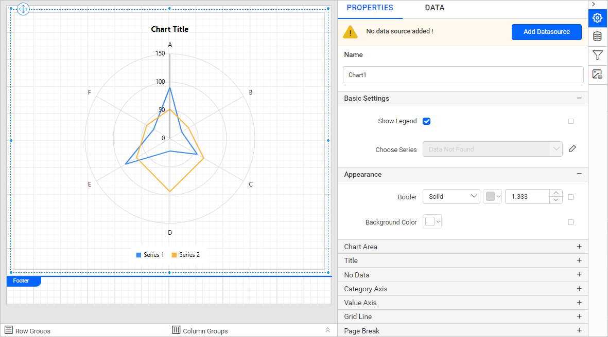
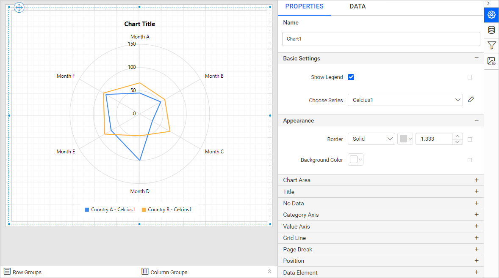
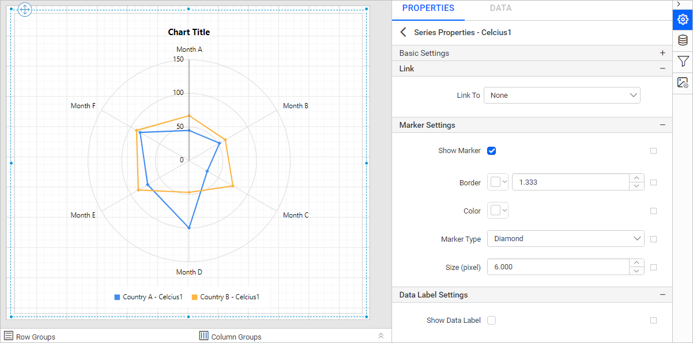
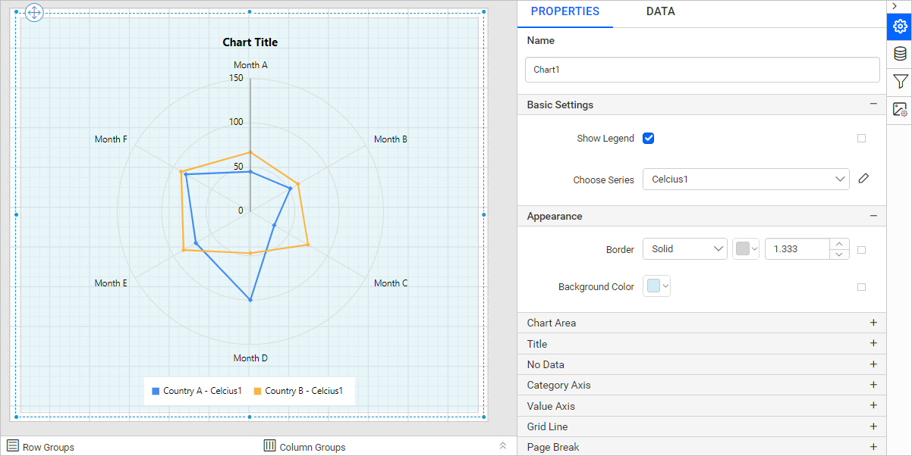
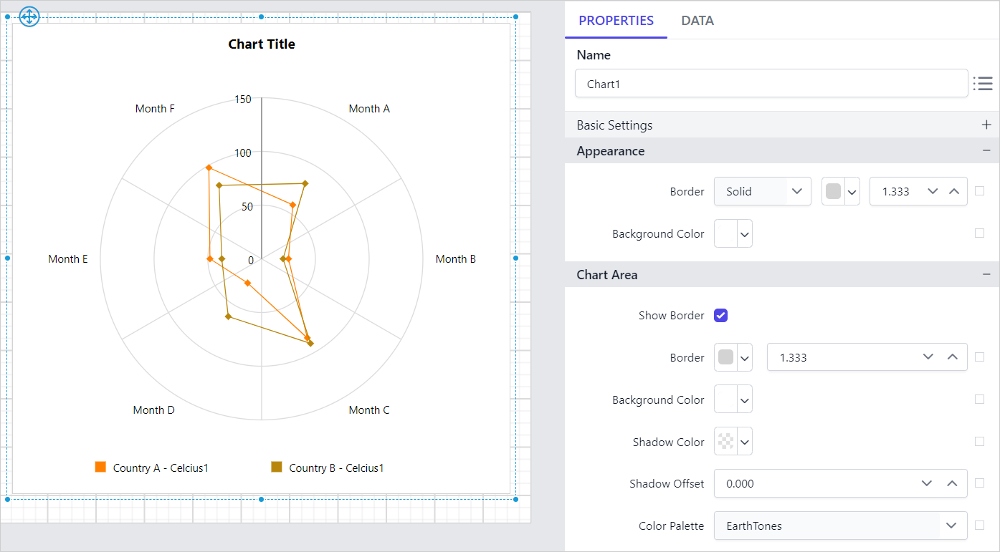
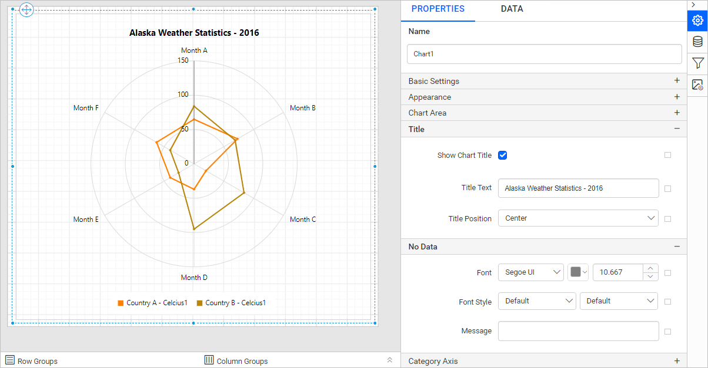

# Add a polar chart in the Bold Reports<sup>®</sup> Web Report Designer

You add a **Polar Chart** to a report in the Bold Reports<sup>®</sup> Web Report Designer by dragging it from the item panel. Use it to visualize data in terms of values and angles. The polar chart provides options for visual comparison between several quantitative or qualitative aspects of a situation.

## How do I add a polar chart to the report?

The Web Report Designer categorizes polar charts under the `Distribution` category in the item panel.

Drag and drop the polar chart from the item panel into the design area.


The polar chart is rendered in the design area, and the chart properties are listed in the properties panel.



## How do I create data for the polar chart?

To present data in the polar chart in the Web Report Designer, create a dataset and bind data to the chart data region. This example uses the following JSON data for dataset creation.

```json
[
    {
        points: [
            { Month: 'Jan', Celcius: -7.1 }, { Month: 'Feb', Celcius: -3.7 },
            { Month: 'Mar', Celcius: 0.8 }, { Month: 'Apr', Celcius: 6.3 },
            { Month: 'May', Celcius: 13.3 }, { Month: 'Jun', Celcius: 18.0 },
            { Month: 'Jul', Celcius: 19.8 }, { Month: 'Aug', Celcius: 18.1 },
            { Month: 'Sep', Celcius: 13.1 }, { Month: 'Oct', Celcius: 4.1 },
            { Month: 'Nov', Celcius: -3.8 }, { Month: 'Dec', Celcius: -6.8 }],
         Country: 'Warmest'
    },
    {
        points: [
            { Month: 'Jan', Celcius: -17.4 }, { Month: 'Feb', Celcius: -15.6 },
            { Month: 'Mar', Celcius: -12.3 }, { Month: 'Apr', Celcius: -5.3 },
            { Month: 'May', Celcius: 1.0 }, { Month: 'Jun', Celcius: 6.9 },
            { Month: 'Jul', Celcius: 9.4 }, { Month: 'Aug', Celcius: 7.6 },
            { Month: 'Sep', Celcius: 2.6 }, { Month: 'Oct', Celcius: -4.9 },
            { Month: 'Nov', Celcius: -13.4 }, { Month: 'Dec', Celcius: -16.4 }],
        Country: 'Coldest'
    }
]
```

> Refer to the [Create Data](./../../../manage-data/dataset/create-an-embedded-dataset/) section for more information. This example creates a dataset using [JSON inline data](./../../../manage-data/data-connectors/json-data-source/#inline-data) to design the report.

## How do I assign data to the polar chart?

The **Polar Chart** in the Web Report Designer needs a minimum of one value element and one column element to showcase. Drop the measure or expression field that you want to analyze into the `Y Value(s)` section. Drop the dimension that categorizes the measure into the `Column` section. To categorize the measure based on a series, drop the respective dimension into the `Row(s)` section.

To configure data in a polar chart, follow these steps:

1. To bind data to a chart report item placed in the design area, focus on that report item.

2. Click the `Properties` icon in the configuration panel to open the property pane. Then, switch to the `DATA` tab.

   

3. The available data in the report is listed in the dropdown. Choose a data in the dropdown list.

   

4. The numeric columns and numeric expressions are listed under the `Measures` section. Other types of columns and dimension expressions are listed under the `Dimensions` section.

   

5. **Drag and Drop Measure Element**:

   Select and drag the numeric column (measure element) or the numeric expression column from the `Measure` section and drop it in the `Y Value(s)` section.

   

   The report item design looks like the following image.

   

6. **Aggregate Options**:

   Click the `Settings` icon (highlighted in the following image) to open the aggregation type dropdown list.

   

   Set the aggregation type used to compute the selected column.

   

7. **Drag and Drop Dimension Element**:

   Select and drag the dimension element from the `Dimensions` section and drop it into the `Column` section. The dimension is measured against the selected numeric column(s) in the `Y Value(s)` section.

   

   The report item design looks like the following image.

   

8. **Grouping**:

   Group the added column element with another column by adding the respective dimension element into the `Row(s)` section.

   

   The report item design looks like the following image.

   

9. **Formatting Column and Row(s) sections**:

   You can also [Filter](./../../../compose-report/filter-data/), [Sort](./../../../compose-report/sort-data/), or [Group](./../../../compose-report/group-data/) the Column or Row(s) sections using expressions.

   For example, here the `Month` field is sorted using the `=Month(cdate("1-" & Fields!Month.Value))` expression.

   

   

   

## How do I format the polar chart?

You format the polar chart in the Web Report Designer through the settings available in the `Properties` tab, for better illustration of the view that you require.

To format a polar chart, follow these steps:

1. Drag and drop the polar chart into the design area and resize it to the required size.
2. Configure the data for the polar chart.
3. Focus on the polar chart and click the `Properties` icon in the configuration panel to open the property pane.

   

The property pane lists the properties available for the report item with their default values.

### Name

The **Name** property in the Web Report Designer provides a unique name for the chart item in the report.


### Basic Settings

The Basic Settings category in the Web Report Designer holds the Show Legend and Choose Series properties of the polar chart.


#### Show Legend

A legend in a Bold Reports<sup>®</sup> chart is text used to describe the data plotted. You can toggle the visibility of the legend in the chart and customize the legend text appearance. To set or reset legend properties, refer to the [Show Legend](./../../../report-items/chart/legend/) property.

#### Choose Series

The `Choose Series` dropdown in the Web Report Designer lists the available series when you add multiple series to the chart. To customize a series appearance, choose the required series name in the dropdown.


You can edit the selected series by clicking the edit button.


**Marker Property**: In this example, the `show Marker` property is enabled, the `Marker type` is set to `Diamond`, and `Size(pixel)` is set to `6.000`.



Refer to the [Series](./../../../report-items/chart/series/) section to customize each series using the properties panel.

### Appearance

The Appearance properties in the Web Report Designer, such as border style, color, width, and background color, style the chart and customize its appearance in the report design. These properties are listed under the `Appearance` category in the properties panel.




### Chart Area

The **Chart Area** property in the Web Report Designer customizes the area of the chart design.


Use the [Color Palette](./../../../report-items/chart/color-palette/) property to customize the color of the chart. The `Color Palette` is listed under the `Chart Area` category.

In this example, the `Color Palette` is set to `EarthTones`, and the design is shown in the following image.



### Title

The polar chart title in the Web Report Designer is shown or hidden by toggling the `Show Chart Title` checkbox. You customize the **chart title** by editing the `Title Text` property of the chart. You can customize the font color, font text, font style, border, background, and position of the title.




### No Data

The **No Data** property in the Web Report Designer displays static text when a dataset returns empty or zero rows at runtime.


To set or reset no data message properties, refer to the [No Data Message](./../../../report-items/chart/no-data-message/) property section.

### Grid line

The **Grid line** properties in the Web Report Designer can be set for the category and value axis of the polar chart.


#### Category Axis

To show the grid line for the category axis, enable the `Category Axis` checkbox.


#### Value Axis

To show the grid line for the value axis, enable the `Value Axis` checkbox.


### Page break

The **page break** property in the Web Report Designer controls the amount of information on each page when you preview the report. To apply the page break property to the chart report item, follow these steps.

1. The **Break Location** property specifies where the page break should occur. Choose any `Break Location` type in the drop-down.

   

2. To prevent predefined page breaks from being applied during report preview, enable the `Break Disabled` property checkbox. You can also control the application of page breaks during report preview by using expressions. For details on setting and resetting page breaks dynamically, refer to the [Set Expression](./../../../compose-report/properties-panel/#set-expression) and [Reset Expression](./../../../compose-report/properties-panel/#reset-expression) sections.

   

3. To restart page numbering on each page, enable the `Page Number Reset` property checkbox.

   

### Data Element

The Data element properties in the Web Report Designer control the visibility of a report item when you export the report in XML format. The Data element properties are listed in the properties panel under the `Data Element` category.


#### Name

The Data Element `Name` field assigns a custom name to the chart element. The chart report item is exported with the provided name.


> Note: The name cannot contain spaces, and it must begin with a letter followed by letters, numbers, or the underscore character (_).

#### Output

The `Output` property controls the visibility of the chart when you export the report. Choosing the following options for the `Output` property performs the respective operations:

* **Auto** or **Output** - Exports the chart report item.
* **NoOutput** - Does not export the chart report item.


### Miscellaneous

The Miscellaneous category in the Web Report Designer holds the page name, tooltip, document map, bookmark, and custom style properties of the chart.

#### Page name

The **page name** property names the first worksheet of the Excel workbook when you export the report to Excel format.


You can set static or dynamic text as the page name. To set and reset dynamic text, refer to the [Set Expression](./../../../compose-report/properties-panel/#set-expression) and [Reset Expression](./../../../compose-report/properties-panel/#reset-expression) sections.

#### Tooltip

The **Tooltip** property displays informative text or values when the user hovers over the report item in the report preview. To set a tooltip for a chart item using the properties panel, refer to the [Tooltip](./../../../compose-report/common-properties/#tooltip) section.

#### Document Map

A **document map** in a Bold Reports<sup>®</sup> report is a navigational feature that displays a separate side pane with a set of navigational links in a hierarchical structure when you view a report. A user can click the content in the list to navigate to the report page that displays that item. Refer to the [Document Map](./../../../compose-report/document-map/) section to configure the document map in the report design.

You can set static or dynamic text as the value for the document map property. To set and reset dynamic text, refer to the [Set Expression](./../../../compose-report/properties-panel/#set-expression) and [Reset Expression](./../../../compose-report/properties-panel/#reset-expression) sections.

#### Bookmark

Bookmark links in a Bold Reports<sup>®</sup> report let users navigate to different parts of an SSRS report. You can add bookmarks to each textbox, image, table, or chart, or to the unique group values displayed in a tablix, to direct users to specified locations in the report. The value of the bookmark property can be your own strings or an expression. Refer to the [Bookmark](./../../../compose-report/bookmark/) section to configure bookmarks in the report design.

You can set static or dynamic text as the value for the bookmark property. To set and reset dynamic text, refer to the [Set Expression](./../../../compose-report/properties-panel/#set-expression) and [Reset Expression](./../../../compose-report/properties-panel/#reset-expression) sections.

#### Custom Style

The `Custom Style` property enables the use of external CSS for styling report items, providing enhanced flexibility beyond the built-in styling options. Use this property to meet specific design requirements and maintain consistent styling across multiple reports. For a step-by-step guide on setting up custom styles in your report, check the **How To** section of this guide.


## How do I preview the polar chart report?

To preview the polar chart report in the Web Report Designer, review the final design and then open the preview:

1. The final design view of the report is shown in the following image.

   

2. The report preview appears as shown in the following image.

   

> Download the [polar chart report design file from GitHub](https://github.com/boldreports/resources/tree/master/docs/report-designer/chart/polar-chart.rdl).

## Frequently asked questions

### What data does a polar chart need?

A polar chart needs a minimum of one value element in the `Y Value(s)` section and one column element in the `Column` section.

### How do I show grid lines on a polar chart?

Enable the `Category Axis` checkbox or the `Value Axis` checkbox under the **Grid line** properties to show the grid line for that axis.

## See also

* [Radar chart](./../radar-chart/)
* [Chart series properties](./../series/)
* [Chart marker](./../marker/)
