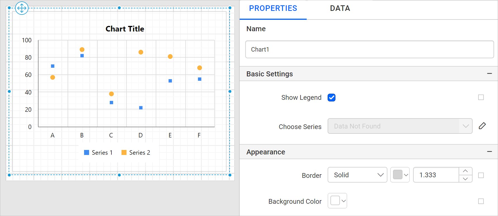
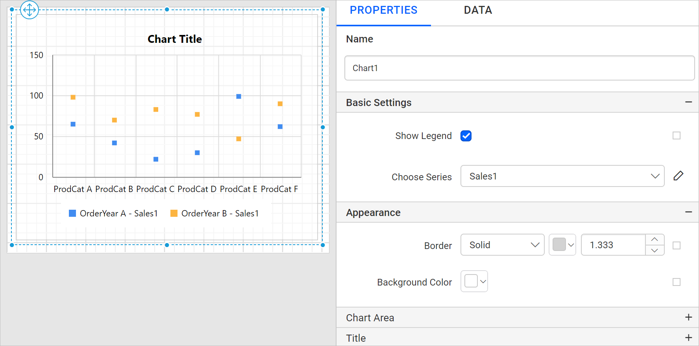
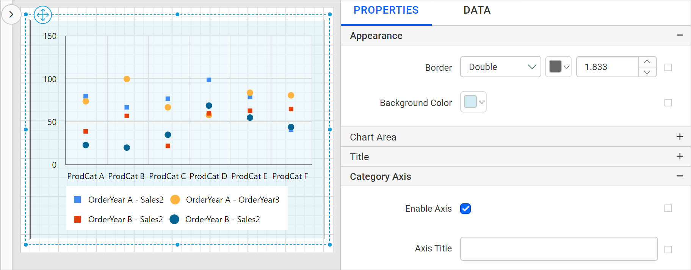
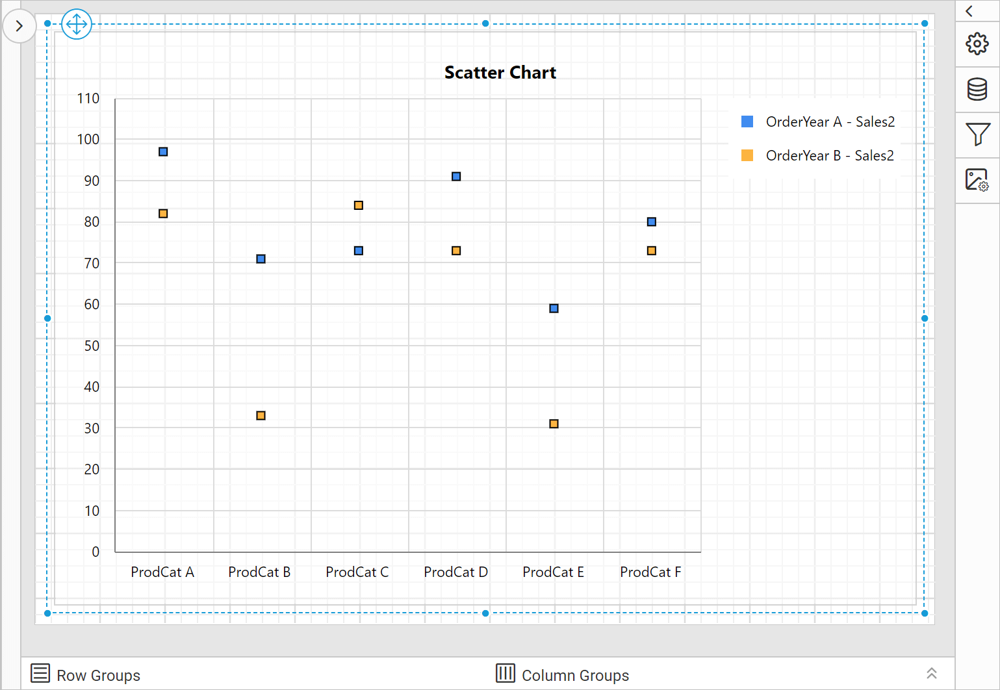
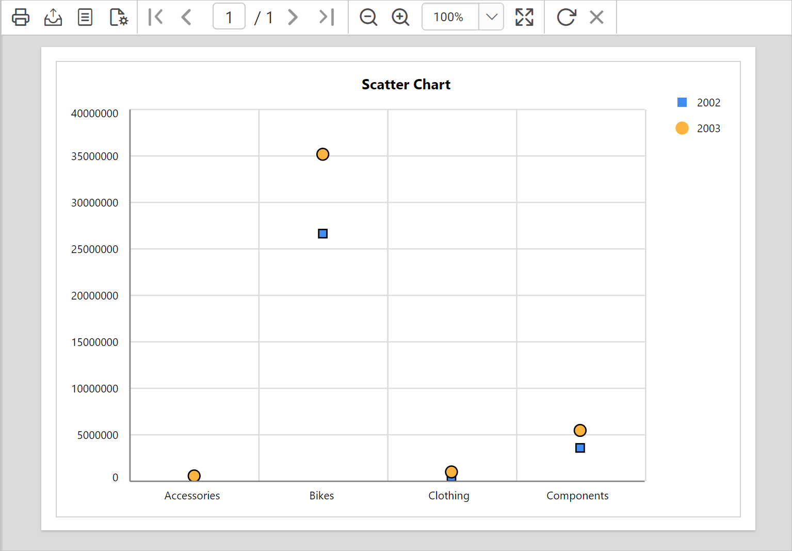

# Scatter chart in Bold Reports<sup>®</sup> Web Report Designer

You add a **Scatter Chart** to a report in the Bold Reports<sup>®</sup> Web Report Designer by dragging it from the item panel. Use it to compare a large number of data points shown as dots, irrespective of time.

## How do I add a scatter chart to the report?

The Bold Reports<sup>®</sup> Web Report Designer lists the scatter chart under the `Distribution` category in the item panel.

1. Drag the scatter chart from the item panel and drop it into the design area.

   

2. The Web Report Designer renders the scatter chart in the design area and lists the chart properties in the properties panel.

   

## How do I create data for the scatter chart?

To present data in a Bold Reports<sup>®</sup> scatter chart, create a dataset and bind it to the chart data region. This example uses the following dataset query to create the dataset.

```sql
SELECT PC.Name AS ProdCat, PS.Name AS SubCat, DATEPART(yy, SOH.OrderDate) AS OrderYear, 'Q' + DATENAME(qq, SOH.OrderDate) AS OrderQtr,SUM(SOD.UnitPrice * SOD.OrderQty) AS Sales
FROM Production.ProductSubcategory PS INNER JOIN
Sales.SalesOrderHeader SOH INNER JOIN
Sales.SalesOrderDetail SOD ON SOH.SalesOrderID = SOD.SalesOrderID INNER JOIN
Production.Product P ON SOD.ProductID = P.ProductID ON PS.ProductSubcategoryID = P.ProductSubcategoryID INNER JOIN
Production.ProductCategory PC ON PS.ProductCategoryID = PC.ProductCategoryID
WHERE (SOH.OrderDate BETWEEN '1/1/2002' AND '12/31/2003')
GROUP BY DATEPART(yy, SOH.OrderDate), PC.Name, PS.Name, 'Q' + DATENAME(qq, SOH.OrderDate), PS.ProductSubcategoryID
```

> Refer to the [Create Data](./../../../manage-data/dataset/create-an-embedded-dataset/) section and create a dataset using the above query. This example uses the `AdventuresWorks` database.

## How do I assign data to the scatter chart?

A Bold Reports<sup>®</sup> scatter chart needs a minimum of 1 value element and 1 column element to display data. Drop the measure or expression field you want to analyze into the `Y Values` section. Drop the dimension that categorizes the measure onto the `Columns` section. To categorize by a series, also drop the respective dimension onto the `Rows` section.

To configure data in the scatter chart, follow these steps:

1. Focus on the chart report item placed in the design area.
2. Click the `Properties` icon in the configuration panel to open the property pane, and switch to the `DATA` tab.
   
3. Choose a dataset from the drop-down list, which shows the data available in the report.
   
4. Review the fields. The `Measures` section lists numeric columns and numeric expressions. The `Dimensions` section lists other column types and dimension expressions.
   
5. **Drag and Drop Measure Element**:
   Drag the numeric column (measure element) or the numeric expression column from the `Measure` section and drop it in the `Y Values` section.
   
   The following image shows the report item design after you add the Y value field.
   
6. **Aggregate Options**:
   Click the `Settings` icon (highlighted in the following image) to open the aggregation type drop-down list.
   
   Set the aggregation type used to compute the selected column.
   
7. **Drag and Drop Dimension Element**:
   Drag the dimension element from the `Dimensions` section and drop it into the `Column` section. The dimension measures against the numeric column(s) selected in the `Y Value(s)` section.
   
   The following image shows the report item design after you add the dimension field.
   
8. **Grouping**:
   Group the added column element with another column by adding the respective dimension element into the Row(s) section.
   
   The following image shows the report item design after you add the row grouping.
   
9. **X-Value(s)**:
   Drag the numeric column (measure element) or the numeric expression column from the `Measure` section and drop it in the `X Values` section. The chart then plots the data between two values to compare a large number of data points.

## How do I format the scatter chart?

You format a scatter chart in the Bold Reports<sup>®</sup> Web Report Designer through the settings in the `Properties` tab. Use them to get the view you require.

To format a scatter chart, follow these steps:

1. Drag and drop the scatter chart into the design area and resize it to the required size.
2. Configure the data for the scatter chart.
3. Focus on the scatter chart and click the `Properties` icon in the configuration panel to open the property pane.
   

The property pane lists the properties available for the report item with their default values.

### Name

The **Name** property gives the scatter chart item a unique name in the report.


### Basic Settings

The **Basic Settings** category of the scatter chart contains the `Show Legend` and `Choose Series` properties.


#### Show Legend

A legend is text that describes the plotted data in a Bold Reports<sup>®</sup> chart. You can toggle the visibility of the legend in the chart and customize the legend text appearance. To set or reset legend properties, refer to the [Show Legend](./../../../report-items/chart/legend/) property.

#### Choose Series

The `Choose Series` drop-down lists the available series when you add multiple series to the chart. To customize the series appearance, choose the required series name in the drop-down.


Refer to the [Series](./../../../report-items/chart/series/) section to customize each series using the properties panel.

### Appearance

The **Appearance** properties style the scatter chart with border style, color, width, and background color in the report design. These properties are listed under the `Appearance` category in the properties panel.




### Chart Area

The **Chart Area** properties customize the area of the chart design with border style, border width, border color, shadow color, shadow offset, and background color.


The properties panel lists these properties under the `Chart Area` category.


Use the [Color Palette](./../../../report-items/chart/color-palette/) property to customize the color of the chart.

### Title

The chart title is customized by editing the `Title Text` property of the scatter chart.

To show or hide the chart title, toggle the `Show Chart Title` checkbox.


Use these properties to customize the font color, font text, font style, border, background, and position of the title in the chart design.

### No Data

The **No Data** property displays static text when the dataset returns empty or zero rows at run time.


To set or reset no data message properties, refer to the [No Data Message](./../../../report-items/chart/no-data-message/) property section.

### Category Axis

The category axis of a Bold Reports<sup>®</sup> chart displays text labels instead of numbers. To use the categorical axis, toggle the `Enable Axis` checkbox under the `Category Axis` category in the chart properties.


To set or reset axis properties, refer to the [Axis Properties](./../../../report-items/chart/axis/) property.

### Value Axis

The value axis of a Bold Reports<sup>®</sup> chart uses a numerical scale and displays numbers as labels. To use the value axis, toggle the `Enable Axis` checkbox under the `Value Axis` category in the chart properties.


To set or reset axis properties, refer to the [Axis Properties](./../../../report-items/chart/axis/) property.

### Grid line

The **Grid line** properties of the scatter chart can be set for the category axis and the value axis.


#### Category Axis

To show the grid line for the category axis, enable the `Category Axis` checkbox.


You can also enable the `Minor Grid Lines` and customize the major and minor gridline style and color in the `Advanced Options` menu.


#### Value Axis

To show the grid line for the value axis, enable the `Value Axis` checkbox.


You can also enable the `Minor Grid Lines` and customize the major and minor gridline style and color in the `Advanced Options` menu.


### Page break

The **page break** property controls the amount of information on each page when you preview the report. To apply the page break property to the chart report item, follow these steps:

1. Choose a `Break Location` type in the drop-down. The Break Location property specifies where the page break occurs.
   
2. To prevent predefined page breaks from being applied during report preview, enable the `Break Disabled` property checkbox. You can also control page breaks during report preview by using expressions. For details on setting and resetting page breaks dynamically, refer to the [Set Expression](./../../../compose-report/properties-panel/#set-expression) and [Reset Expression](./../../../compose-report/properties-panel/#reset-expression) sections.

   
3. To restart page numbering on each page, enable the `Page Number Reset` property checkbox.
   

### Data Element

The **Data Element** properties control the visibility of the chart report item when you export the report in XML format. The properties panel lists them under the `Data Element` category.


#### Name

The `Name` field assigns a custom name to the chart element. The chart report item is exported with the provided name.


> Note: The name cannot contain spaces, and it must begin with a letter followed by letters, numbers, or the underscore character (_).

#### Output

The `Output` property controls the visibility of the chart when you export the report. Choose one of the following options:

* **Auto** or **Output** - Exports the chart report item.
* **NoOutput** - Does not export the chart report item.


### Miscellaneous

The **Miscellaneous** category of the scatter chart contains the page name, document map, bookmark, custom attributes, tooltip, and custom style properties.

#### Page name

The **page name** property names the first worksheet of the Excel workbook when you export the report to Excel format.


You can set static or dynamic text as the page name. To set and reset dynamic text, refer to the [Set Expression](./../../../compose-report/properties-panel/#set-expression) and [Reset Expression](./../../../compose-report/properties-panel/#reset-expression) sections.

#### Document Map

A **document map** is a navigational feature that displays a separate side pane with navigational links in a hierarchical structure when you view a report. Users click an item in the list to navigate to the report page that displays that item. Refer to the [Document Map](./../../../compose-report/document-map/) section to configure a document map in the report design.

You can set static or dynamic text as the value of the document map property. To set and reset dynamic text, refer to the [Set Expression](./../../../compose-report/properties-panel/#set-expression) and [Reset Expression](./../../../compose-report/properties-panel/#reset-expression) sections.

#### Bookmark

Bookmark links let users navigate to different parts of an SSRS report. You can add bookmarks to each textbox, image, table, or chart, or to the unique group values displayed in a tablix, to direct users to specified locations in the report. The bookmark value can be your own string or an expression. Refer to the [Bookmark](./../../../compose-report/bookmark/) section to configure bookmarks in the report design.

You can set static or dynamic text as the value of the bookmark property. To set and reset dynamic text, refer to the [Set Expression](./../../../compose-report/properties-panel/#set-expression) and [Reset Expression](./../../../compose-report/properties-panel/#reset-expression) sections.

#### Custom attributes

The **custom attributes** property sets the values for chart custom properties. To assign values for custom properties using the properties panel, refer to the [Custom Properties](./../../../compose-report/common-properties/#custom-properties) section.

#### Tooltip

The **Tooltip** property displays informative text or a value when the user hovers over the report item in report preview. To set a tooltip for a chart item using the properties panel, refer to the [Tooltip](./../../../compose-report/common-properties/#tooltip) section.

#### Custom Style

The `Custom Style` property enables the use of external CSS for styling report items, providing enhanced flexibility beyond the built-in styling options. Use this property to meet specific design requirements and maintain consistent styling across multiple reports. For a step-by-step guide on setting up custom styles in your report, check the **How To** section of this guide.


## How do I preview the scatter chart report?

You preview the scatter chart report in the Bold Reports<sup>®</sup> Web Report Designer by clicking the preview icon in the design view.

1. The following image shows the final design with the preview icon.
   
2. The following image shows the report preview.
   

> Download the [scatter chart report design file from GitHub](https://github.com/boldreports/resources/tree/master/docs/report-designer/chart/scatter-chart.rdl).

## Frequently asked questions

### What is the minimum data a scatter chart needs?

A Bold Reports<sup>®</sup> scatter chart needs a minimum of 1 value element and 1 column element to display data.

### Where is the scatter chart in the item panel?

The scatter chart is listed under the `Distribution` category in the item panel of the Web Report Designer.

## See also

* [Chart series properties](./../../../report-items/chart/series/)
* [Chart axis properties](./../../../report-items/chart/axis/)
* [Chart legend properties](./../../../report-items/chart/legend/)
