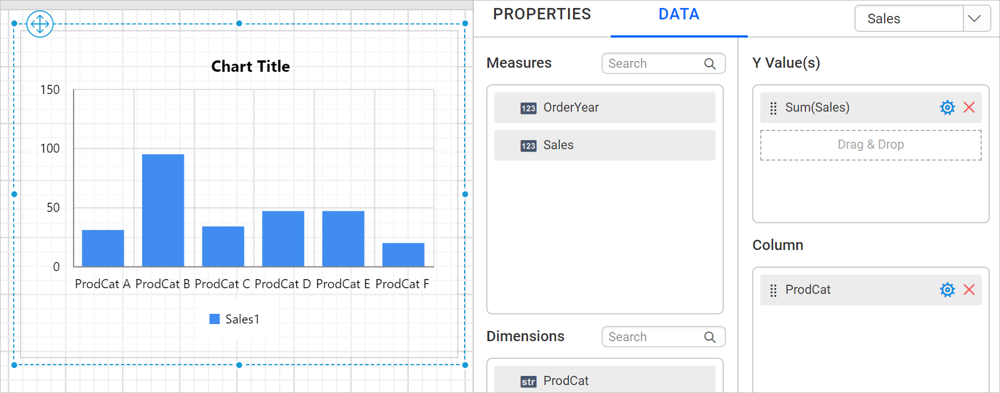
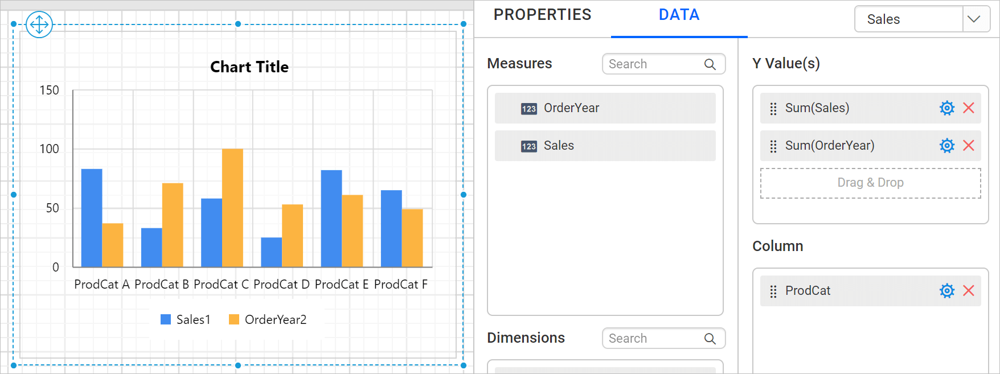
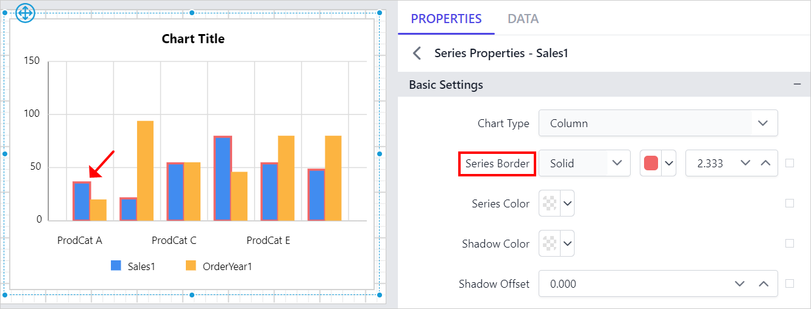
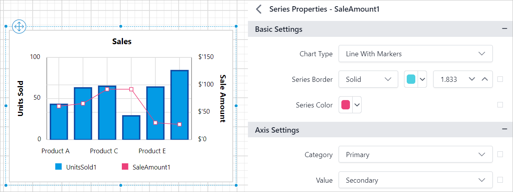
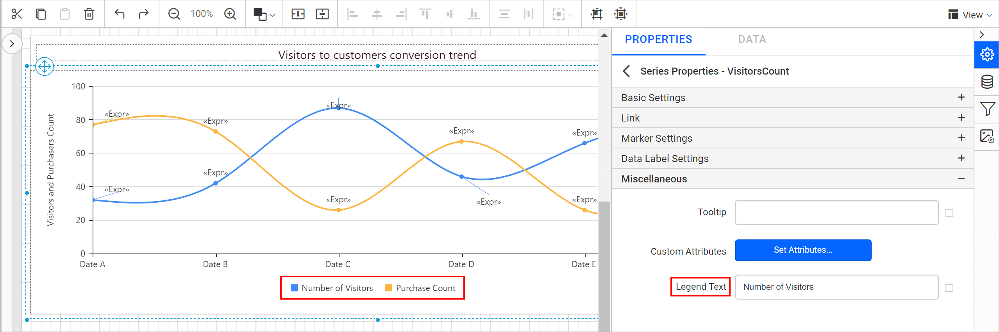

# Customize chart series in Bold Reports® Web Report Designer

In the Bold Reports® Web Report Designer, you customize the chart series appearance by using the properties panel. You can add multiple series to the chart, and the available series are listed in the `Choose Series` drop-down.

## How does the Choose Series drop-down list series?

The `Choose Series` drop-down in the Bold Reports® Web Report Designer lists one entry for each series in the chart. In the following image, the chart has a single series.

So, the drop-down lists only one series.

The following image shows a chart with multiple series.

In this case, the properties panel lists both series.

## How do I open the properties of a series?

You open the series properties in the Web Report Designer from the `Choose Series` drop-down.

1. Choose the required series name in the drop-down.
2. Click the edit icon.

   

The secondary panel then displays the properties of the selected series.

## Basic Settings

The **Basic Settings** of a chart series in Bold Reports® contain the chart type, series border, series color, and series shadow properties.

### Chart Type

The `Chart Type` property drop-down lists the supported chart types. You can switch a series to the required chart type based on your data presentation.

For example, the following chart has two series. Both series are of the column chart type.

Choose the first series and change its chart type to `Line`.

The respective series changes to the line type on the chart surface.

Refer to the [Chart switcher](./../../../report-items/chart/switch-chart-type/) section to customize each series using the properties panel.

### Series Border

The **Series Border** properties customize the chart series border in the design.

In the following design, border color, width, and style properties are applied to the chart series.

You can also set these properties based on dynamic values by using `Expressions`. Refer to the [Set Expression](./../../../compose-report/properties-panel/#set-expression) and [Reset Expression](./../../../compose-report/properties-panel/#reset-expression) sections to open the set or reset expression menu in the properties panel.

### Series Color

The **Series Color** property customizes the series colors in the chart area. If the chart has multiple series, use this property to differentiate them.

The selected color is applied to the respective series in the chart design.

You can also apply the series color based on dynamic values by using `Expressions`. Refer to the [Set Expressions](./../../../compose-report/properties-panel/#set-expression) and [Reset Expressions](./../../../compose-report/properties-panel/#reset-expression) sections to open the set or reset expression menu in the properties panel.

### Series Shadow

The `Shadow Color` property lets you set the color of shadows for chart elements, enhancing their appearance. The `Shadow Offset` property adjusts the distance between the chart series and their shadows, allowing for subtle or bold shadow effects.

The selected shadow color and offset are applied to the corresponding series in the chart design during preview.

You can also apply shadow properties based on dynamic values by using `Expressions`. Refer to the [Set Expressions](./../../../compose-report/properties-panel/#set-expression) and [Reset Expressions](./../../../compose-report/properties-panel/#reset-expression) sections to open the set or reset expression menu in the properties panel.

## How do I show a series on a secondary axis?

You show a series on a secondary axis in Bold Reports® by choosing `Secondary` in the series Category or Value property drop-down. Charts typically have two axes to organize and display data more meaningfully. Primary and secondary axes let you present series data with different ranges or unit types on different axes.

The Category and Value property drop-downs list the `Primary` and `Secondary` axis options.

For example, you may want to show the number of units sold (in unit type numbers) in every month of the year along with the total sale amount (in unit type Dollars). You do not have to compare these in two different charts. Instead, display the total number of units sold on the primary y-axis and the total sale amount on the secondary y-axis. You can then compare multiple series with different ranges on the same chart.

> Note: Axis settings are not applicable for `Proportion` and `KPI` chart types.

## Link

The **Link** properties of a chart series make the Bold Reports® report interactive.

### Link To

The **Link To** property configures a **Hyperlink**, **Bookmark**, or **Report path** on the chart series to create an interactive report. Refer to the [Linking](./../../../compose-report/link-data/) section to set or reset the link property for a chart series.

## Marker Settings

The **Marker Settings** of a chart series control data markers on each data point.

### Show Marker

Data markers provide information about each data point to the user. You can add a shape and label to adorn each data point. To set or reset marker properties, refer to the [Marker](./../../../report-items/chart/marker/) property section.

## Data Label Settings

The **Data Label Settings** of a chart series control the labels shown on data points.

### Show Data Label

The `Show Data Label` property adds a data label to a chart series. By default, the labels appear at the top of the data point. To set or reset data label properties, refer to the [Data Label](./../../../report-items/chart/data-label/) property section.

## Miscellaneous

The **Miscellaneous** settings of a chart series contain the tooltip, custom attributes, and legend text properties.

### Tooltip

The **Tooltip** property displays informative text or a value when the user hovers over the respective series in report preview. To set a tooltip for a chart series using the properties panel, refer to the [Tooltip](./../../../compose-report/common-properties/#tooltip) section.

### Custom Attributes

The **Custom Attributes** property sets the values for chart series custom properties. To assign values for series custom properties using the properties panel, refer to the [Custom Properties](./../../../compose-report/common-properties/#custom-properties) section.

### Legend Text

The **Legend Text** property customizes the legend text of each series in the chart.

You can customize the text for all legends in your report from the series properties.

You can also set the legend text property based on dynamic values by using `Expressions`. Refer to the [Set Expression](./../../../compose-report/properties-panel/#set-expression) and [Reset Expression](./../../../compose-report/properties-panel/#reset-expression) sections to open the set or reset expression menu in the properties panel.

## Frequently asked questions

### Can different series in one chart use different chart types?

Yes. Choose a series and change its `Chart Type` property, for example from column to `Line`, and only that series changes on the chart surface.

### Do axis settings apply to every chart type?

No. Axis settings are not applicable for `Proportion` and `KPI` chart types.

## See also

* [Switch the chart type](./../../../report-items/chart/switch-chart-type/)
* [Chart marker properties](./../../../report-items/chart/marker/)
* [Chart data label properties](./../../../report-items/chart/data-label/)
